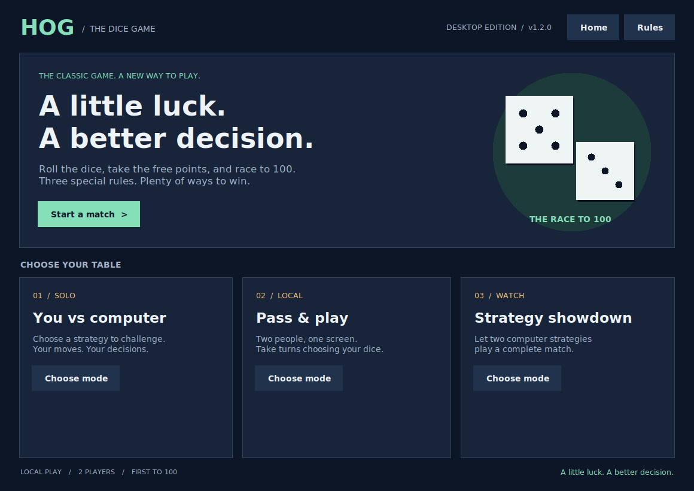
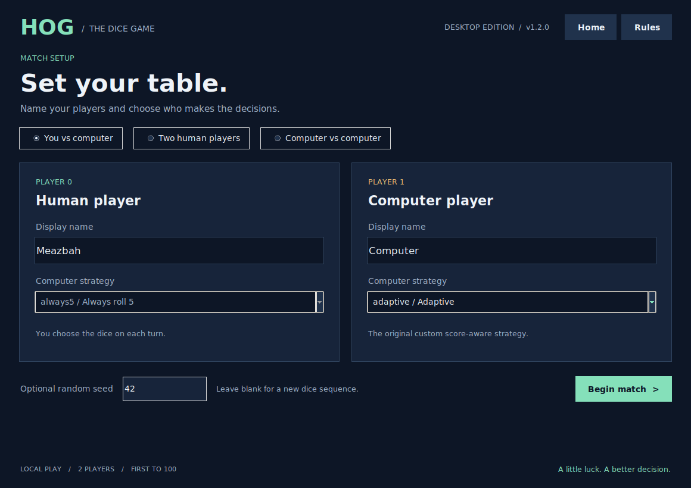
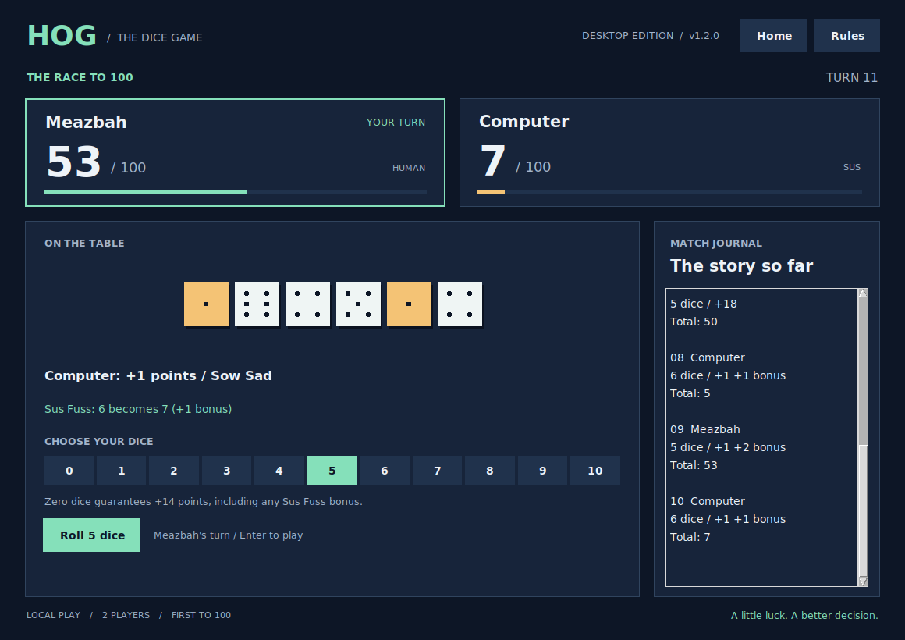
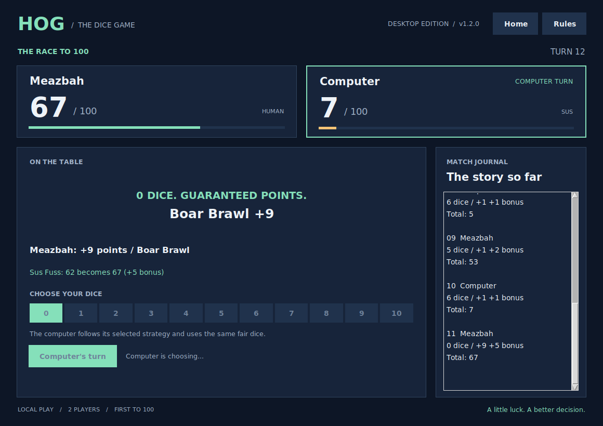
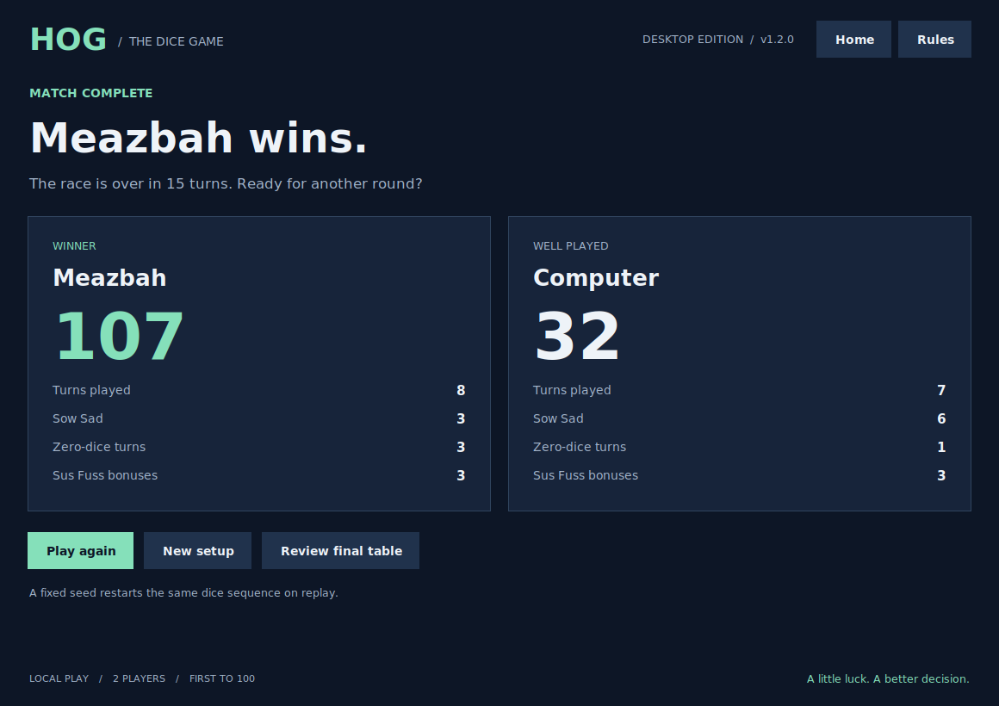
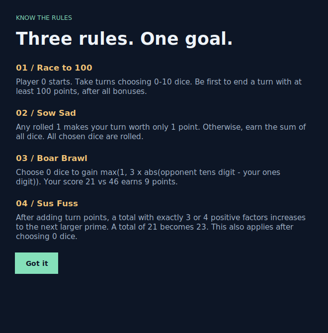

# The Game of Hog

**v1.2.0 · Graphical Desktop Edition · Python 3.10+ · Tkinter**

A little luck. A better decision.

The second upgrade to my Python Programming project turns Hog into a complete local desktop game. Choose your players, pick a strategy, click the dice controls, and race to 100. The terminal game and strategy lab from v1.1.0 are still included.



## Quick Start

1. Download and extract `hog-v1.2.0.zip`.
2. Open a terminal inside the extracted `hog-v1.2.0` folder.
3. Launch the desktop game:

```bash
python hog_desktop.py
```

Use `python3` instead of `python` if needed. On Windows, you can also use:

```bash
py -3 hog_desktop.py
```

In PyCharm, open the project folder, choose a Python 3.10+ interpreter, and run `hog_desktop.py`.

**Runtime requirements:** Python 3.10 or newer, Tkinter, and a graphical desktop. No third-party Python packages are needed to play. Tkinter is part of Python's standard library, but some Python distributions install its Tk support separately.

Check Tk support with:

```bash
python -m tkinter
```

This should open a small test window. On Ubuntu/Debian, missing Tk support can usually be installed with `sudo apt install python3-tk`. Use an interpreter that includes Tk on Windows or macOS. A remote shell without a display cannot open the desktop window; the terminal game remains available with `python hog_ui.py`.

## What's New in v1.2.0

- **Desktop home screen** with three playable modes.
- **Match setup** for names, human/computer control, six computer strategies, and an optional random seed.
- **Clickable 0-10 dice controls** and an action button; press Enter to confirm a human move.
- **Graphical dice** drawn from the actual outcomes, with rolled ones highlighted.
- **Live score panels**, progress bars, and human/computer turn indicators.
- **Scoring explanations** for Sow Sad, Boar Brawl, and Sus Fuss.
- **Zero-dice preview** showing the guaranteed gain before a human chooses.
- **Scrollable match journal** recording every completed turn.
- **Winner screen** with final scores and per-player match statistics.
- **Play again**, **New setup**, and **Review final table** actions after a match.
- **Rules window** available from the home screen or during play.
- **Shared incremental game engine**, keeping graphical and terminal scoring consistent.
- **55 automated checks**, including real Tk window interactions.

## Set Up a Match



| Mode | Who controls the players? |
| --- | --- |
| **You vs computer** | Player 0 is human; Player 1 uses the selected strategy. |
| **Pass & play** | Two humans share the same screen and take alternating turns. |
| **Strategy showdown** | Both players use selected computer strategies. |

Names can contain 1-20 printable characters. Computer strategy selectors are disabled for human-controlled players. A blank seed gives a fresh random dice sequence; a whole-number seed makes a match reproducible when the same choices are made on the same Python version.

Click **Begin match** to start. Player 0 always goes first.

## Play a Turn



1. Check whose score panel has the active border.
2. Read the guaranteed points available from choosing zero dice.
3. Click a number from **0 to 10**.
4. Click **Roll N dice** or **Take free points**. Enter also confirms a human move.
5. See the actual outcomes, scoring rule, updated total, and journal entry.

Human controls are disabled during computer turns. Computer turns are scheduled through Tk's event loop, so the interface can continue handling window events. A computer-only match advances automatically.

The table shows the **last completed turn's dice**, while the score panel indicates **who plays next**. Gold dice mark a rolled 1, which triggers Sow Sad.



Click **Rules** to review the scoring rules. Clicking **Home** during an unfinished match asks whether to leave it. Match progress is kept only while the app is open; this edition does not save games to disk.

## Finish, Replay, or Review



The game ends as soon as a player finishes a turn with at least 100 points, including any Sus Fuss bonus. The winner screen reports final scores, turns played, Sow Sad occurrences, zero-dice turns, and Sus Fuss bonuses.

- **Play again:** restart with the same names, mode, and strategies.
- **New setup:** choose a new match configuration.
- **Review final table:** inspect the last dice and scroll through the completed journal. The action button returns to the match summary.

A desktop replay with a fixed seed restarts that seed's dice sequence. Without a seed, it uses a fresh sequence. The retained terminal replay behavior is unchanged: it continues its session's existing dice stream.

## Game Rules

Players alternate turns, choosing 0-10 dice. The goal is **100 points**.

| Rule | What happens | Example |
| --- | --- | --- |
| **Sow Sad** | If any rolled die is 1, earn only 1 point for the turn. Otherwise, earn their sum. | `[4, 1, 6]` earns 1 point. |
| **Boar Brawl** | Choosing zero dice earns `max(1, 3 * abs(opponent_tens - player_ones))`. | Your score 21, opponent 46: gain 9. |
| **Sus Fuss** | After adding turn points, a total with exactly 3 or 4 positive factors increases to the next larger prime. | A total of 21 becomes 23. |

Sus Fuss applies to both rolled and zero-dice turns. All chosen dice are rolled even if a 1 appears early. These rules are unchanged from the original project.



## Computer Strategies

| Strategy key | Behavior |
| --- | --- |
| `always5` | Always roll five dice. |
| `always6` | Always roll six dice. |
| `catch-up` | Roll six when behind, otherwise five. |
| `boar` | Take zero dice for at least 11 Boar Brawl points; otherwise roll six. |
| `sus` | Take zero dice for at least 11 combined Boar Brawl and Sus Fuss points; otherwise roll six. |
| `adaptive` | Use my original score-aware strategy. |

The adaptive strategy's original decision order is preserved: take a zero-dice win; take at least 10 guaranteed points; roll three if my score is at least 80; otherwise roll eight if the opponent is at least 80; roll six when both are below 30; otherwise roll five. It is a heuristic, not a trained AI model.

## Terminal Game and Strategy Lab

The previous terminal interface remains available:

```bash
python hog_ui.py
python hog_ui.py -n 1 --name0 Meazbah --strategy1 adaptive
python hog_ui.py -n 2 --name0 Alice --name1 Bob
python hog_ui.py -n 0 --strategy0 adaptive --strategy1 sus --seed 42 --no-replay
```

Run sampled experiments from the terminal:

```bash
python hog.py -r --games 100 --samples 500 --seed 42
```

`--games` counts games **per starting position, per strategy**. This command runs 200 games for each of six strategies, or 1,200 games total. `--samples` controls sampled turns for each roll count. The default opponent is `always6`; use `--baseline` to change it.

The lab reports each starting position separately, an overall win rate, and an approximate pooled 95% Wilson interval. Results are sampled estimates rather than guarantees. The lab is a terminal feature in this release; it is not integrated into a graphical chart screen yet.

## Previous Versions and Release Progress

| Version | Main additions | Status |
| --- | --- | --- |
| **v1.0.0** | Original coursework simulator, scoring rules, starter text UI, strategy helpers, and adaptive strategy. | Original baseline. |
| **v1.1.0** | Terminal menus, names, strategy selection, rule explanations, summaries, replay, working experiments, seeds, and 39 tests. | Previous release. |
| **v1.2.0** | Graphical desktop interface, incremental session engine, match journal, winner screen, real desktop screenshots, and 55 tests. | This release. |
| v2.0.0 | Dice animation, sound, themes, and richer controls. | Planned after approval. |
| v2.1.0 | Stronger opponents, move advice, and visual comparisons. | Planned. |
| v2.2.0 | Profiles, saved progress, history, and tournaments. | Planned. |
| v3.0.0 | Tutorial, replay viewer, practice settings, and showcase polish. | Planned. |

### v1.1.0 - Improved Terminal Edition

The first upgrade introduced the main menu, named players, selectable strategies, replay, score explanations, and a working experiment command. It used terminal output for all play and had no graphical window.


The full [v1.1.0 README](docs/history/v1.1.0.md) and its [validation notes](docs/history/v1.1.0-validation.md) are preserved. Those archived files describe that historical version, including the roadmap as it stood then.

### v1.0.0 - Original Project

The original solution implemented the game rules, complete-game simulator, higher-order strategy tools, and my adaptive strategy. It used fixed player labels, started an automatic game without flags, and supported one or two human players through the starter UI. The experiment flag existed but did not run experiments.


See [CHANGELOG.md](CHANGELOG.md) for cumulative changes.

## Screenshots and Reproducibility

The **v1.2.0 PNGs are actual captures of the running Tk application** on Linux with Tk 8.6. The capture script plays a real seeded match; it does not inject scores or fabricate dice. In the captured match, the human-side choices follow the adaptive strategy, the opponent uses `sus`, and the seed is 42. The resulting final score is 107-32 over 15 turns.

The historical v1.0.0 and v1.1.0 images remain styled renderings of captured terminal output. Their complete raw transcripts are retained beside the PNGs.

Optional documentation tools:

```bash
python tools/capture_desktop.py
python tools/capture_terminal.py
```

These tools require Pillow; desktop capture also needs a graphical display. Neither tool nor Pillow is required to play or run the automated tests. The terminal capture tool writes version-specific filenames without overwriting the historical captures.

## Project Files

| File or folder | Purpose |
| --- | --- |
| `hog_desktop.py` | Desktop views, graphical dice, controls, computer timers, rules, and summary. |
| `hog_match.py` | Validated match configuration, independent of the display. |
| `hog.py` | Scoring, strategies, `TurnEvent`, incremental `GameSession`, and full-game `play`. |
| `hog_ui.py` | Retained terminal game and menus. |
| `hog_experiments.py` | Seeded terminal experiments and win-rate comparisons. |
| `dice.py`, `ucb.py` | Original supplied support code. |
| `tests/` | Core, session, terminal, configuration, and real-window GUI checks. |
| `docs/screenshots/` | Current desktop screenshots and historical terminal captures. |
| `docs/history/` | Preserved previous-release README and validation notes. |
| `docs/VALIDATION.md` | Current verification details and platform limits. |
| `tools/` | Optional screenshot utilities. |
| `RELEASE_NOTES.md` | Copy-ready GitHub release tag, title, and description. |

## Engine Example

The desktop uses the same incremental engine as the simulator:

```python
from hog import GameSession, seeded_dice

session = GameSession(dice=seeded_dice(42))
event = session.advance(3)
print(event.outcomes, session.scores, session.current_player)
```

A completed `GameSession` rejects further moves. The original `play` function, positional parameters, and strategy names remain available. Its optional observer receives each completed `TurnEvent` without consuming extra dice.

The desktop uses a 100-point goal. The engine accepts other goals, but the original adaptive strategy still uses its 100-point thresholds.

## Run the Checks

From a graphical desktop:

```bash
python -m unittest discover -s tests -v
python -m doctest hog.py dice.py
```

All **55 tests** pass with a display available. Without a display, the real-window test class is skipped and the remaining 46 tests still run. On Linux CI, a virtual display can include the GUI checks:

```bash
xvfb-run -a python -m unittest discover -s tests -v
```

Verified on Linux with Python 3.12.14 / Tk 9.0 and Python 3.12.3 / Tk 8.6. The GUI checks cover setup validation, mode switching, human controls, automatic turns through Tk's event loop, leaving a match, replay, final-table review, rules windows, and controls fitting a 1040x720 window. Native Windows and macOS execution was not tested in this build.

## Current Scope

This release is a local desktop game with the terminal tools retained. It has a fixed dark palette and immediate dice results. Animations, sound, selectable themes, persistent profiles, saved games, online play, and packaged executables are not included in this version.

## Credits

Original project and adaptive strategy: **Md Meazbah Mehedi Prodhan**.

Based on the supplied **Python Programming - Project 1: The Game of Hog** assignment and starter files. `dice.py` and `ucb.py` retain the supplied code; `ucb.py` identifies its utilities as originating from UC Berkeley projects. This expanded GitHub edition adds a desktop interface, refactors the reusable engine, and includes experiments, tests, and documentation.

The original coursework submission limited edits to `hog.py`; this GitHub edition goes beyond that assignment's file scope.
