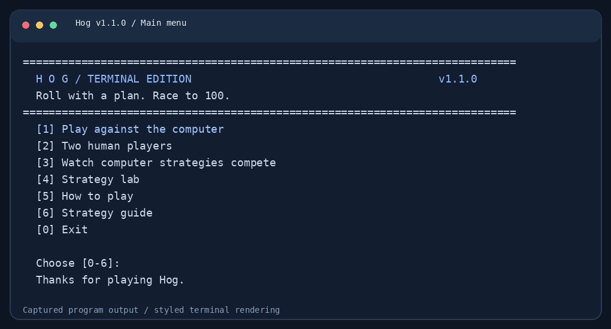
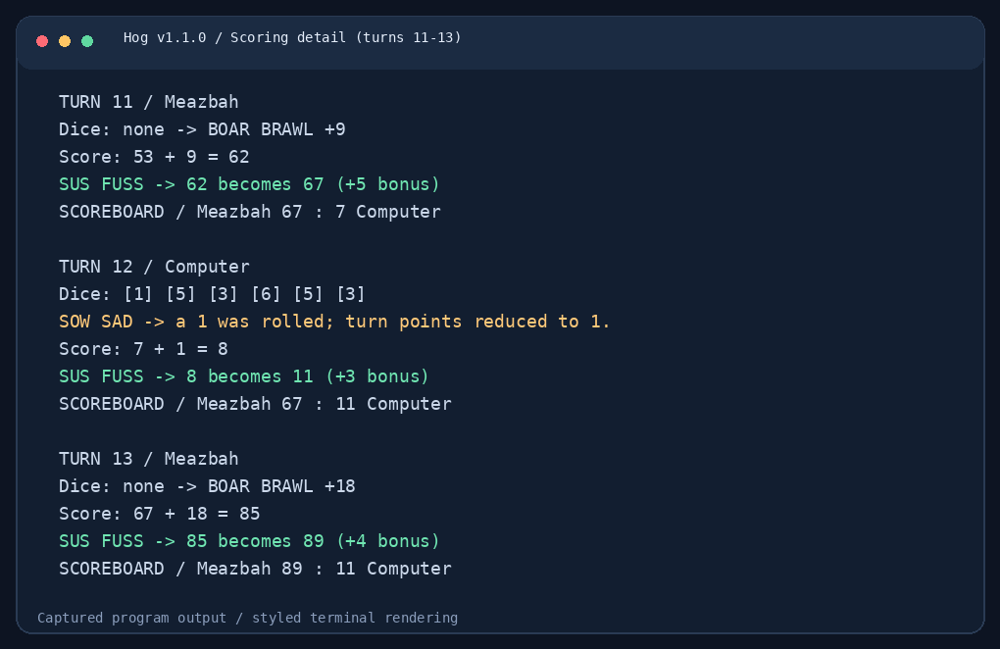
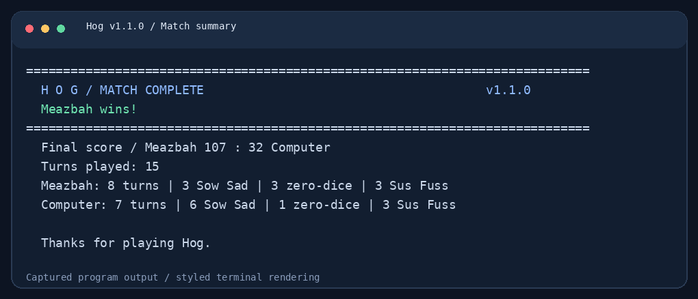
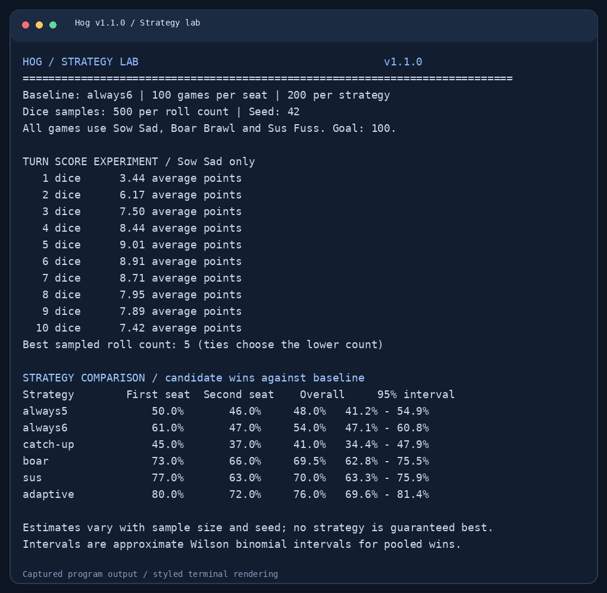
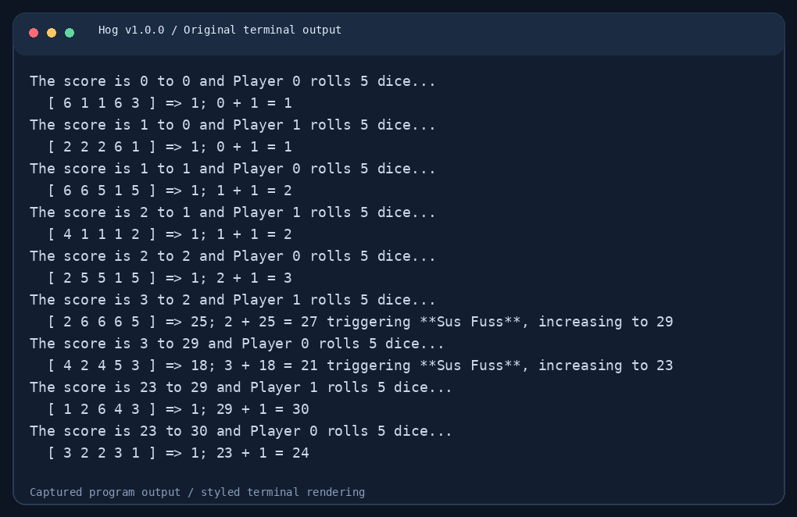

# The Game of Hog

**v1.1.0 · Improved Terminal Edition · Python 3.10+ · No runtime dependencies**

A two-player dice game where choosing **not to roll** can be your best move.

This is the first upgrade to my Python Programming Project 1. It builds on the original Hog simulator and adaptive strategy with a complete terminal menu, selectable computer opponents, named players, replay, clearer scoring, and a working strategy lab.



## Start Playing

1. Download and extract this release ZIP.
2. Open a terminal inside the extracted `hog-v1.1.0` folder.
3. Run:

```bash
python hog_ui.py
```

Use `python3` instead of `python` if needed. On Windows, `py -3 hog_ui.py` is another option. In PyCharm, open the extracted folder and run `hog_ui.py` using a Python 3 interpreter.

The game and tests use only the Python standard library. No `pip install` step is needed to play.

## What's New in v1.1.0

- **Main menu:** start a game, watch computers compete, read the rules, or open the strategy lab.
- **Named players:** enter names of up to 20 printable characters.
- **Selectable opponents:** choose any of six strategies through the menu or command line.
- **Readable turns:** see dice outcomes, the reason for a scoring rule, and both players' totals.
- **Zero-dice preview:** human players see their guaranteed gain, including Sus Fuss, before choosing.
- **Match summary:** see the winner, final scores, turns, Sow Sad occurrences, zero-dice turns, and prime bonuses.
- **Replay:** play another match with the same setup without restarting the program.
- **Working experiments:** `python hog.py -r` now measures roll counts and strategy win rates.
- **Reproducible sessions:** optional seeds use a separate random generator.
- **Safer input:** invalid choices retry; `q`, end-of-input, and Ctrl+C are handled cleanly.
- **Engine improvements:** one strategy call per turn, optional turn events, faster factor/prime checks, and no duplicate `winner` definition.
- **Verification:** 39 automated tests plus executable documentation examples.

## Game Modes and Controls

| Menu option | Action |
| --- | --- |
| `1` | Human vs computer; choose the computer's strategy. |
| `2` | Two humans sharing one terminal. |
| `3` | Computer vs computer; choose both strategies. |
| `4` | Strategy lab; choose games per starting position. |
| `5` | Read the rules. |
| `6` | Read the strategy guide. |
| `0` | Exit. |

During a human turn, enter a whole number from **0 to 10**. Enter `q`, `quit`, or `back` to leave a screen or unfinished match. In menu mode this returns to the main menu; in direct `-n` mode it closes the session. At the main menu, use `0` to exit. Ctrl+C or end-of-input exits without a traceback.

After a completed match, choose `1` to replay or `0` to finish. In menu mode, finishing returns to the main menu.

## Game Rules

Player 0 starts. Players alternate turns, choosing 0-10 dice. The first player to finish a turn with **at least 100 points** wins. The game stops immediately, after applying all scoring rules.

| Rule | Effect | Example |
| --- | --- | --- |
| **Sow Sad** | Any rolled `1` makes the turn worth only 1 point. Otherwise, sum all dice. | `[4, 1, 6]` earns 1 point. |
| **Boar Brawl** | Choosing zero dice earns `max(1, 3 * abs(opponent_tens - player_ones))`. | Your score 21, opponent 46: gain 9. |
| **Sus Fuss** | After adding turn points, a total with exactly 3 or 4 positive factors increases to the next larger prime. | A total of 21 becomes 23. |

Sus Fuss applies after both rolled and zero-dice turns. All chosen dice are rolled, even if a `1` appears early.



## Command-Line Examples

Skip the menu and play against the original five-dice opponent:

```bash
python hog_ui.py -n 1
```

Play against the adaptive strategy with custom names:

```bash
python hog_ui.py -n 1 --name0 Meazbah --name1 Computer --strategy1 adaptive
```

Play with two human players:

```bash
python hog_ui.py -n 2 --name0 Alice --name1 Bob
```

Watch one repeatable computer match, then exit without a replay prompt:

```bash
python hog_ui.py -n 0 --strategy0 adaptive --strategy1 sus --name0 Meazbah --name1 Computer --seed 42 --no-replay
```

`-n 0` defaults to two five-dice strategies, preserving the original automatic game mode. Without `-n`, the new main menu opens. `--strategy0` affects computer-only mode; `--strategy1` affects modes 0 and 1. Human players always make their own choices.

The same seed and the same sequence of choices reproduce a session on the same Python version. Replays advance the existing dice stream rather than restarting it. A fresh process with the same seed restarts the sequence.

```bash
python hog_ui.py --help
python hog.py --help
python hog_ui.py --version
```



## Computer Strategies

| CLI name | Function | Decision |
| --- | --- | --- |
| `always5` | `always_roll_5` | Always roll five dice. |
| `always6` | `always_roll(6)` | Always roll six dice. |
| `catch-up` | `catch_up` | Roll six when behind, otherwise five. |
| `boar` | `boar_strategy` | Roll zero for at least 11 Boar Brawl points; otherwise six. |
| `sus` | `sus_strategy` | Roll zero for at least 11 combined Boar Brawl and Sus Fuss points; otherwise six. |
| `adaptive` | `adaptive_strategy` | Use the original custom strategy described below. |

### My Adaptive Strategy

The original decision order is preserved:

1. Choose zero dice if the resulting score reaches 100.
2. Choose zero dice if the guaranteed gain is at least 10 points.
3. If my score is at least 80, roll three dice.
4. Otherwise, if the opponent has at least 80, roll eight dice.
5. If both scores are below 30, roll six dice.
6. Otherwise, roll five dice.

This is a score-based heuristic, not a trained AI model. Its performance depends on the opponent and the sample used for evaluation.

## Strategy Lab

Run the experiment command that was unfinished in the original release:

```bash
python hog.py -r --games 100 --samples 500 --seed 42
```

Equivalent entry point:

```bash
python hog_experiments.py --run-experiments --games 100 --samples 500 --seed 42
```

- `--games` is the number of games **per starting position, per strategy**. A value of 100 evaluates each candidate over 200 games, and all six candidates over 1,200 games.
- `--samples` controls the number of sampled turns for each roll count from 1 to 10.
- `--baseline` selects the opponent; the default is `always6`.
- The turn-score experiment applies Sow Sad. Complete-game comparisons apply all three rules.
- First-seat and second-seat win rates are reported separately, with an overall rate and an approximate 95% Wilson interval for pooled wins.



In the included run on Python 3.12.14, seed 42, the adaptive strategy won **76.0% of 200 games** against `always6`. That is one sampled result; it does not guarantee future wins. Even a strategy playing itself can produce a sampled rate different from 50%.

## Version History

This release keeps the original project as the **v1.0.0 baseline** and adds the first of six planned upgrades.

| Version | What it introduced | Status |
| --- | --- | --- |
| **v1.0.0** | Original simulator, all three rules, text interface, higher-order strategy tools, and custom adaptive strategy. | Previous baseline. |
| **v1.1.0** | Terminal menus, player names, strategy selection, turn explanations, summaries, replay, seeded experiments, tests, and illustrated documentation. | This release. |
| v1.2.0 | Graphical desktop interface. | Planned; not included. |
| v2.0.0 | Animations, sound, themes, and richer controls. | Planned. |
| v2.1.0 | Stronger opponents, optional move advice, and visual comparisons. | Planned. |
| v2.2.0 | Profiles, saved progress, match history, and tournaments. | Planned. |
| v3.0.0 | Tutorial, replay viewer, practice settings, and final showcase polish. | Planned. |

### Previous Version: v1.0.0

The original version used fixed player labels and began an automatic game when launched without flags. Interactive modes were available with `-n 1` and `-n 2`. Strategy helpers existed, but the experiment flag only parsed arguments and did not run experiments. It did not provide menus, replay, player naming, or a match statistics summary.



### About the Screenshots

These images are **styled renderings of real captured terminal output**. The frame and colors are documentation styling; this release runs in your terminal and does not open a graphical game window. Complete, unedited output transcripts are included next to the PNGs in `docs/screenshots/`. The game capture shows an excerpt of turns 11-13; the legacy capture shows its first 18 output lines.

The optional `tools/capture_terminal.py` script regenerates current-version captures. It requires Pillow and a supported monospace font; neither is needed to play or test the game.

## Project Files

| File or folder | Purpose |
| --- | --- |
| `hog.py` | Rules, original strategy functions, engine, and optional turn events. |
| `hog_ui.py` | Terminal menu, setup, human input, scoring output, and replay. |
| `hog_experiments.py` | Seeded roll and strategy experiments. |
| `dice.py` | Original starter fair and deterministic dice functions. |
| `ucb.py` | Original starter utility functions. |
| `tests/` | Rule, engine, strategy, input, and command-line regression tests. |
| `docs/screenshots/` | Current and previous-version PNGs with their source transcripts. |
| `docs/VALIDATION.md` | What was checked for this release. |
| `tools/capture_terminal.py` | Optional documentation capture tool. |
| `CHANGELOG.md` | Cumulative release history. |
| `RELEASE_NOTES.md` | GitHub tag, title, and release description. |

## Use the Engine from Python

The original simulator functions remain available:

```python
from hog import adaptive_strategy, always_roll, play, seeded_dice, sus_update

score0, score1 = play(
    adaptive_strategy,
    always_roll(6),
    sus_update,
    dice=seeded_dice(42),
)
print(score0, score1)
```

For a custom interface, pass `observer=callback` to `play`. The callback receives an immutable `TurnEvent` after each turn, including actual dice outcomes, ordinary turn points, final score, and the bonus. The engine does not print or reroll dice for display.

Input validation now raises `ValueError` for invalid roll counts, invalid starting scores, and non-positive sampling counts, instead of relying on assertions. The game UI keeps the default 100-point goal. Although the engine accepts other goals, `adaptive_strategy` retains its original 100-point thresholds.

## Run the Checks

From the project folder:

```bash
python -m unittest discover -s tests -v
python -m doctest hog.py dice.py
```

The suite checks the scoring definitions, factor and prime calculations, strategy decision bounds, turn order, immediate game termination, observer behavior, repeatable randomness, menu setup, replay, both human modes, invalid input, clean exit, and real experiment output.

This release was verified with **Python 3.12.14 on Linux**. Other supported Python environments can run the same commands; native Windows and macOS execution was not tested in this build.

## Current Scope

This edition is a local terminal game. Statistics shown at the end of a match last only for that session. Graphical controls, saved profiles, persistent history, sound, and stronger opponents belong to later releases.

## Project Origin and Credits

Original project and adaptive strategy: **Md Meazbah Mehedi Prodhan**.

Based on the supplied **Python Programming - Project 1: The Game of Hog** assignment and starter files. `dice.py` and `ucb.py` retain the supplied code; `ucb.py` identifies its utilities as originating from UC Berkeley projects. This expanded GitHub edition refactors `hog.py`, updates `hog_ui.py`, and adds experiments, tests, and documentation.

The original assignment limited submission edits to `hog.py`; this expanded edition goes beyond that coursework file scope.
