# The Game of Hog

**v2.1.0 · Smart Opponent Edition · Python 3.10+ / Tkinter**

This release adds three difficulty choices, an optional move advisor, and a graphical comparison lab. Existing animations, themes, sound, pause/restart, terminal modes, and original strategies remain available.

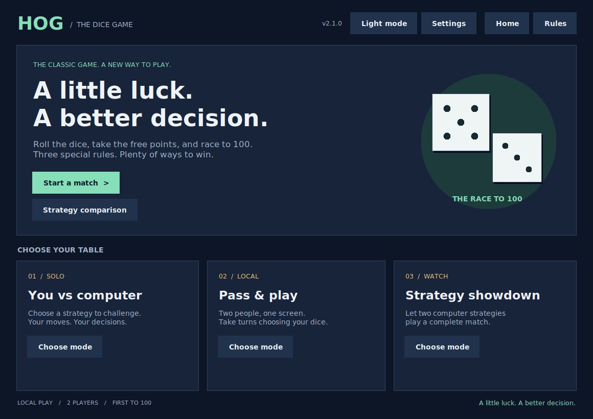

## What's New in v2.1.0

- **Easy:** a fixed five-dice opponent for practice.
- **Medium:** maximizes exact expected score gain, including Sus Fuss; takes a guaranteed zero-dice win.
- **Hard:** chooses the move with the best model probability of winning the complete match against an optimal opponent.
- **Move advisor:** click **Move advice / H** during a human turn. See every legal move, expected gain, Sow Sad risk, and model win chance. Advice never plays your move.
- **Strategy comparison:** open from Home, choose a baseline and games per starting seat, then run real matches in a background worker. Bars show measured win rates; gold lines show approximate 95% Wilson intervals.
- Policy preparation and comparisons run outside Tk callbacks. The worker never touches widgets.
- Original six strategies remain; all nine are selectable in desktop and terminal modes.

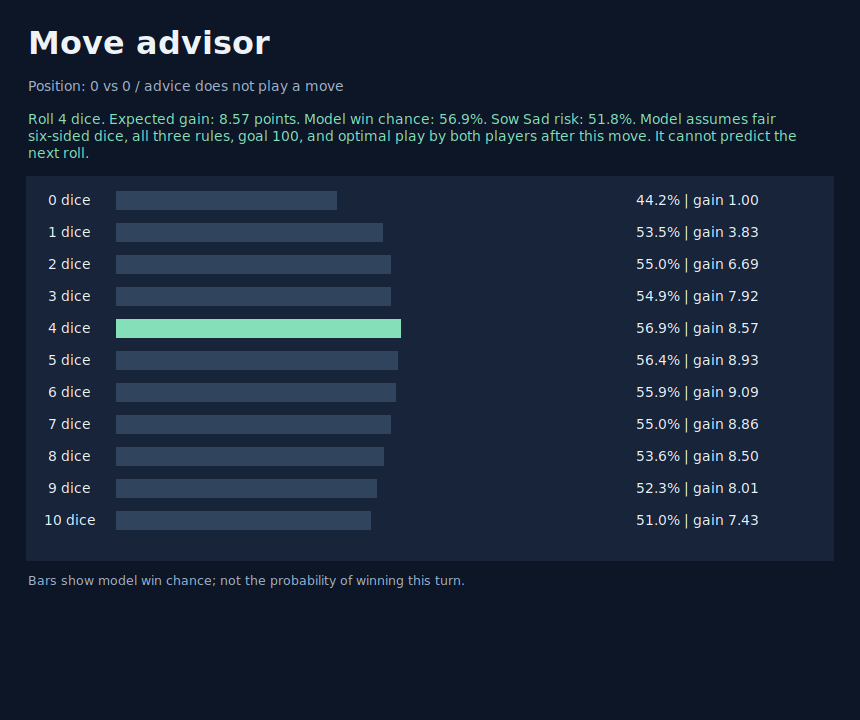

The advisor displays a snapshot of the position shown at the top. It is requested explicitly, rather than shown automatically during ordinary play. If you continue playing with the window open, request fresh advice for the new position.

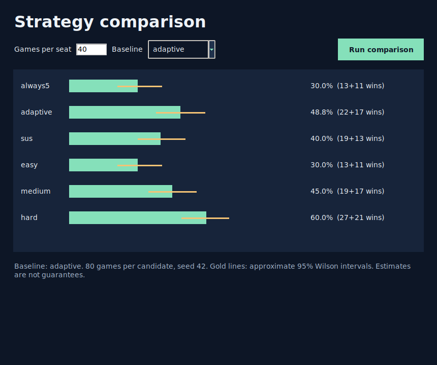

### How the Hard Opponent Works

This edition uses exact finite-state probability calculations rather than noisy Monte Carlo move estimates. For each roll count, the program counts every possible non-one sum and includes the probability of Sow Sad. Zero dice is deterministic. Sus Fuss is applied to every possible resulting score.

The policy solves 10,000 active score pairs in descending total-score order. Every turn increases a score, so the dependency graph is acyclic. It selects the action maximizing `sum(P(outcome) * (1 - opponent_value(next_state)))`, treating a winning turn as value 1. Near ties favor fewer dice.

**Assumptions:** fair six-sided dice, the three original rules, goal 100, and optimal play by both players after the considered move. The displayed model chance is not a prediction of the next roll or a measured win rate against the selected opponent. No trained model, API, GPU, or network connection is involved.

Medium optimizes immediate points; Hard optimizes winning the match. Difficulty labels are not a guarantee of monotonically increasing empirical win rates against every heuristic.

### Measured Benchmark

An included run used 100 games per starting seat, seed 42, and the original adaptive strategy as baseline. Hard won **112/200 (56.0%)**, with an approximate 95% Wilson interval of **49.1%-62.7%**. Medium won 95/200 (47.5%). These are sampled results with overlapping uncertainty, not proof of superiority in every matchup. Full counts and intervals are in [benchmark.json](../benchmark.json).

The comparison screen evaluates six named candidates, including Easy and its identical five-dice baseline, against any of the nine strategies. It resets the same seed for each candidate, so runs are reproducible. `--games` in the terminal experiment lab still evaluates all nine available strategies.

## Start

Extract the ZIP, open the project folder, and run:

```bash
python hog_desktop.py
```

Python 3.10+, Tkinter, and a graphical desktop are required. No third-party Python packages are required to play. On Windows, `py -3 hog_desktop.py` also works. On Linux, Tk support may require `python3-tk`. Check with `python -m tkinter`.

## Retained from v2.0.0

- Dice roll previews rotate and bounce before the actual result is resolved once.
- Animation uses independent randomness and never alters seeded scoring outcomes.
- Switch between dark and light themes without resetting a match or setup fields.
- Pause freezes computer turns and an in-progress animation; resume continues it.
- Restart confirms before resetting scores and cancels pending callbacks.
- Settings automatically pause a running match, then restore its previous state.
- Reduced-motion mode resolves turns immediately.
- Optional original WAV effects for rolling, Sow Sad, bonuses, and wins.
- Relaxed, normal, and fast computer pacing.
- Display preferences are saved atomically outside the source folder.

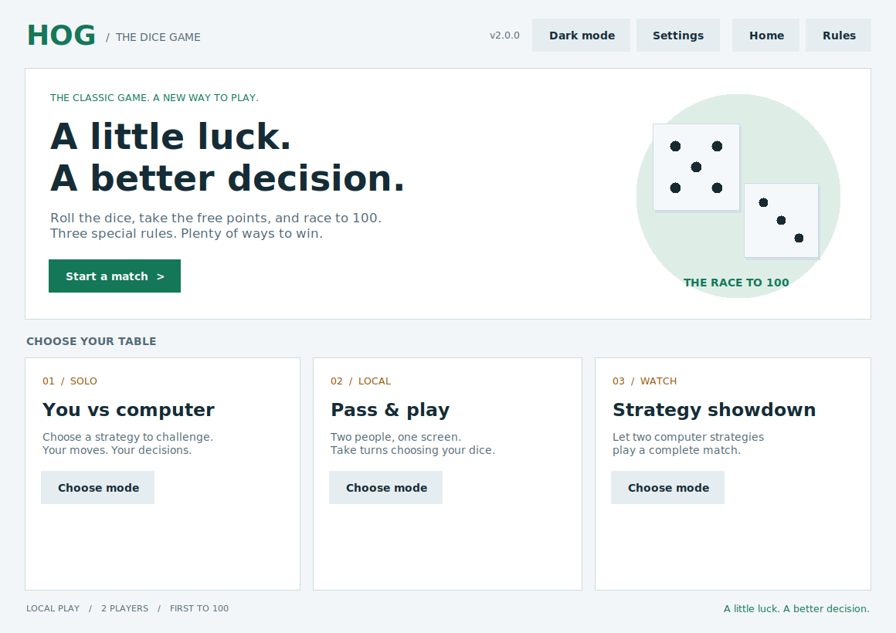

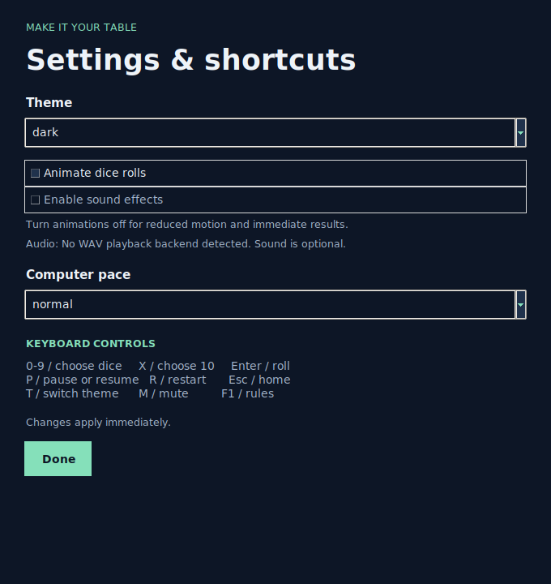

## Controls

| Key | Action |
| --- | --- |
| 0–9 | Choose dice count |
| X | Choose 10 dice |
| Enter | Confirm a human move |
| P | Pause / resume |
| R | Restart match |
| T | Switch theme |
| M | Toggle optional sound |
| F1 | Rules |
| H | Request move advice during a human turn |
| Esc | Home, confirming before leaving a match |

Shortcuts do not interfere with typing in name/seed fields. Mouse controls remain available. Human inputs are locked during rolling and computer turns.

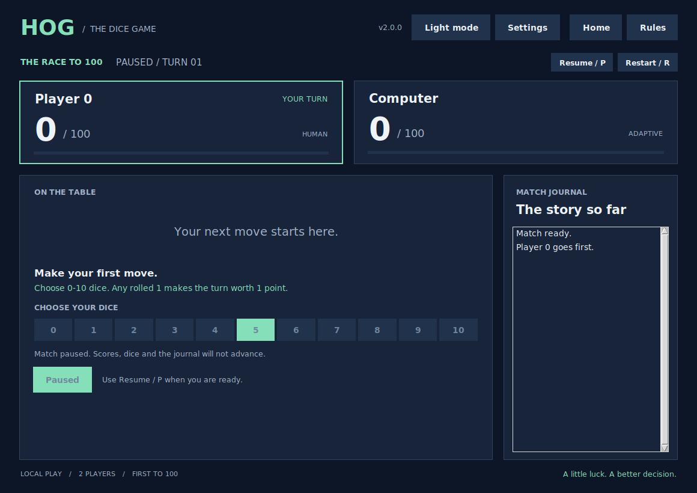

## Sound and Preferences

Sound defaults to off. Windows uses built-in `winsound`; macOS uses `afplay`; Linux uses an available `paplay` or `aplay`. If no backend exists, the sound control is disabled and the game remains playable. An available player still needs a working audio device. Playback failures do not interrupt a match.

Preferences contain only theme, animation, sound, and computer pace. Locations:

- Windows: `%APPDATA%/Hog/settings.json`
- macOS: `~/Library/Application Support/Hog/settings.json`
- Linux: `${XDG_CONFIG_HOME:-~/.config}/Hog/settings.json`

Malformed settings fall back to defaults. If saving fails, changes still apply for the current session. No player profiles or match history are saved yet.

Launch overrides:

```bash
python hog_desktop.py --theme light --no-animation --mute
```

## Rules and Modes

Choose human vs computer, two humans, or computer vs computer. Player 0 starts; first to finish a turn with at least 100 points wins.

- **Sow Sad:** any rolled 1 makes the turn worth 1 point; otherwise sum the dice.
- **Boar Brawl:** zero dice earns `max(1, 3 * abs(opponent_tens - player_ones))`.
- **Sus Fuss:** totals with exactly 3 or 4 positive factors rise to the next prime, including after zero-dice turns.

The original six strategies remain: `always5`, `always6`, `catch-up`, `boar`, `sus`, and the original `adaptive` heuristic. The winner screen offers replay, new setup, and final-table review. A fixed seed restarts on desktop replay.

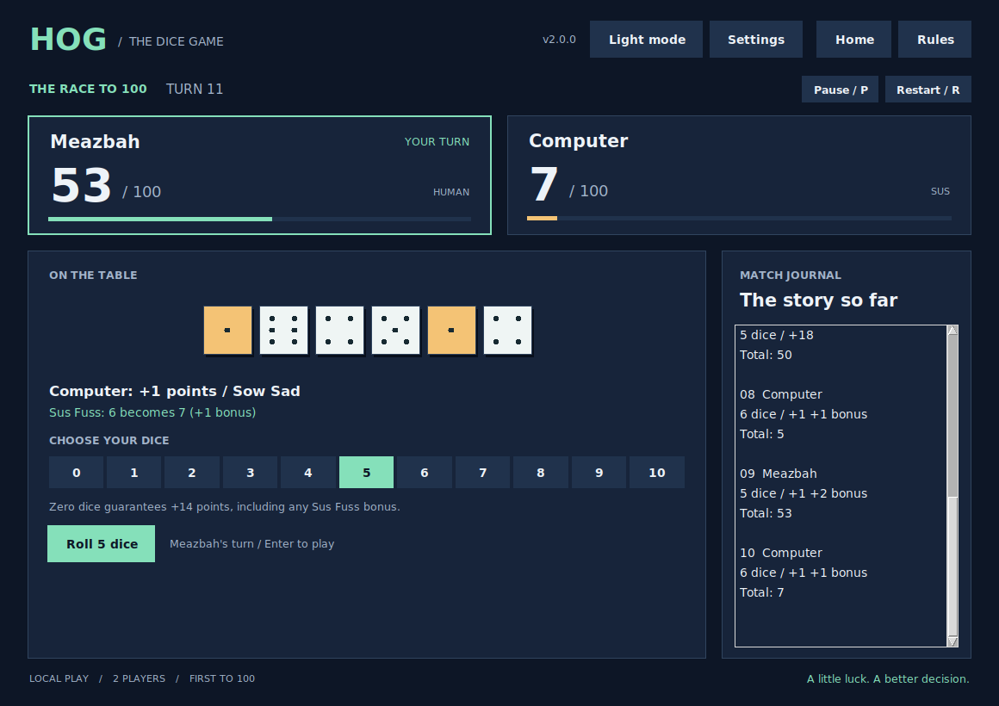

## Terminal and Experiments

```bash
python hog_ui.py
python hog.py -r --games 100 --samples 500 --seed 42
```

The experiment game count is per starting seat per strategy. Results are sampled estimates; both seats and approximate pooled Wilson intervals are reported.

## Previous Releases

| Version | Main changes |
| --- | --- |
| v1.0.0 | Original coursework simulator, rules, text interface, and adaptive strategy. |
| v1.1.0 | Terminal menus, names, opponent selection, replay, working experiments, seeds, and 39 checks. |
| v1.2.0 | First graphical desktop interface, journal, winner screen, incremental engine, and 55 checks. |
| v2.0.0 | Animation, themes, optional sound, pause/restart, shortcuts, settings persistence, and 82 checks. |
| **v2.1.0** | Easy/Medium/Hard opponents, exact win-probability policy, optional advice, visual comparisons, and 94 checks. |
| v2.2.0 | Planned: profiles, history, and tournaments. |
| v3.0.0 | Planned: final showcase edition. |

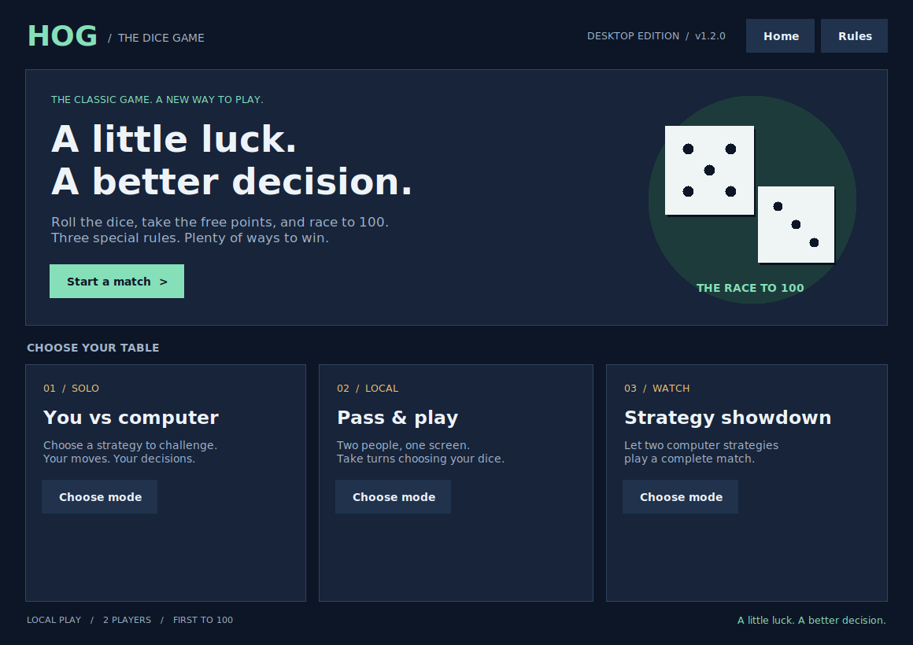

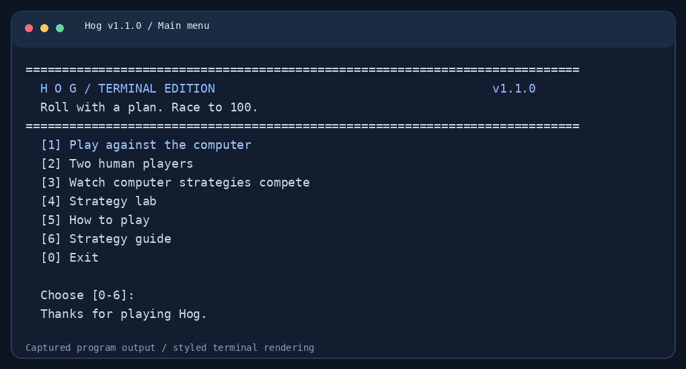

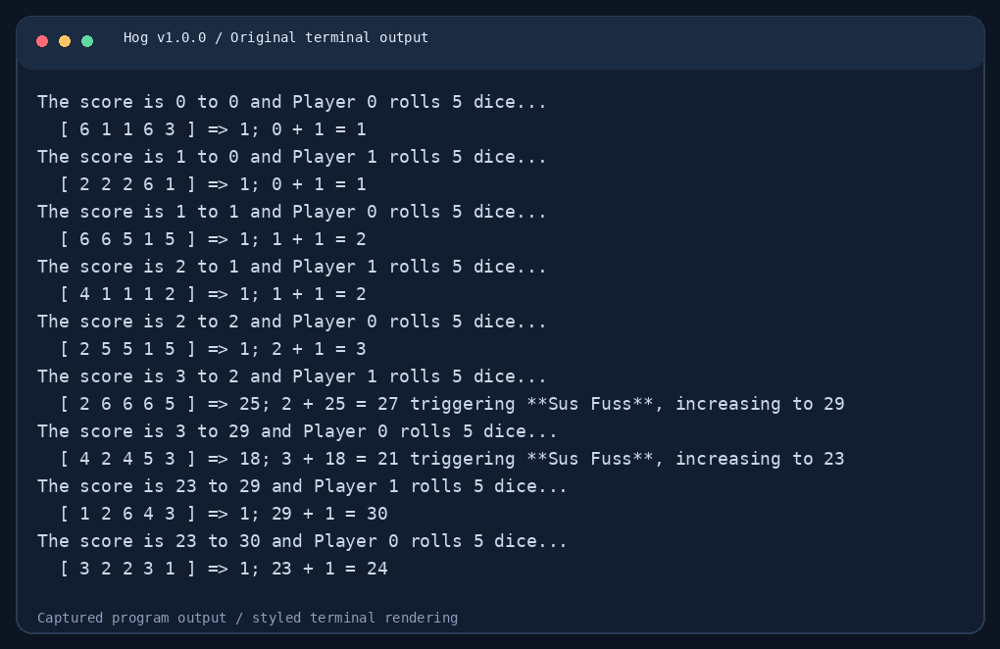

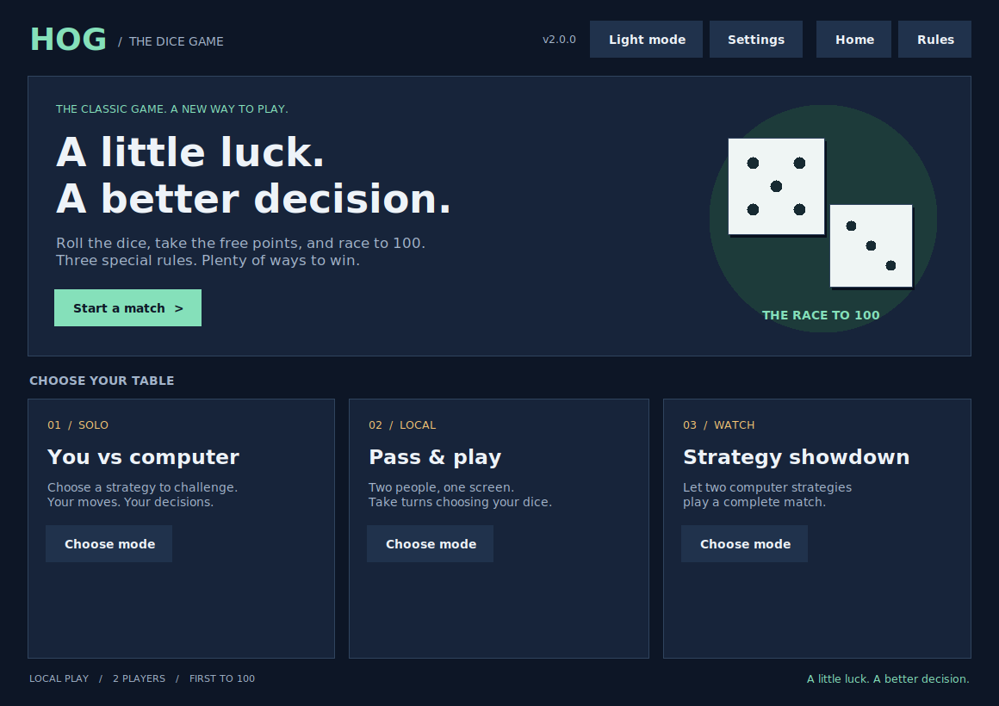

Full earlier documentation: [v2.0.0](v2.0.0.md), [v1.2.0](v1.2.0.md), [v1.1.0](v1.1.0.md). See [CHANGELOG.md](../../CHANGELOG.md) for cumulative changes. Archived README files describe their historical releases.

## Architecture and Files

| Module | Responsibility |
| --- | --- |
| `hog.py` | Rules, strategy registry, incremental sessions, full-match simulator |
| `hog_ai.py` | Exact roll distributions, greedy and optimal policies, move advice, measured comparisons |
| `hog_match.py` | Validated match setup |
| `hog_desktop.py` | Tk views, controls, animation and cancellable timers |
| `hog_preferences.py` | Palette tokens, validated settings, atomic saving |
| `hog_audio.py` | Optional nonblocking WAV playback |
| `hog_ui.py`, `hog_experiments.py` | Retained terminal tools |
| `assets/sounds/` | Four original generated WAV effects |
| `tests/` | Engine, CLI, GUI, animation, preferences, and audio regressions |
| `docs/` | Screenshots, archived documentation, validation |
| `tools/` | Optional captures and sound generation |

A move passes from the UI through animation to `GameSession.advance` exactly once. Completed turn events update scores and the journal. Pausing cancels the current timer; restart discards the old animation. Cosmetic previews use separate randomness from gameplay.

## Validation and Screenshots

```bash
python -m unittest discover -s tests -v
python -m doctest hog.py dice.py
```

94 checks passed on Python 3.12.14 / Tk 9.0 on a Linux virtual display, alongside 18 documentation examples. GUI classes skip when no display is available. Native Windows/macOS playback was verified with mocked backends, not physical audio devices. Native OS execution is not claimed.

Current PNGs capture actual Tk windows. Historical terminal images are styled renderings with raw transcripts preserved. Optional screenshot tools require Pillow; playing and tests do not. The WAV generator uses only the standard library.

This edition does not include online play, profiles, saved matches, or packaged executables. These remain later-release work.

## Credits

Original project and adaptive strategy: **Md Meazbah Mehedi Prodhan**. Based on the supplied Python Programming Project 1 Hog assignment and starter files. Original `dice.py` and `ucb.py` are retained; `ucb.py` credits UC Berkeley project utilities. This expanded GitHub edition goes beyond the coursework restriction to edit only `hog.py`.
