# The Game of Hog

**v3.3.0 · Coaching and Challenges Edition · Python 3.10+ / Tkinter**

Choose with a reason. v3.3.0 adds an offline move coach, post-match decision reviews, and eight puzzle challenges to Hog. Learn why dice choices rank differently, separate decision quality from dice luck, and practice finding strong actions in specific positions. The coach uses the existing exact probability policy; it requires no API key, network, trained neural model, or new runtime package.

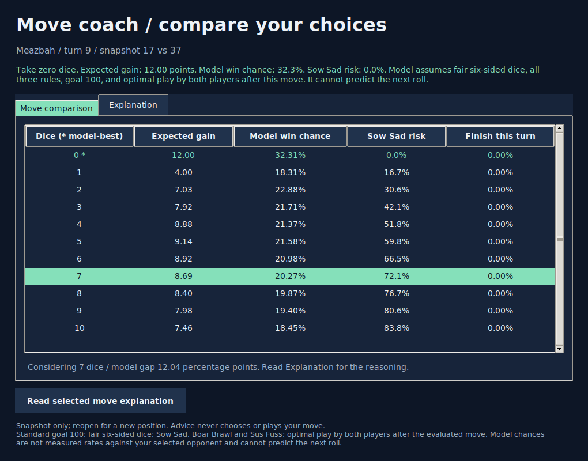

## What's New in v3.3.0

- **Coaching hub:** a new **Coach** dashboard action links live advice, completed-match reviews, and puzzle challenges.
- **Expanded live advice:** compare all 11 dice choices by expected points, match-winning model value, Sow Sad risk, and immediate finish chance.
- **Move explanations:** inspect a considered move, the best available choices, guaranteed zero-dice gain, immediate-gain alternatives, and the model assumptions.
- **Post-match decision review:** evaluate the position before every recorded roll, filter by seat, and sort by turn or largest model gap.
- **Opportunity review:** find lower-valued choices and positions where a guaranteed finish was available; actual outcomes are displayed separately.
- **Eight position puzzles:** submit a dice count, receive feedback, retry, or reveal the full explanation. All numerically tied model-best actions are accepted.
- **Honest learning progress:** track attempts and unassisted solves during the current app session; revealed answers do not become unassisted solves.
- **Navigation improvements:** small dashboard windows use two navigation rows. Replay and result screens link directly to decision review.
- **Match-selection fix:** numbered choices distinguish matches even when timestamps, player names and shortened IDs would look identical.
- **Release documentation:** nine actual screenshots, archived prior documentation, release notes, and a rebuilt Linux desktop package.

## Use the Coach

From the dashboard, open **Coach**. For live help, start a standard match and select **Coach / H** during an active human turn. The existing H shortcut and `show_advice` entry point now open the expanded coach. Paused, completed, computer, and in-flight animation turns do not open live advice.

The coach shows a snapshot of the current player's score, opponent score, and turn number. Select a row to consider a different dice count, then open **Explanation**. Selecting a row changes only the coach view; it does not change the main table's dice selection or play a move. Reopen the coach after the position changes to request fresh analysis.

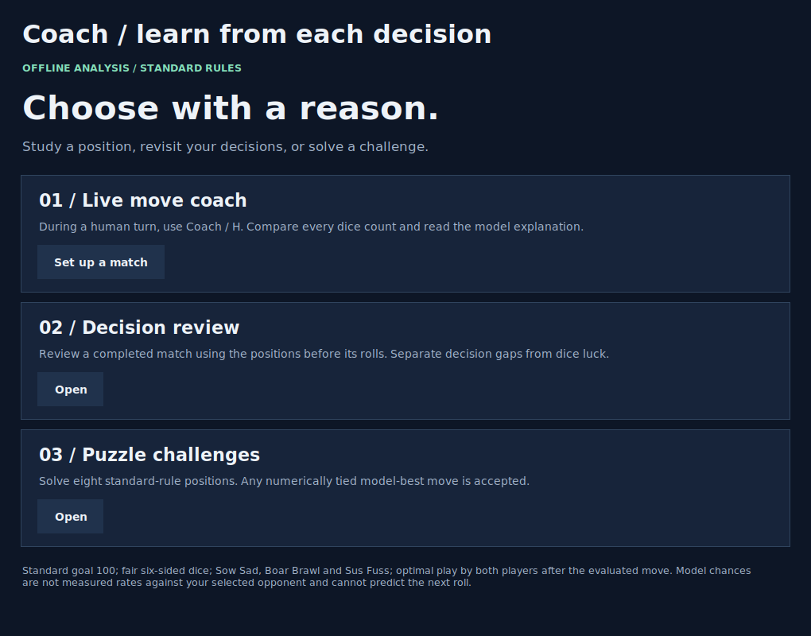

### What the Numbers Mean

| Figure | Meaning |
| --- | --- |
| Expected gain | Average immediate score increase, including Sus Fuss. |
| Model win chance | Probability of eventually winning under the standard optimal-play model. |
| Sow Sad risk | Probability of rolling at least one 1 with the selected dice count. |
| Finish this turn | Probability the move reaches 100 after applying all scoring rules. |
| Pre-roll gap | Best available model win probability minus the considered move's value, expressed in percentage points. |

The exact policy assumes **fair six-sided dice, goal 100, all three original rules, and optimal play by both players after the evaluated move**. It does not predict a roll or measure performance against the selected human/heuristic opponent. Custom practice rules are outside this model.

The explanation compares immediate points with the objective of winning the match. It also calculates the zero-dice option's base points, Sus Fuss adjustment, resulting score, and guaranteed gain. A guaranteed immediate finish is identified from the modeled outcomes. These are calculations and rule-based explanations, not generated conversation from an LLM.

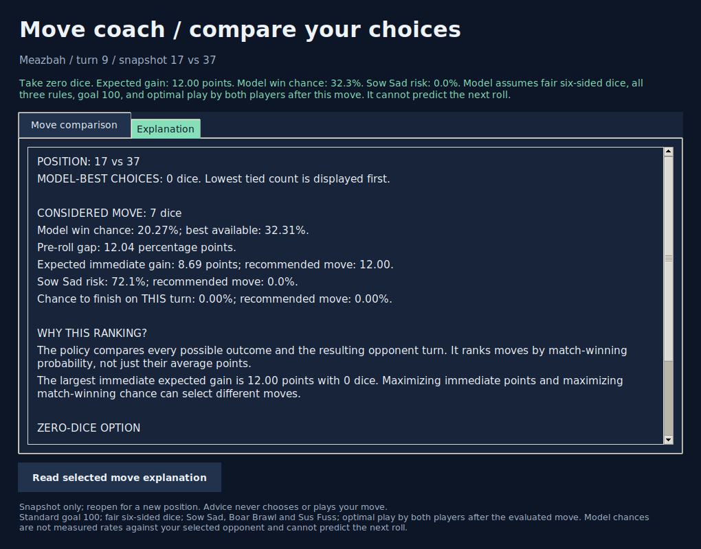

## Review a Completed Match

Open **Coach > Decision review**, **Review** on the winner screen, or **Review decisions** inside Replay. Choose one of the latest 100 stored records. Invalid records are excluded using the existing validation rules. The result-screen shortcut selects its completed match when that record is in the list.

The worker reconstructs each turn's **pre-roll position from that player's perspective**, then compares the recorded dice count with every legal alternative. The default filter selects the first human seat, or all seats for a computer-only game. You can select either seat or all seats and sort by **Largest model gap** or **Turn order**.

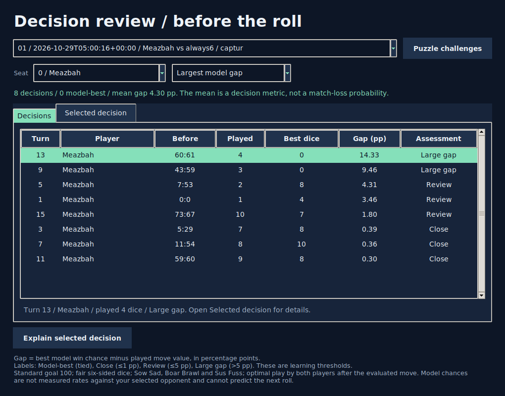

| Assessment | Learning threshold |
| --- | --- |
| Model-best | Tied for the highest value within `1e-9` probability tolerance. |
| Close | Positive gap up to 1 percentage point. |
| Review | Gap above 1 and up to 5 percentage points. |
| Large gap | Gap above 5 percentage points. |

These thresholds are descriptive learning labels, not a certified skill rating. The summary reports the number of decisions, model-best choices, and mean gap. Gaps from different turns are not summed into an alleged match-loss probability. The mean describes the selected decisions, not a probability that the player lost the match.

Select a row and open **Selected decision** to inspect the actual dice, base points, bonus and resulting score alongside the pre-roll explanation. A lucky winning roll does not remove an earlier model gap; an unlucky outcome does not make a model-best decision wrong. The review does not branch or simulate an alternative match.

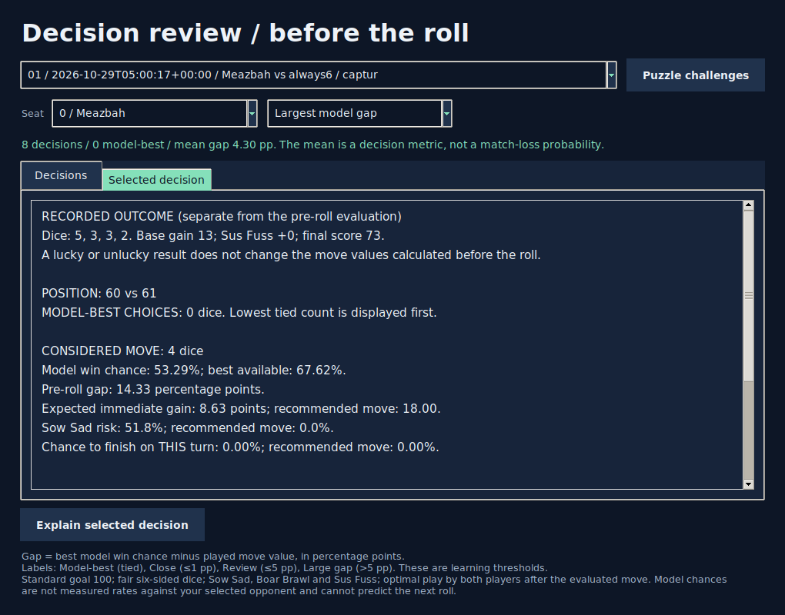

## Solve Puzzle Challenges

Open **Coach > Puzzle challenges**, or use the button inside Decision review. Choose a position and select 0–10 dice. **Check my move** accepts any action whose model win chance is within `1e-9` of the maximum. An incorrect answer gives a gap and a hint without revealing the best dice count, so you can retry.

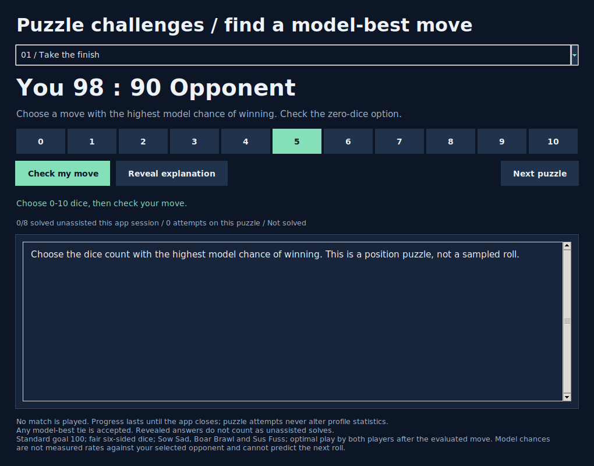

| Puzzle | Position: you / opponent | Focus |
| --- | --- | --- |
| Take the finish | 98 / 90 | Inspect a guaranteed finish. |
| A prime opportunity | 14 / 60 | Include Sus Fuss in the comparison. |
| The opening table | 0 / 0 | Compare opening decisions. |
| Chasing the leader | 37 / 81 | Choose using match-winning value. |
| The final stretch | 84 / 92 | Evaluate late-game alternatives. |
| Read the digits | 61 / 87 | Compare Boar Brawl with rolling. |
| A level table | 52 / 52 | Find a strong move from equal scores. |
| One point away | 99 / 99 | Recognize equally strong alternatives. |

Correct answers show the full explanation. **Reveal explanation** also displays it, marking subsequent answers as assisted. Attempts count every submitted answer; an unassisted solve means the answer was accepted before revealing the explanation, and can include retries. **Next puzzle** cycles through the eight positions; you may also select any puzzle directly.

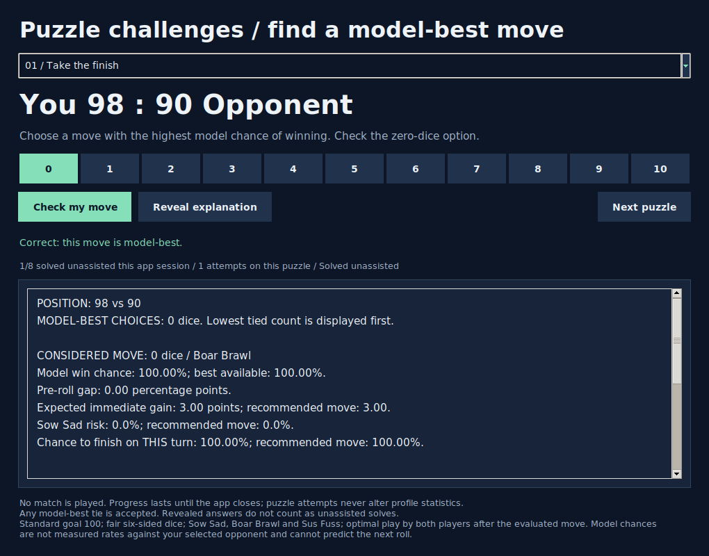

Progress survives closing/reopening the puzzle window within the same app session and resets when the application closes. Puzzles do not play matches or affect wins, history, profile achievements, tournament standings, or the manual save slot. Persistent campaign progression and unlockable cosmetics remain future work.

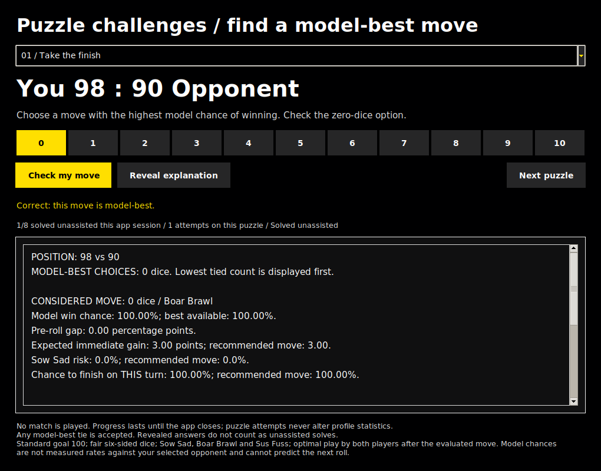

## Compatibility and Responsiveness

The SQLite schema remains at version 1, with the same settings and data paths. Existing profiles, saves, history, tournaments, replays, statistics, practice and terminal modes remain available. Live coaching, review calculations and puzzle preparation run in the analysis worker; only the Tk thread updates widgets and accesses SQLite.

Closing or replacing an analysis window cancels its polling callback. Model preparation may finish in the worker for reuse; its abandoned callback does not update the replacement window. New learning windows use scrollable explanation text, and comparison/review tables have vertical scrollbars. Larger text can still need a wider or taller window.

The main window retains the 960 × 720 standard-text minimum. Below 1180 pixels wide, the expanded dashboard navigation uses two rows; wider windows retain the rail. Learning windows have a 900 × 720 minimum.

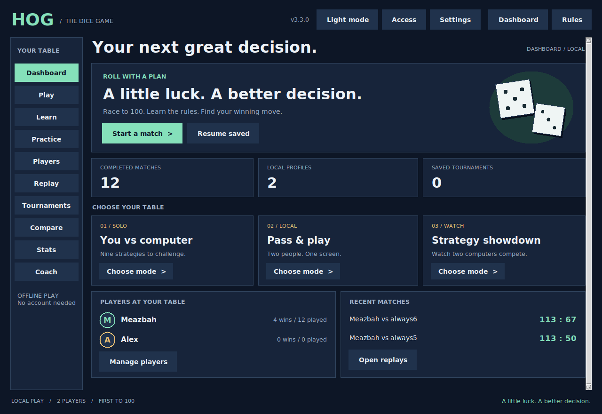

The screenshots are actual Tk windows showing seeded example matches and temporary in-memory profiles. Their displayed results are demonstrations, not strategy benchmarks or the user's stored personal history. No demonstration database is shipped.

## Retained from v3.2.0

Profile statistics, observed opponent results, personal records, dice-choice charts, interactive score replays, timeline scrubbing, key turns, adjustable playback speeds, and read-only history validation remain included. Historical screenshots below show those features at introduction.

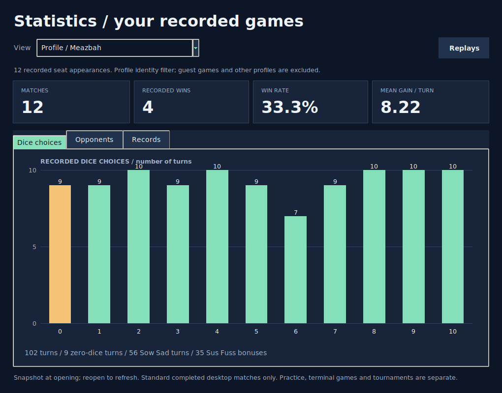

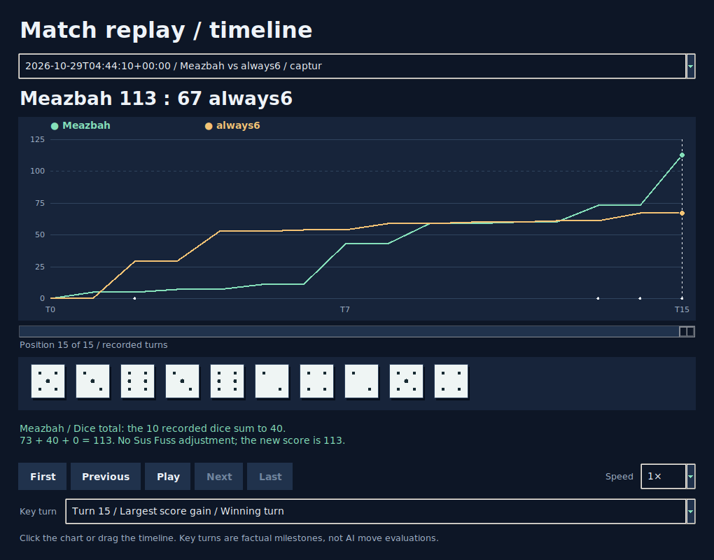

## Retained from v3.1.0

The adaptive dashboard, real activity totals, player cards, name-initial avatars, match scoring breakdown, dice-risk previews, collapsible journal, and motion-aware turn pulse remain available. The new Stats action joins the navigation rail and compact horizontal strip.

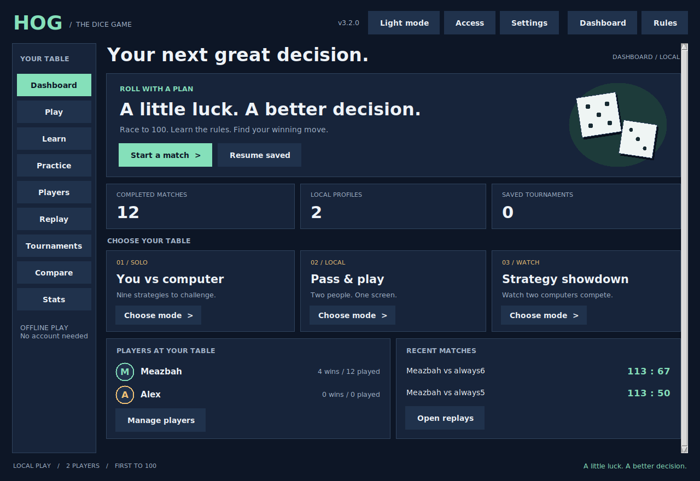

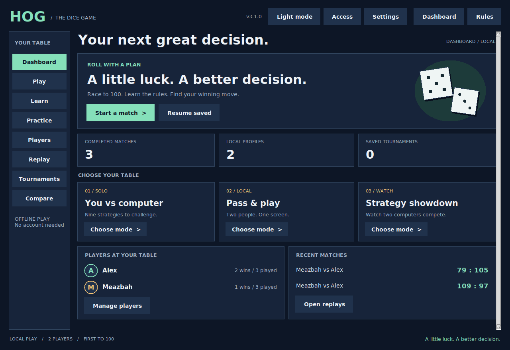

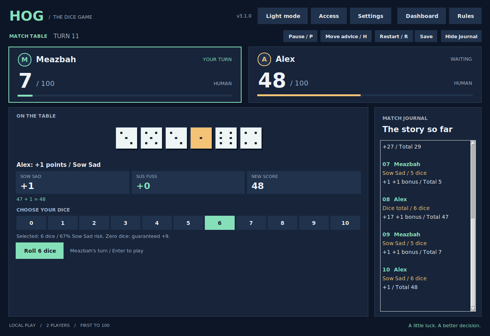

## Retained from v3.0.0

v3.0.0 completed the original six-upgrade plan. Its tutorial, replay viewer, configurable practice, accessibility settings, and native packaging are retained here. Historical screenshots below illustrate when each feature was introduced.

### Interactive Tutorial

From Home, click **Tutorial**. Choose answers to four questions. Incorrect answers receive feedback; the next lesson unlocks after the correct answer. Answers come from the same scoring functions used by the game. Tutorial exercises do not alter profiles or history.

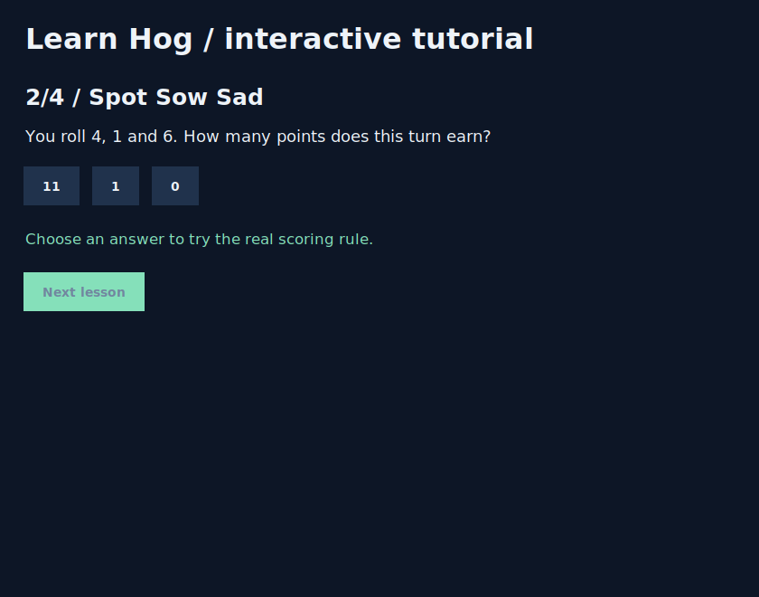

### Read-Only Match Replays

Open **Player hub > Replay viewer**, then select one of the latest 100 completed desktop matches. Use **First**, **Previous**, **Play / pause**, **Next**, and **Last** to inspect the match. Every displayed score pair is reconstructed and validated from recorded outcomes, rather than generated from new rolls. Turn points, bonus points, dice choices, and final totals remain visible.

Replay viewing never adds history entries or changes statistics. Earlier v2.2.0 completed desktop records are supported; this viewer is for standard 100-point matches, not practice sessions.

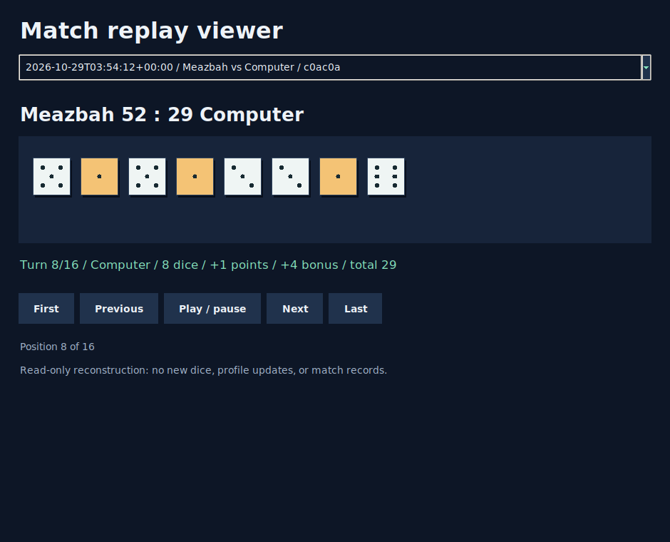

### Configurable Practice Table

From Home, click **Practice**. Choose a goal from 20 to 200, starting scores below that goal, an optional integer seed, and an opponent: `always5`, `always6`, or `catch-up`. Toggle Sus Fuss on/off, then start practice. Sow Sad and Boar Brawl always apply. Human and computer turns use immediate results so you can focus on the rule effects.

Practice is temporary and deliberately isolated: no saved match, profile ranking, achievements, history entry, or optimal-policy advice. The Hard policy assumes standard rules and goal 100, so it is not offered for custom practice.

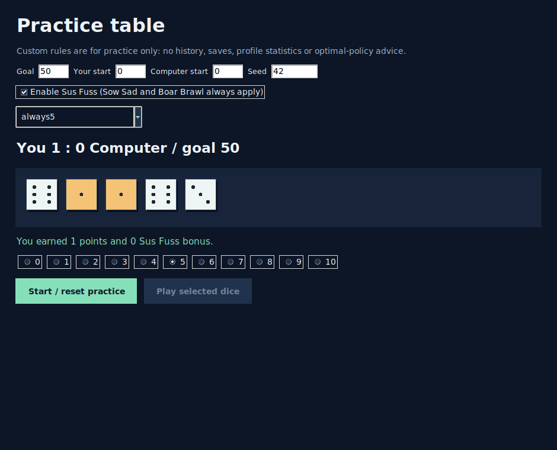

### Accessibility Controls

Click **Access** in the header. Enable larger label/control text, reduced motion, high contrast, or mute. These settings persist with existing preferences and preserve the current match. High contrast is also available in the Settings theme selector. Larger text may need a wider window; canvas diagrams retain their own readable labels.

Buttons retain keyboard focus indicators. Standard gameplay shortcuts remain listed below. This release does not claim complete screen-reader certification.

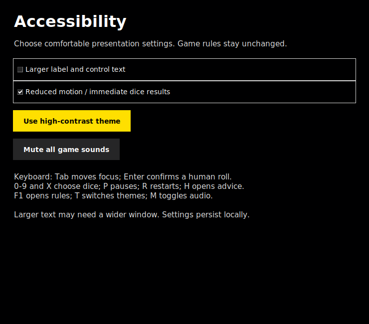

### Run Without a Separate Python Installation on Linux

A tested one-folder Linux x86_64 build is included. Keep the entire `Hog` folder together:

```bash
chmod +x native/linux-x86_64/Hog/Hog
./native/linux-x86_64/Hog/Hog
```

It was built and checked on Linux with glibc 2.39, Python 3.12.3, and Tk 8.6. It requires a graphical desktop and system graphics libraries. Compatibility with older glibc versions is not claimed.

For Windows, use the Python source command below, or run **`build-windows.bat` on Windows** to produce `dist/Hog/Hog.exe`. A Windows executable is not included, and Windows execution has not been tested here. Native executables must be built on their target operating system.

Optional build commands:

```bash
python -m pip install -r requirements-build.txt
python tools/build_desktop.py
```

The included native build used PyInstaller 6.22.3. This dependency is only for packaging, not source play. See [native/README.md](../../native/README.md) and [INSTALL.md](../../INSTALL.md).

Installation smoke check, with temporary in-memory data:

```bash
python hog_desktop.py --smoke-test
./native/linux-x86_64/Hog/Hog --smoke-test
```

## Retained from v2.2.0

- Local profiles with case-insensitive unique names; no online account or password.
- Attach a profile to each human seat in Match setup, or play as a guest.
- Persistent matches played, wins, losses, best score, zero-dice turns, and prime bonuses.
- Six achievement milestones derived from completed profile matches.
- Desktop match history, a local profile leaderboard, and history CSV export.
- One manual save slot, retaining configuration, completed turns, profile identities, and exact future dice state.
- Resuming opens the match paused; press P to continue. Unfinished animations return to the last completed-turn boundary.
- Seeded computer round robins with equal starting seats, standings charts, persistent tournament results, and match-level CSV export.
- SQLite transactions and unique match IDs prevent replaying a result screen from double-counting wins.

### Create and Use Profiles

Open **Player hub** from Home, enter a name, and select **Create profile**. In Match setup, choose that profile for a human seat. Selecting it fills the display name; you may still customize the displayed name without changing the profile identity. A profile cannot occupy both seats, and computers cannot use human profiles.

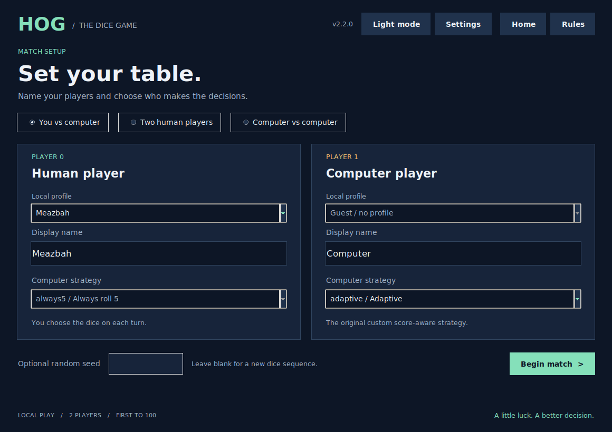

Guest desktop matches enter history but do not create profile statistics. The original terminal game is deliberately separate and does not write to the desktop database. Computer tournaments also keep separate standings rather than changing human statistics.

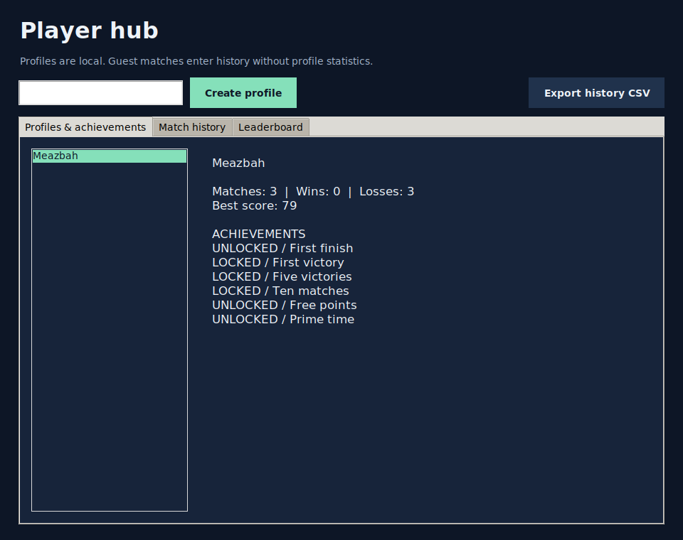

| Achievement | Unlock condition |
| --- | --- |
| First finish | Complete one profile match. |
| First victory | Win one profile match. |
| Five victories | Win five profile matches. |
| Ten matches | Complete ten profile matches. |
| Free points | Complete a match containing at least one zero-dice turn for that profile. |
| Prime time | Complete a match containing at least one Sus Fuss bonus for that profile. |

The leaderboard sorts profiles by wins, then matches played, then name. It is a local activity ranking, not an online rating or an Elo estimate.

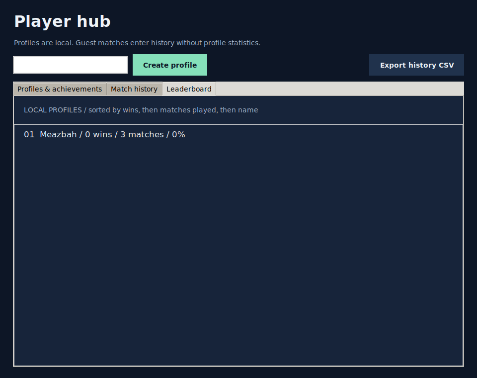

### Match History and CSV

The Player hub's **Match history** tab shows the latest 100 completed desktop matches. The CSV export includes all stored matches, one row per player, with UTC finish time, match ID, seat, name, score, win flag, turns, and scoring-rule counts. Spreadsheet formula prefixes in display names are escaped on export.

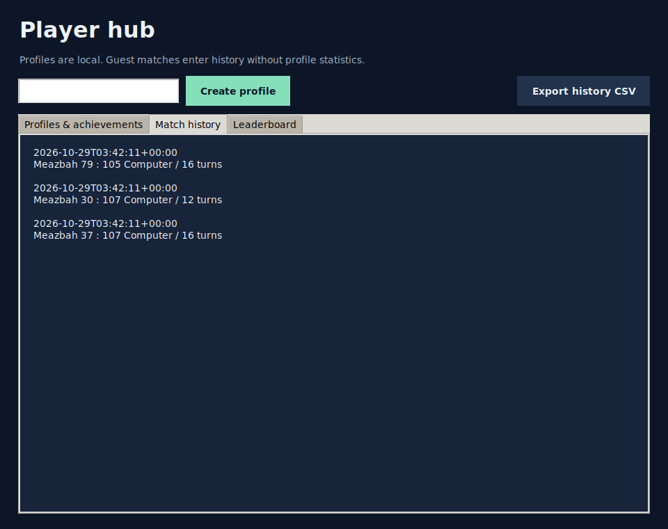

### Save and Resume

Click **Save** during an unfinished desktop match. The match pauses and the latest save slot is replaced. Saving is manual; closing an unsaved game does not automatically save it. From Home, click **Resume saved**. The match reopens paused with the same scores, journal, player to move, identities, and future dice sequence, even when the original game had no seed.

If saved during a roll preview, only completed turns are stored. No scoring dice were consumed by that preview, so resuming at the turn boundary preserves the future result. Finishing that match clears its own save slot; finishing a different match does not clear another saved match.

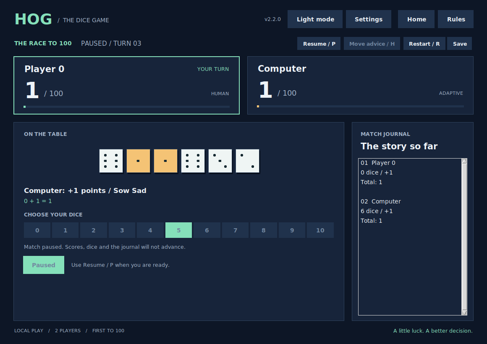

A desktop replay starts a new match ID and, if set, restarts its seed. Resume keeps the old match ID and generator state. Completed matches are deduplicated by ID before statistics are updated.

### Computer Tournaments

Open **Tournaments** from Home. Select 2-9 distinct strategies, 1-200 games per starting seat, and an integer seed. Each pair plays the same number of games in both seat orders. A five-strategy tournament with 10 games per seat runs 200 matches, with 80 appearances per strategy.

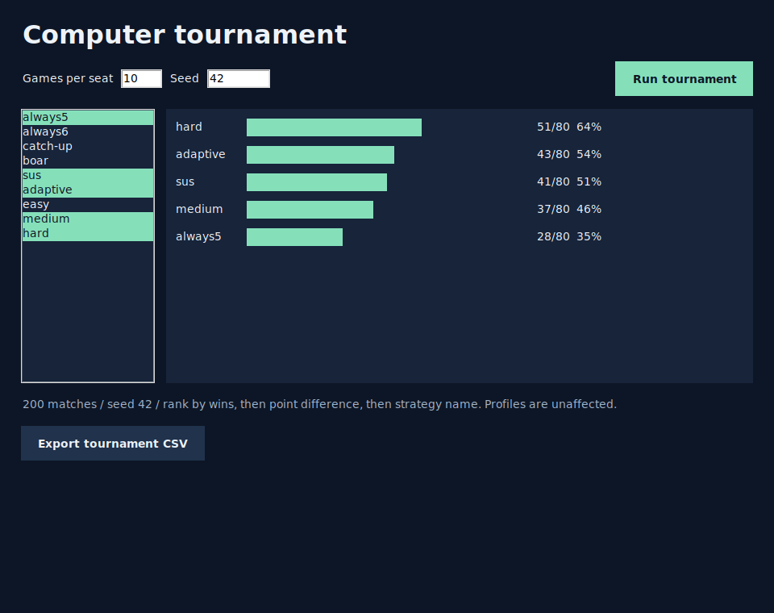

Standings sort by wins, then total point difference, then strategy name. Bars show observed win rates over the selected opponents. These sampled results do not guarantee future performance. The tournament runs in a worker; keep its window open until results appear to save that run. The dropdown reopens previously saved tournament results. **Export tournament CSV** writes one row per game, with player strategies, scores, and winner.

### Local Data and Backups

The normal desktop launcher stores `hog.sqlite3` beside `settings.json` in the platform's Hog configuration directory listed below. The database holds profiles, completed desktop matches, one save slot, and tournament results. There is no cloud synchronization or telemetry. Close the app before copying this database for backup or transfer. A clean release ZIP contains no personal database or demo profiles.

If the database cannot be opened, the app shows a notice in Player hub and uses temporary in-memory storage for that session; existing data is not replaced. Save and history failures are reported without changing game rules. Profiles currently cannot be renamed or deleted through the interface.

## Retained from v2.1.0

- **Easy:** a fixed five-dice opponent for practice.
- **Medium:** maximizes exact expected score gain, including Sus Fuss; takes a guaranteed zero-dice win.
- **Hard:** chooses the move with the best model probability of winning the complete match against an optimal opponent.
- **Move advisor:** click **Move advice / H** during a human turn. See every legal move, expected gain, Sow Sad risk, and model win chance. Advice never plays your move.
- **Strategy comparison:** open from Home, choose a baseline and games per starting seat, then run real matches in a background worker. Bars show measured win rates; gold lines show approximate 95% Wilson intervals.
- Policy preparation and comparisons run outside Tk callbacks. The worker never touches widgets.
- Original six strategies remain; all nine are selectable in desktop and terminal modes.

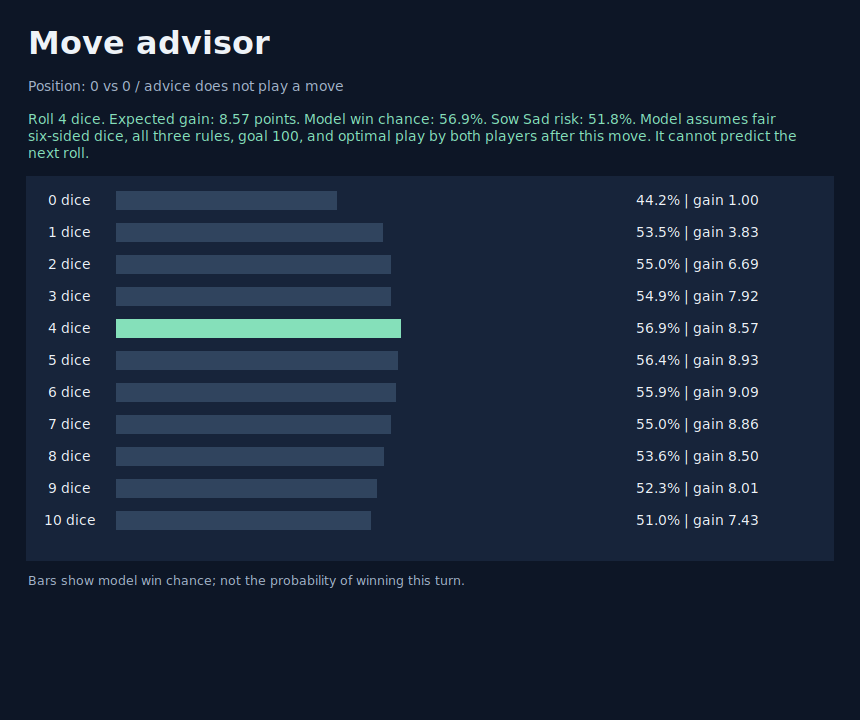

The advisor displays a snapshot of the position shown at the top. It is requested explicitly, rather than shown automatically during ordinary play. If you continue playing with the window open, request fresh advice for the new position.

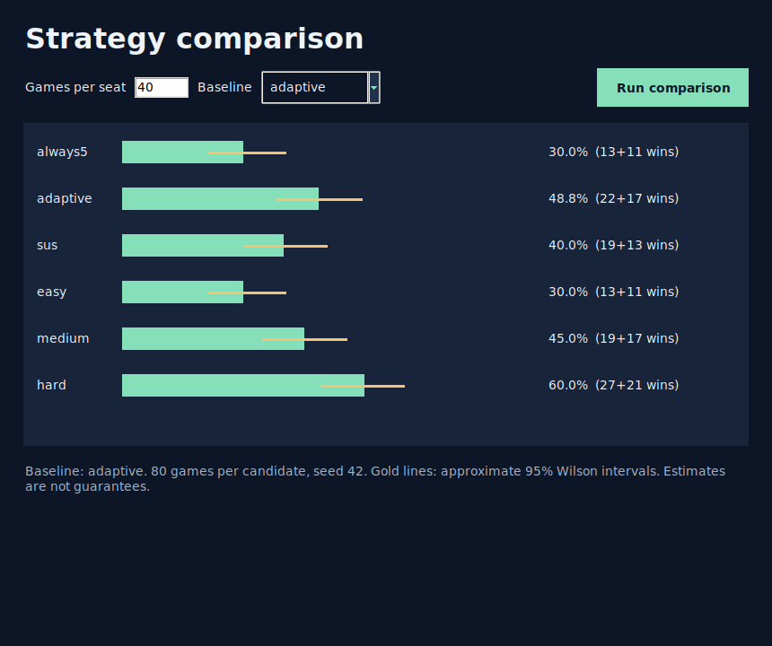

### How the Hard Opponent Works

This edition uses exact finite-state probability calculations rather than noisy Monte Carlo move estimates. For each roll count, the program counts every possible non-one sum and includes the probability of Sow Sad. Zero dice is deterministic. Sus Fuss is applied to every possible resulting score.

The policy solves 10,000 active score pairs in descending total-score order. Every turn increases a score, so the dependency graph is acyclic. It selects the action maximizing `sum(P(outcome) * (1 - opponent_value(next_state)))`, treating a winning turn as value 1. Near ties favor fewer dice.

**Assumptions:** fair six-sided dice, the three original rules, goal 100, and optimal play by both players after the considered move. The displayed model chance is not a prediction of the next roll or a measured win rate against the selected opponent. No trained model, API, GPU, or network connection is involved.

Medium optimizes immediate points; Hard optimizes winning the match. Difficulty labels are not a guarantee of monotonically increasing empirical win rates against every heuristic.

### Measured Benchmark

An included run used 100 games per starting seat, seed 42, and the original adaptive strategy as baseline. Hard won **112/200 (56.0%)**, with an approximate 95% Wilson interval of **49.1%-62.7%**. Medium won 95/200 (47.5%). These are sampled results with overlapping uncertainty, not proof of superiority in every matchup. Full counts and intervals are in [benchmark.json](../benchmark.json).

The comparison screen evaluates six named candidates, including Easy and its identical five-dice baseline, against any of the nine strategies. It resets the same seed for each candidate, so runs are reproducible. `--games` in the terminal experiment lab still evaluates all nine available strategies.

## Start

Extract the ZIP, open the project folder, and run:

```bash
python hog_desktop.py
```

Python 3.10+, Tkinter, and a graphical desktop are required. No third-party Python packages are required to play. On Windows, `py -3 hog_desktop.py` also works. On Linux, Tk support may require `python3-tk`. Check with `python -m tkinter`.

## Retained from v2.0.0

- Dice roll previews rotate and bounce before the actual result is resolved once.
- Animation uses independent randomness and never alters seeded scoring outcomes.
- Switch between dark and light themes without resetting a match or setup fields.
- Pause freezes computer turns and an in-progress animation; resume continues it.
- Restart confirms before resetting scores and cancels pending callbacks.
- Settings automatically pause a running match, then restore its previous state.
- Reduced-motion mode resolves turns immediately.
- Optional original WAV effects for rolling, Sow Sad, bonuses, and wins.
- Relaxed, normal, and fast computer pacing.
- Display preferences are saved atomically outside the source folder.

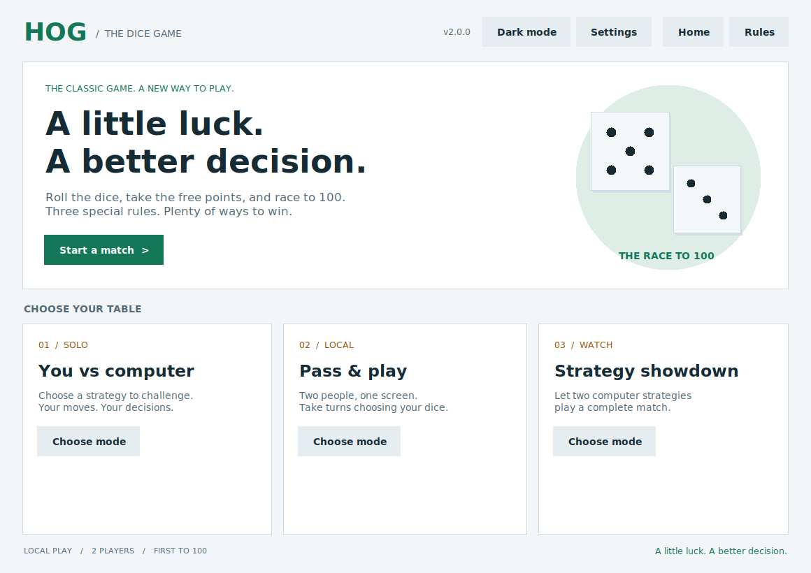

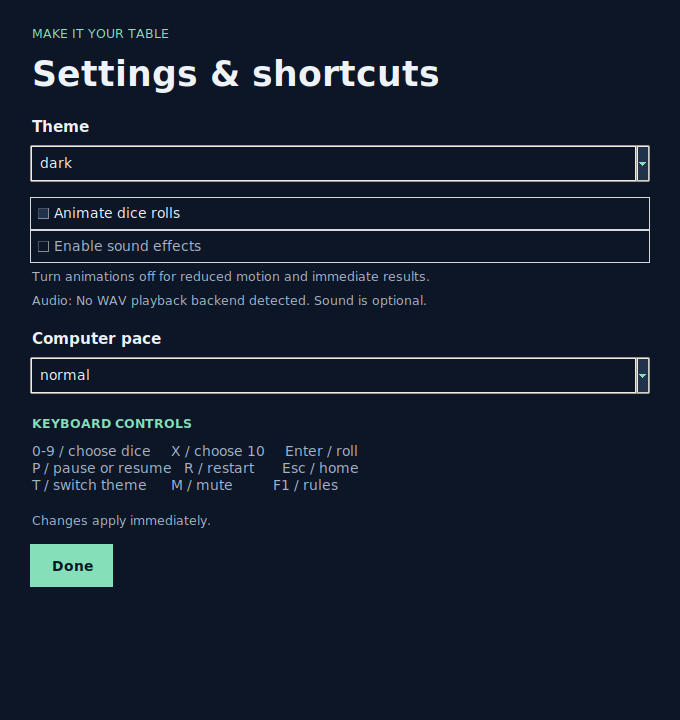

## Controls

| Key | Action |
| --- | --- |
| 0–9 | Choose dice count |
| X | Choose 10 dice |
| Enter | Confirm a human move |
| P | Pause / resume |
| R | Restart match |
| T | Switch theme |
| M | Toggle optional sound |
| F1 | Rules |
| H | Request move advice during a human turn |
| Esc | Home, confirming before leaving a match |

Shortcuts do not interfere with typing in name/seed fields. Mouse controls remain available. Human inputs are locked during rolling and computer turns.

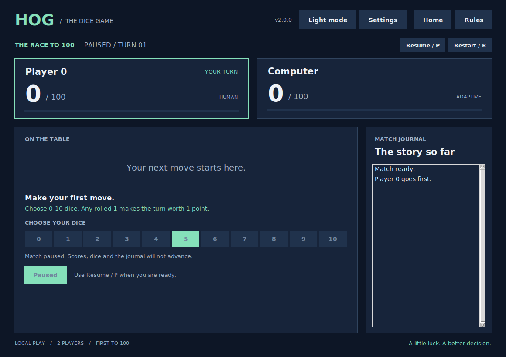

## Sound and Preferences

Sound defaults to off. Windows uses built-in `winsound`; macOS uses `afplay`; Linux uses an available `paplay` or `aplay`. If no backend exists, the sound control is disabled and the game remains playable. An available player still needs a working audio device. Playback failures do not interrupt a match.

Preferences contain only theme, animation, sound, and computer pace. Locations:

- Windows: `%APPDATA%/Hog/settings.json`
- macOS: `~/Library/Application Support/Hog/settings.json`
- Linux: `${XDG_CONFIG_HOME:-~/.config}/Hog/settings.json`

Malformed settings fall back to defaults. If saving fails, changes still apply for the current session. Profiles, history, saves, and tournament results use the separate SQLite database described above.

Launch overrides:

```bash
python hog_desktop.py --theme light --no-animation --mute
```

## Rules and Modes

Choose human vs computer, two humans, or computer vs computer. Player 0 starts; first to finish a turn with at least 100 points wins.

- **Sow Sad:** any rolled 1 makes the turn worth 1 point; otherwise sum the dice.
- **Boar Brawl:** zero dice earns `max(1, 3 * abs(opponent_tens - player_ones))`.
- **Sus Fuss:** totals with exactly 3 or 4 positive factors rise to the next prime, including after zero-dice turns.

The original six strategies remain: `always5`, `always6`, `catch-up`, `boar`, `sus`, and the original `adaptive` heuristic. The winner screen offers replay, new setup, and final-table review. A fixed seed restarts on desktop replay.

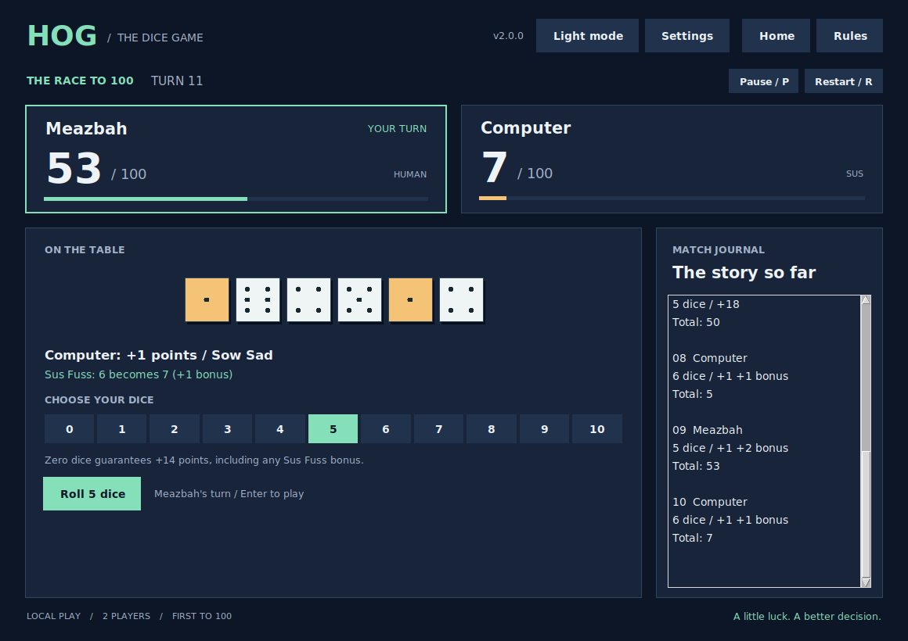

## Terminal and Experiments

```bash
python hog_ui.py
python hog.py -r --games 100 --samples 500 --seed 42
```

The experiment game count is per starting seat per strategy. Results are sampled estimates; both seats and approximate pooled Wilson intervals are reported.

## Previous Releases

| Version | Main changes |
| --- | --- |
| v1.0.0 | Original coursework simulator, rules, text interface, and adaptive strategy. |
| v1.1.0 | Terminal menus, names, opponent selection, replay, working experiments, seeds, and 39 checks. |
| v1.2.0 | First graphical desktop interface, journal, winner screen, incremental engine, and 55 checks. |
| v2.0.0 | Animation, themes, optional sound, pause/restart, shortcuts, settings persistence, and 82 checks. |
| v2.1.0 | Easy/Medium/Hard opponents, exact win-probability policy, optional advice, visual comparisons, and 94 checks. |
| v2.2.0 | Profiles, statistics, six achievements, history, exact save/resume, local leaderboard, tournaments, CSV export, and 110 checks. |
| v3.0.0 | Interactive tutorial, replay navigation, practice settings, accessibility, native Linux build, packaging scripts, and 122 checks. |
| v3.1.0 | Dashboard navigation, activity/player cards, initial avatars, adaptive layout, scoring breakdown, risk previews, collapsible journal, turn pulse, and 135 checks. |
| v3.2.0 | Profile statistics, opponent results, dice-choice charts, records, interactive score timelines, replay speeds, factual turn explanations, and 156 checks. |
| **v3.3.0** | Expanded move coach, pre-roll decision review, eight model-based puzzles, session learning progress, navigation fixes, and 177 checks. |

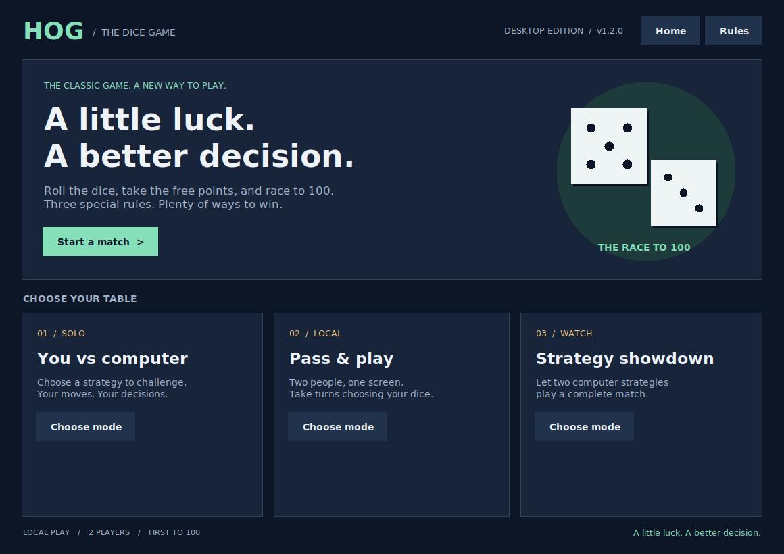

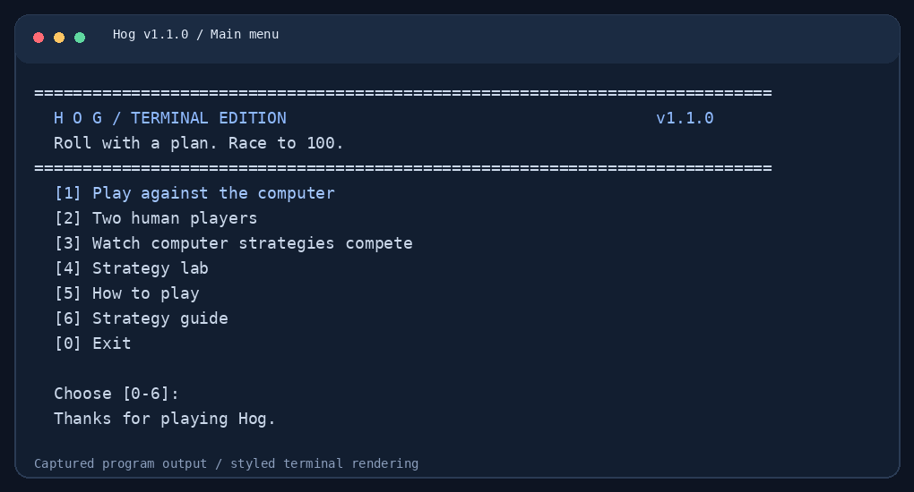

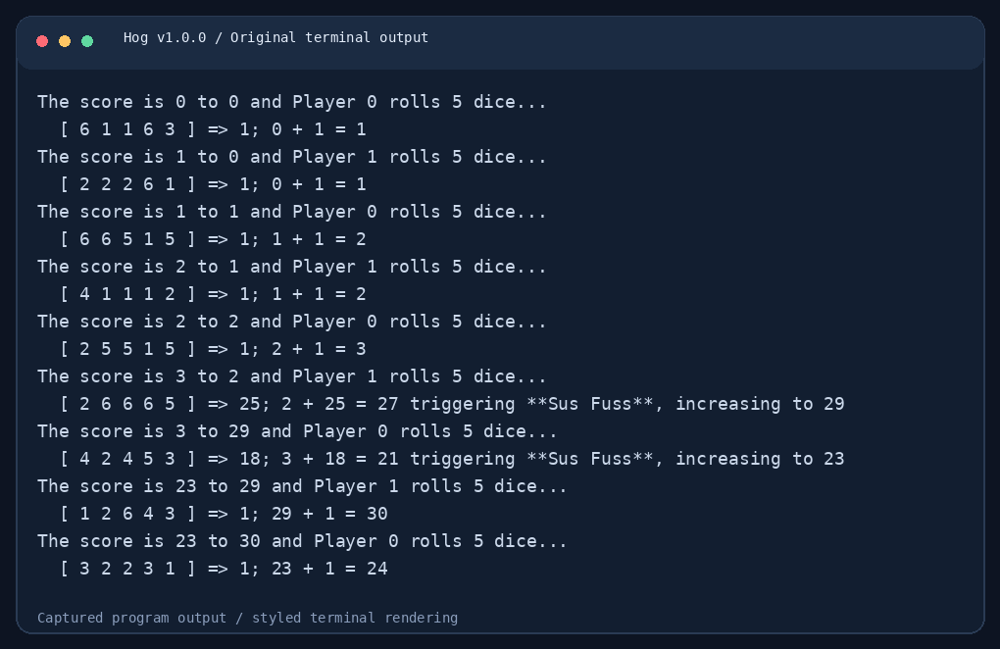

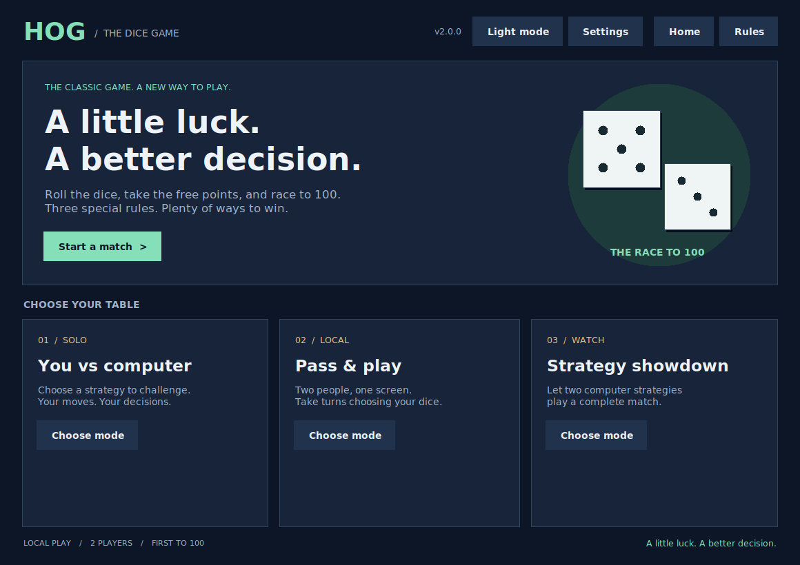

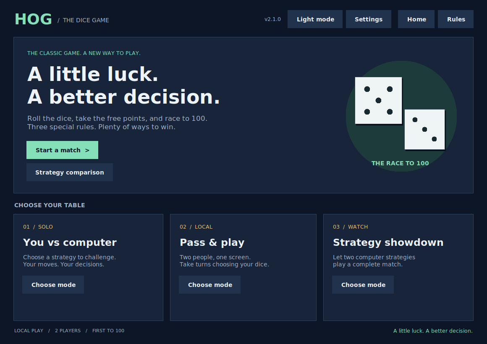

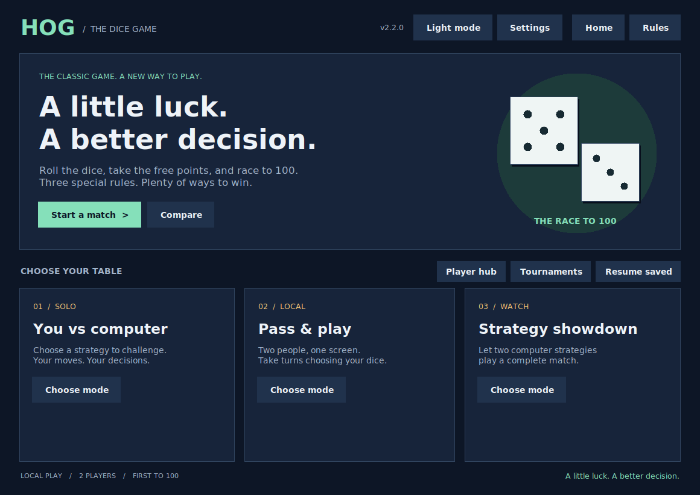

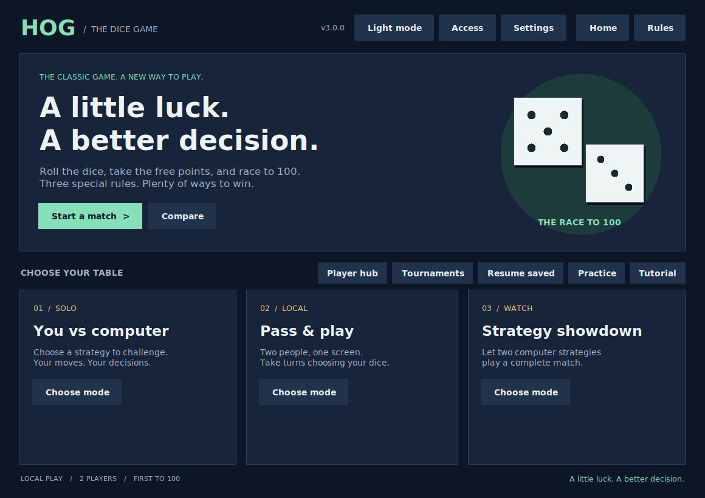

Full earlier documentation: [v3.2.0](v3.2.0.md), [v3.1.0](v3.1.0.md), [v3.0.0](v3.0.0.md), [v2.2.0](v2.2.0.md), [v2.1.0](v2.1.0.md), [v2.0.0](v2.0.0.md), [v1.2.0](v1.2.0.md), [v1.1.0](v1.1.0.md). See [CHANGELOG.md](../../CHANGELOG.md) for cumulative changes. Archived README files describe their historical releases.

## Architecture and Files

| Module | Responsibility |
| --- | --- |
| `hog.py` | Rules, strategy registry, incremental sessions, full-match simulator |
| `hog_ai.py` | Exact roll distributions, greedy and optimal policies, move advice, measured comparisons |
| `hog_match.py` | Validated match setup and human profile assignments |
| `hog_coach.py` | Model comparisons, move explanations, pre-roll review and puzzle answer validation |
| `hog_coach_ui.py` | Learning hub, live coach, decision review, puzzles and session progress |
| `hog_statistics.py` | Validated history reading, per-profile aggregates, records, milestones, scoring explanations |
| `hog_insights_ui.py` | Statistics and interactive replay windows, playback and timeline controls |
| `hog_charts.py` | Canvas dice-choice and score-progression charts |
| `hog_drawing.py` | Shared vector dice drawing for live play and replay |
| `hog_dashboard.py` | Initial avatars, recorded result summaries, and scoring breakdown presentation |
| `hog_showcase.py` | Tutorial exercises, practice rules, validated replay reconstruction |
| `native/` | Tested Linux one-folder package and native runtime notices |
| `tools/build_desktop.py` | Reproducible native packaging command |
| `hog_storage.py` | SQLite profiles, statistics, history, save validation, and exports |
| `hog_tournament.py` | Seeded equal-seat round robins and tournament CSV export |
| `hog_desktop.py` | Tk views, controls, animation and cancellable timers |
| `hog_preferences.py` | Palette tokens, validated settings, atomic saving |
| `hog_audio.py` | Optional nonblocking WAV playback |
| `hog_ui.py`, `hog_experiments.py` | Retained terminal tools |
| `assets/sounds/` | Four original generated WAV effects |
| `tests/` | Engine, CLI, GUI, animation, preferences, and audio regressions |
| `docs/` | Screenshots, archived documentation, validation |
| `tools/` | Optional captures and sound generation |

A move passes from the UI through animation to `GameSession.advance` exactly once. Completed turn events update scores and the journal. Pausing cancels the current timer; restart discards the old animation. Cosmetic previews use separate randomness from gameplay.

## Validation and Screenshots

```bash
python -m unittest discover -s tests -v
python -m doctest hog.py dice.py
```

177 checks passed on Python 3.12.14 / Tk 9.0 on a Linux virtual display, alongside 18 documentation examples. The rebuilt Linux package passed its version and real-window smoke checks. GUI classes skip when no display is available. Native Windows/macOS playback was verified with mocked backends, not physical audio devices. Native Windows/macOS execution is not claimed.

Current PNGs capture actual Tk windows. Historical terminal images are styled renderings with raw transcripts preserved. Optional screenshot tools require Pillow; playing and tests do not. The WAV generator uses only the standard library.

This edition does not include online play, cloud accounts, or a prebuilt Windows/macOS executable. v3.3.0 is the third release in the new improvement roadmap. Persistent campaign progression, customization unlocks, and online multiplayer remain proposed future work.

## Credits

Original project and adaptive strategy: **Md Meazbah Mehedi Prodhan**. Based on the supplied Python Programming Project 1 Hog assignment and starter files. Original `dice.py` and `ucb.py` are retained; `ucb.py` credits UC Berkeley project utilities. This expanded GitHub edition goes beyond the coursework restriction to edit only `hog.py`.

## Architecture and Development Takeaways

Presentation helpers (`hog_dashboard.py`) derive dashboard summaries and scoring labels without modifying match data. The coaching layer reuses the exact policy and reviews the score pair before each recorded roll. Its puzzle evaluator accepts numerical ties and keeps session progress separate from profile records. The statistics layer validates completed events before aggregating them; replay charts consume those reconstructed states. `hog_insights_ui.py` composes the two analysis windows with the main desktop app, and `hog_charts.py` renders data without external dependencies. Layout, pulse, and scoring callbacks are tracked separately so cosmetic changes cannot advance a match.

The project separates scoring and turn events (`hog.py`), probability analysis (`hog_ai.py`), local persistence (`hog_storage.py`), tournament simulation (`hog_tournament.py`), tutorial/practice/replay validation (`hog_showcase.py`), and Tk presentation (`hog_desktop.py`). Background workers calculate policies and tournaments; only the Tk thread updates widgets or SQLite records.

Game randomness, cosmetic animation randomness, and recorded replay outcomes have distinct lifecycles. Tests verify that animation and advice do not change real dice results, saved games preserve future outcomes, replay is read-only, and practice cannot distort standard profile statistics.

The original coursework grew into six separately packaged upgrades, followed by the dashboard, statistics and coaching releases, while preserving the scoring rules. This progression demonstrates control flow, closures, probability, dynamic programming, event-driven interfaces, transactional storage, input validation, reproducible tests, and native packaging.
