# The Game of Hog

**v3.5.0 · Private Multiplayer Edition · Python 3.10+ / Tkinter**

Share a table with a friend through a private room. This release adds an authoritative Python relay and desktop multiplayer: invitation codes, ready status, synchronized scoring, turn timers, rematches and temporary seat reconnection. The complete local game, campaign, cosmetics, coaching and analysis tools remain included.

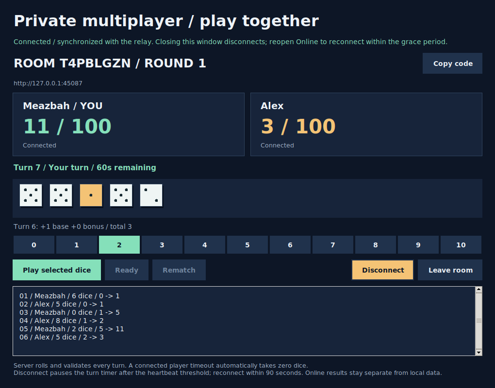

## What's New in v3.5.0

- **Private rooms:** create an eight-character invitation code or join a friend's room on the same relay.
- **Ready lobby:** both players explicitly ready up before round 1.
- **Server-owned scoring:** clients send a dice count; the relay generates the actual roll and applies the original rules.
- **Synchronized table:** player presence, scores, active turn, last dice, bonuses and a scrollable turn journal.
- **Turn timers:** disabled, 30, 60 or 120 seconds; a connected player timeout takes the real zero-dice action.
- **Reconnection:** heartbeat-based connection indicators, timer pauses, temporary seat reservation and automatic transport retries.
- **Rematches:** both players vote to start another round; the starting seat alternates.
- **Retry protection:** match/turn checks and request identities prevent a repeated response-loss retry from rolling twice.
- **HTTP(S) client and relay:** optional direct TLS and trusted-CA configuration, with certificate verification enabled.
- **Window cleanup fix:** cyclic view callbacks are disposed on the Tk thread before workers can collect them.
- **Release material:** eight actual screenshots, a two-client smoke script, hosting guide, archived documentation and rebuilt Linux client.

## Try Multiplayer Locally

Start the relay in one terminal:

```bash
python hog_server.py
```

Keep it running. Open two desktop clients in separate terminals:

```bash
python hog_desktop.py
```

In each client, choose **Online** in dashboard navigation. Use `http://127.0.0.1:8765`, enter a display name, and create or join a room. The creator shares the code; both players click **Ready**.

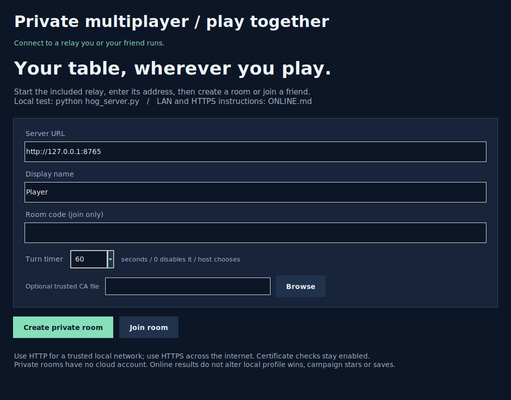

The relay is a separate Python process. The ZIP does not deploy a public server, and opening Online does not start one automatically. Both players need the same reachable relay address as well as the room code. For LAN hosting, direct HTTPS, certificates and troubleshooting, read [ONLINE.md](../../ONLINE.md).

A quick automated network check needs no display:

```bash
python tools/network_smoke.py
```

## Private Rooms and Ready Status

Create uses seat 0; Join takes the vacant seat. A room has two players and rejects extra joins while full or playing. Ready can be toggled in the lobby. The relay starts the match when both occupied seats are connected and ready.

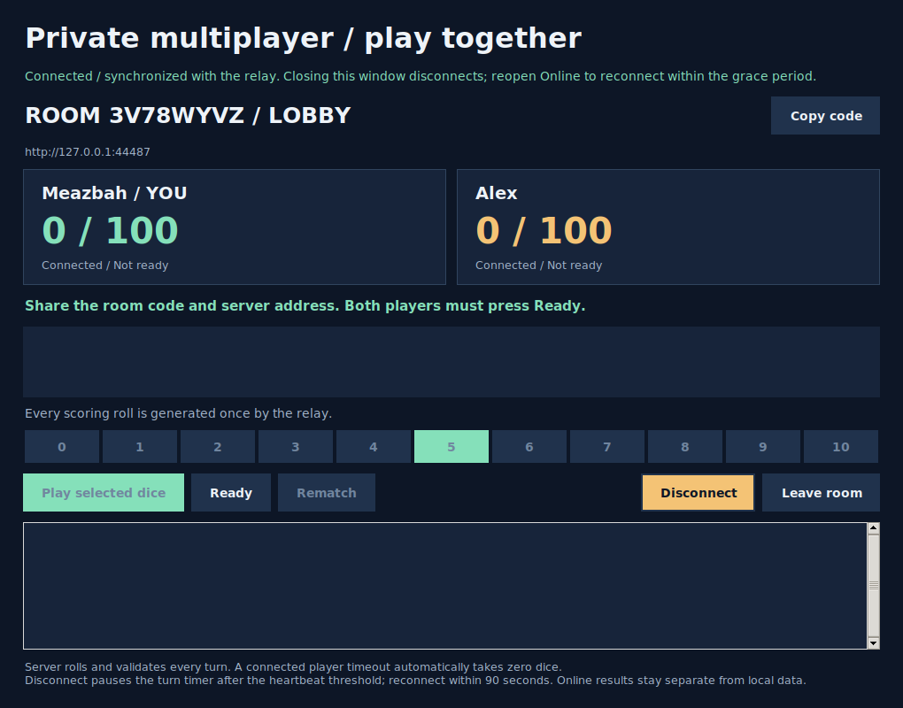

The clipboard button copies only the room code. The private seat token remains in memory and is not copied, shown in the interface or stored in local profile data. Names are temporary display names rather than verified accounts.

## Turns, Timers and Results

Choose 0–10 dice and click **Play selected dice** during your turn. The relay validates your seat, match ID and turn number. It rolls exactly once, updates the scores, and supplies the same event log to both clients. Displayed dice are those recorded server outcomes.

A move timeout automatically selects zero dice. It earns Boar Brawl points and receives any Sus Fuss adjustment, exactly like a chosen zero-dice move. Timeout events are marked in the journal. A timer of zero disables automatic turn timeouts.

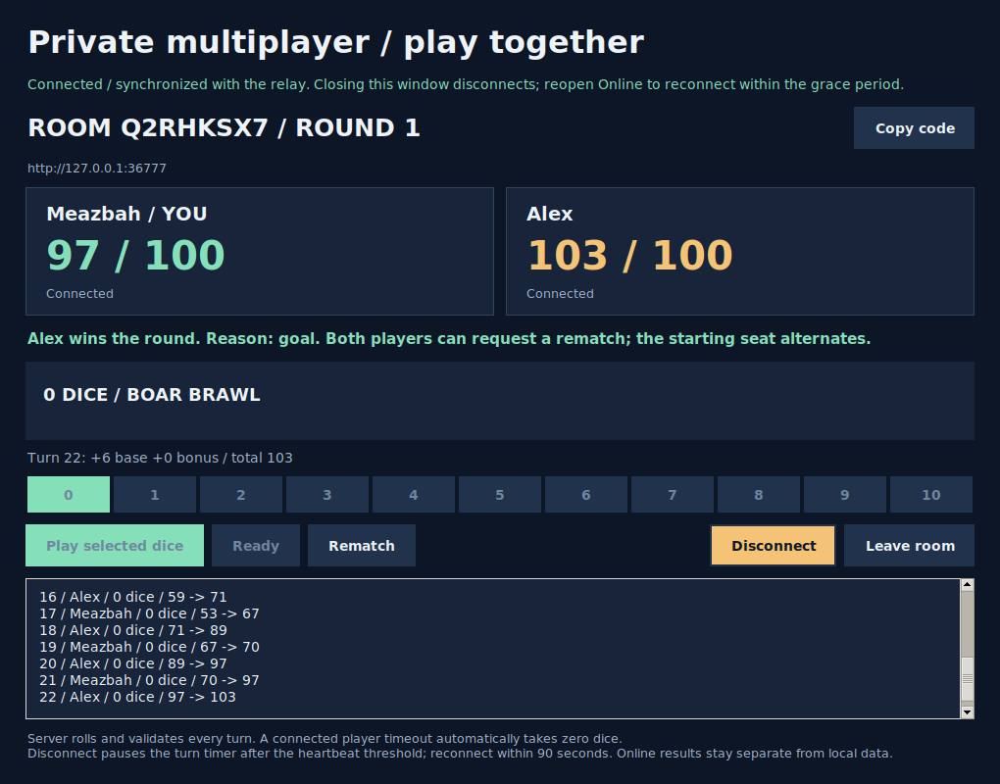

Goal finishes, explicit departures and expired reconnect reservations have distinct result reasons. A forfeit can end an online round before either score reaches 100; these results never enter standard local match history.

Both players must request a rematch. A new round resets the scores and event log, creates a new match identity and server dice stream, and alternates the opening seat. Round 1 starts with seat 0, round 2 with seat 1.

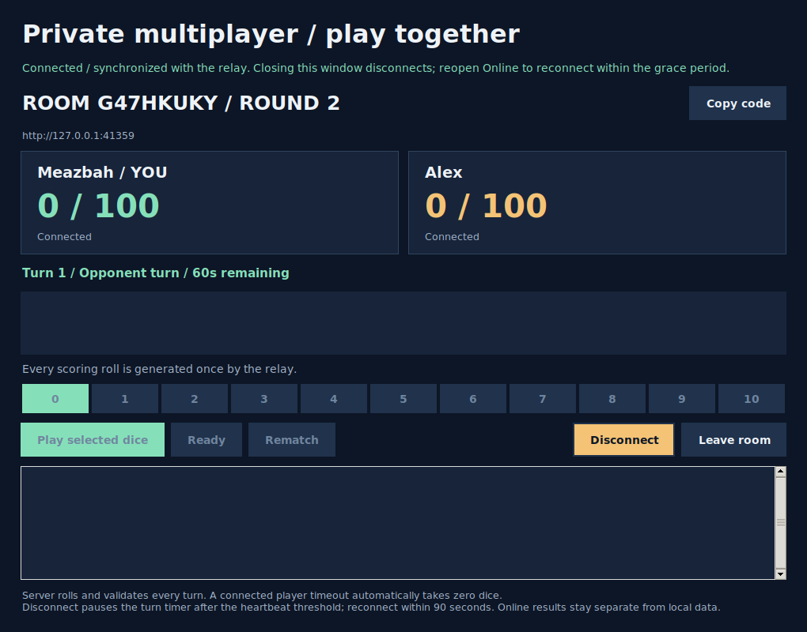

## Disconnect and Reconnect

The desktop normally polls approximately every 600 ms through a dedicated network worker. If a request fails, it retries. Interrupted moves retain their original request identity, so accepting a move and losing its response cannot create a second roll when the client retries.

After eight seconds without an authenticated heartbeat, a player is marked disconnected and the relay pauses the turn timer. The reservation expires 90 seconds after the last successful heartbeat. Reconnecting both players within that period restores the remaining timer; a reservation expiry ends an active round by forfeit, or without a winner when both seats expire.

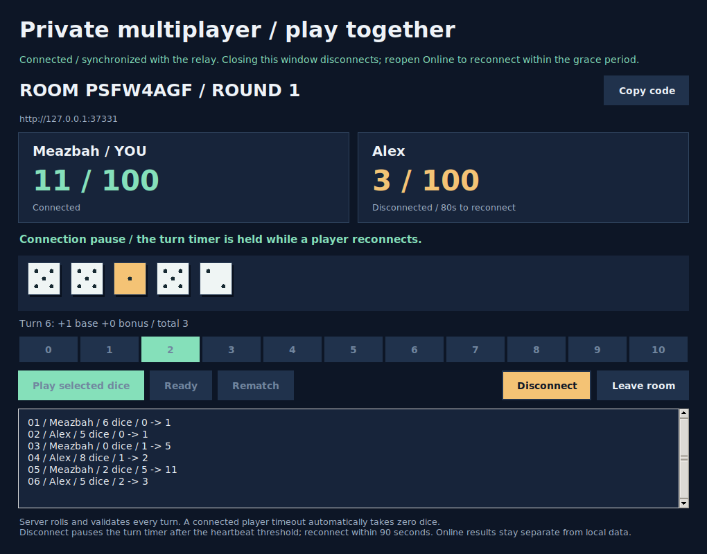

**Disconnect**, closing the room window, or opening another analysis view stops polling while retaining the token in the running app. Reopen **Online** to reconnect. **Leave room** removes the seat immediately and forfeits an active round. App exit loses the token, and relay restart removes all rooms; this release provides no cross-restart online recovery or cloud account.

## Hosting, HTTPS and Scope

For trusted LAN play, start `python hog_server.py --host 0.0.0.0 --port 8765` and enter the host's actual LAN address in the clients. For internet play, provide a host reachable by both players and use HTTPS. The relay supports `--certfile` and `--keyfile`; the client performs normal certificate and hostname validation and accepts an optional trusted CA PEM file. Full commands are in [ONLINE.md](../../ONLINE.md).

Online state is temporary relay memory. It does not alter local profile wins, standard statistics, campaign stars, achievements, replays, coaching history, tournaments or manual saves. Local profile IDs and cosmetic inventories are not transmitted. Online seats use neutral dice styling; local and campaign customization remains unchanged.

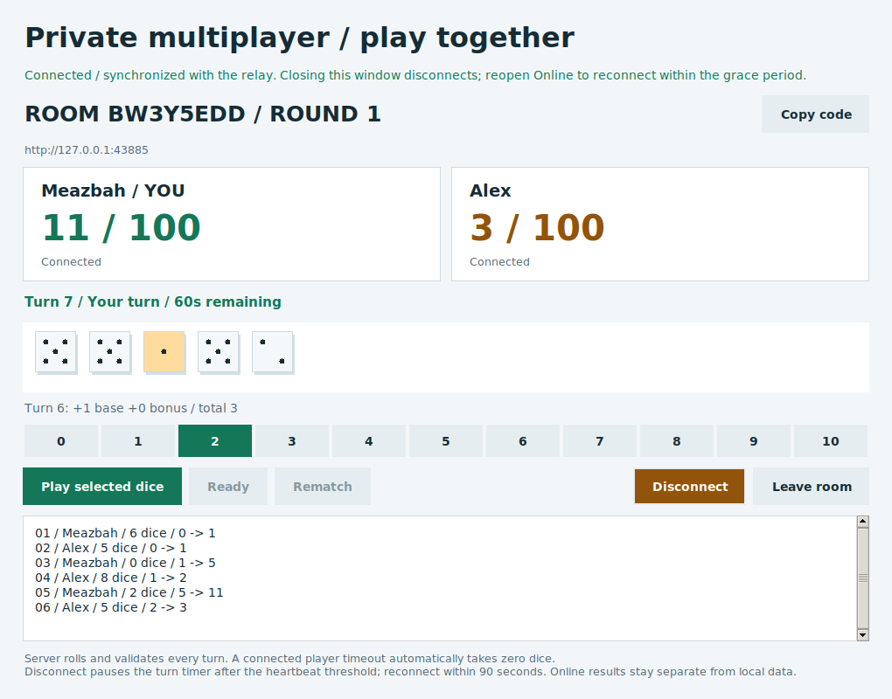

The SQLite schema stays at 2; the previous schema-1 backup/migration path is retained. No runtime dependency beyond Python/Tkinter is added. The native Linux package is a multiplayer-capable client; the relay runs from the Python source. Native Windows/macOS networking and public-internet routing were not tested here.

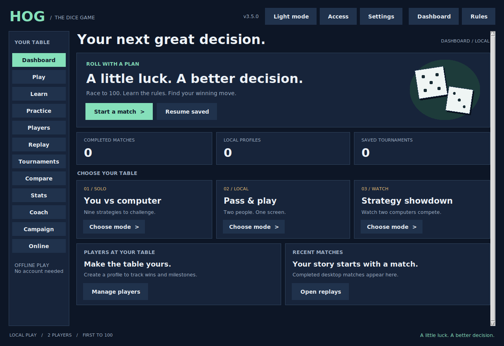

All new screenshots show actual Tk windows using a real temporary loopback relay and independent clients. Demonstration rooms shut down after capture. No credentials, server private keys or personal database are included in the ZIP.

## Retained from v3.4.0

The persistent six-stage campaign, objective stars, named strategy personalities, wardrobe, dice/avatar/theme rewards and milestone progress bars remain available. The following campaign sections and historical screenshots explain those retained features.

## Start Your Campaign

Open **Campaign** in the dashboard navigation. Select an existing local profile, or enter a new name and click **Create profile**. The app remembers the selected campaign profile while it remains open. On the map, click a numbered node or use the stage selector to inspect a table and its objectives. Locked stages can be inspected but cannot be started.

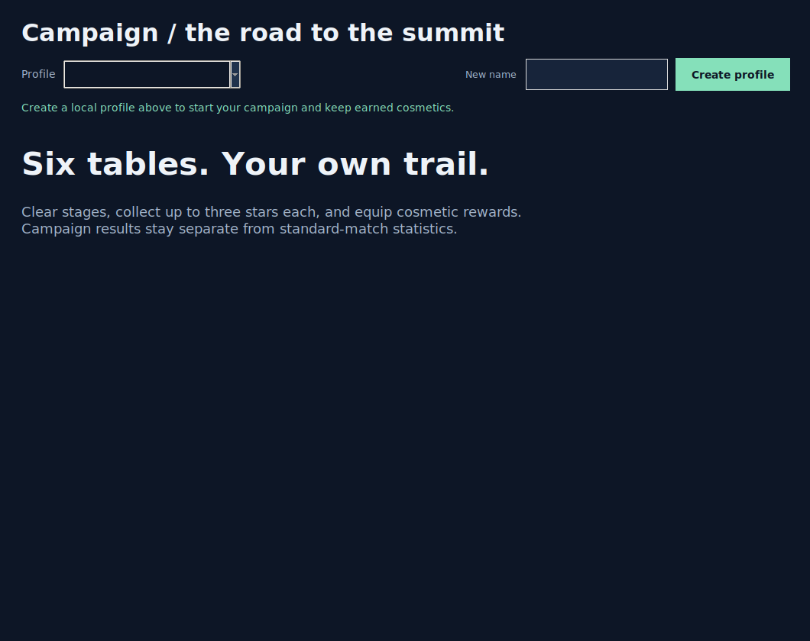

Stage 1 is initially available. Clearing a stage unlocks the next. A stage's **first objective** is the clear condition: completing the match for First Steps, and winning for every later stage. This means a first-stage loss still opens stage 2. Optional objectives award extra stars only when the clear condition is met in that same attempt.

### The Six Tables

Every campaign match uses the original three rules, a 100-point goal, zero starting scores, a human in seat 0 and a computer in seat 1.

| Stage | Opponent / strategy | Clear condition | Optional star objectives |
| --- | --- | --- | --- |
| First Steps | Milo / `always5` | Complete the match | Win; choose zero dice at least once. |
| Free Points Bay | Nora / `boar` | Win | Choose zero dice at least twice; receive at least one Sus Fuss bonus. |
| The Pursuit | Dash / `catch-up` | Win | Gain at least 20 points in one turn; finish with at most two Sow Sad turns. |
| Prime Garden | Iris / `sus` | Win | Receive at least two Sus Fuss bonuses; choose zero dice at least once. |
| The Calculator | Quinn / `medium` | Win | Finish within ten human turns; win by at least 15 points. |
| The Summit | Atlas / `hard` | Win | Finish with at most two Sow Sad turns; gain at least 25 points in one turn. |

Single-turn gains include the Sus Fuss adjustment. Turn-count and Sow Sad objectives count the human player's turns only. Opponent personalities are descriptions of existing algorithms, not newly trained agents or guarantees of steadily increasing empirical difficulty.

Each stage uses its own fixed seed, 3401–3406. Repeating the same choices repeats the same dice sequence; changing choices changes which rolls occur on later turns. All six stages have executable three-star completion certificates in the test fixtures, so optional goals have been verified as achievable.

### Play a Stage

Choose 0–10 dice and click **Play selected dice**. Campaign turns resolve immediately. The computer follows its named strategy after the selected computer pace delay. The table shows scores, the last dice, base points, Sus Fuss bonus, and objective status.

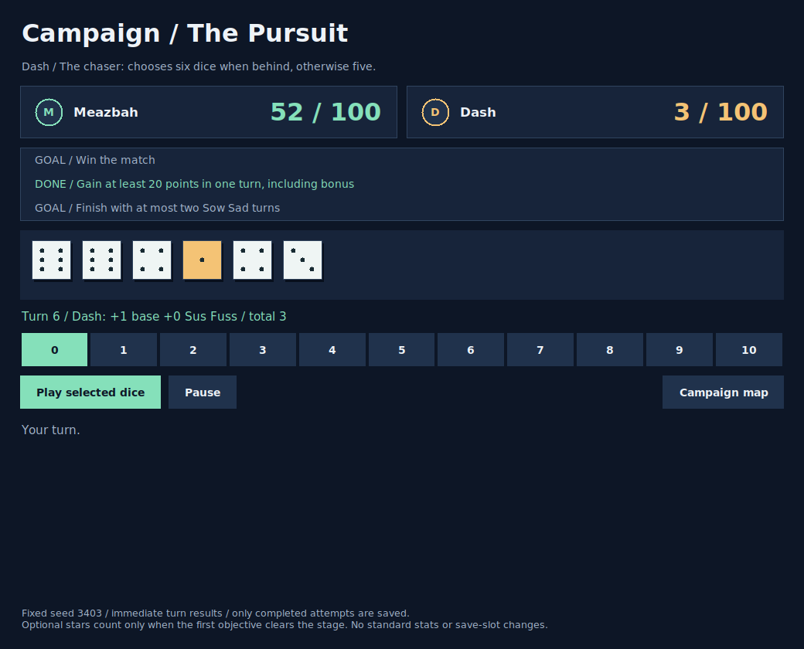

**Pause** freezes a pending computer turn without consuming dice. **Resume** continues it. Returning to the map or closing an unfinished campaign window asks before abandoning the attempt. Campaign runs do not use the standard game's keyboard shortcuts or manual save slot. Only completed attempts are persisted; quitting the application does not autosave an unfinished campaign.

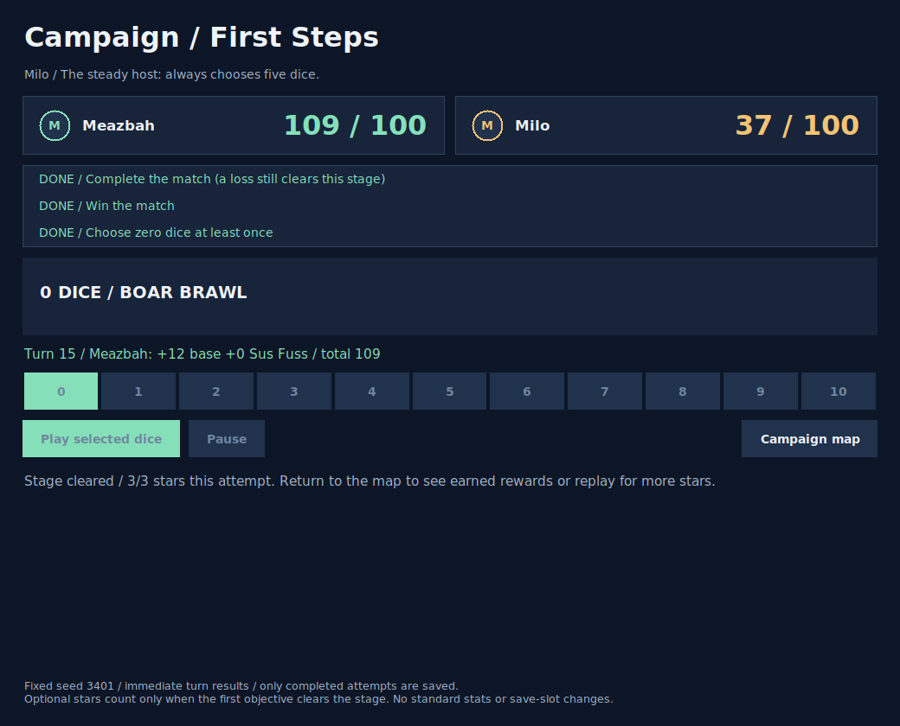

A completed attempt is inserted once using its unique run ID, after validating its turns against the stage seed, scoring rules and opponent strategy. Reopening the map or redrawing the result cannot duplicate rewards. A replay adds an attempt but never reduces best stars. Stars are the **maximum earned in one attempt per stage**, then summed across stages; you cannot combine two separate two-star runs into a three-star result.

## Equip Earned Cosmetics

Open the **Wardrobe** tab for your campaign profile. You may preview any item. Locked rewards show their required star total and have a disabled Equip button. Earned items can be equipped independently.

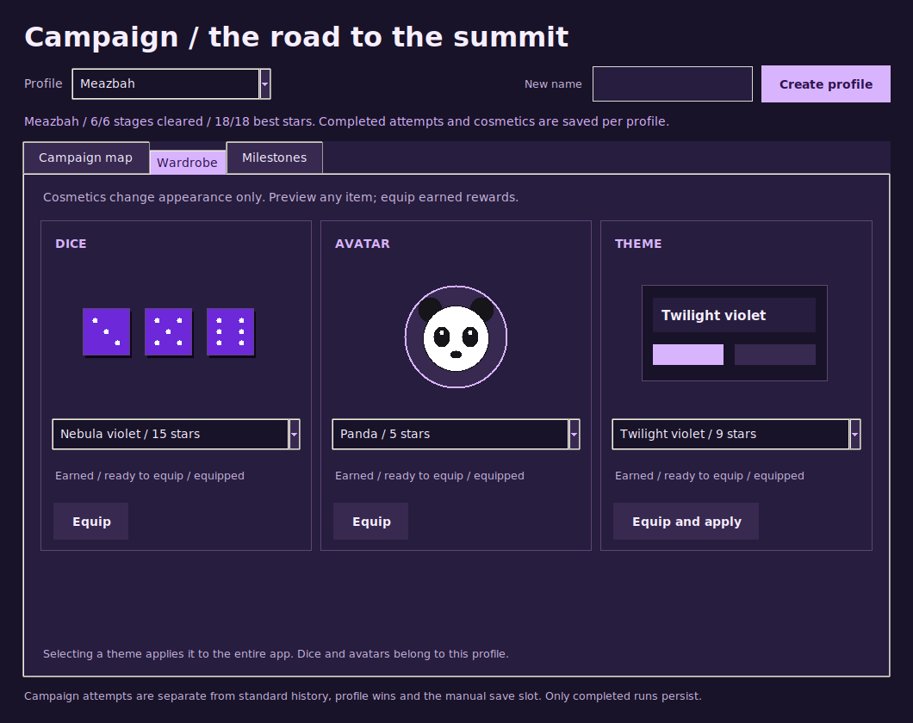

| Item | Required total best stars |
| --- | --- |
| Classic ivory dice, initials avatar, dark/light/high-contrast themes | Available from the start. |
| Aurora teal theme | 2 |
| Cobalt blue dice | 3 |
| Panda avatar | 5 |
| Ruby red dice | 6 |
| Twilight violet theme | 9 |
| Crown avatar | 12 |
| Nebula violet dice | 15 |

Dice skins and avatars belong to the profile. They appear on that profile's dashboard cards, standard match score cards and campaign table. Standard and campaign dice use the active player's skin; standard replay dice use the profile's currently equipped skin, not a historical appearance snapshot. Guest and computer seats retain the default style. Avatars are built-in vector presets, not uploaded pictures.

**Equip and apply** saves the profile's chosen theme and applies it globally across the current app. The active palette is also saved in normal appearance preferences and returns on the next launch. Selecting another profile does not automatically change the global palette; apply its theme explicitly in Wardrobe. Settings continues to offer the base themes and the currently applied reward theme; other reward palettes are chosen through Wardrobe.

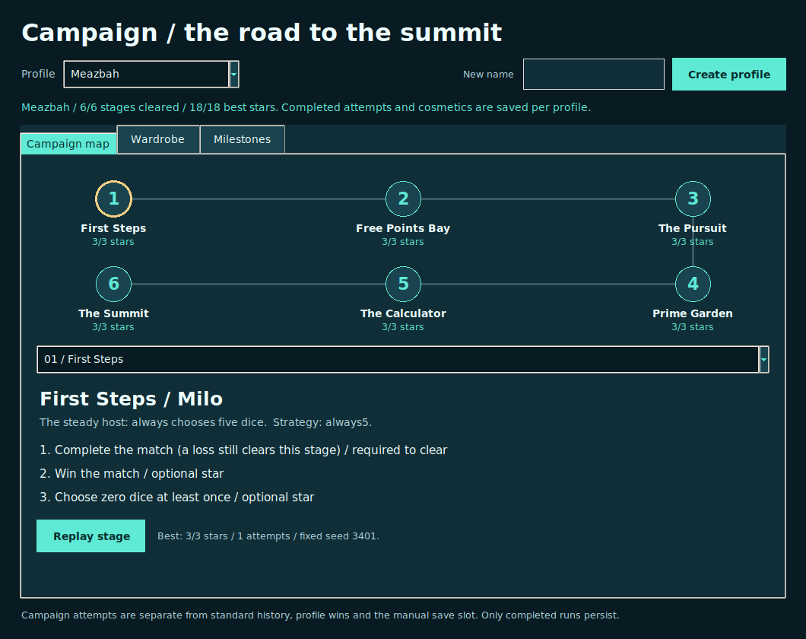

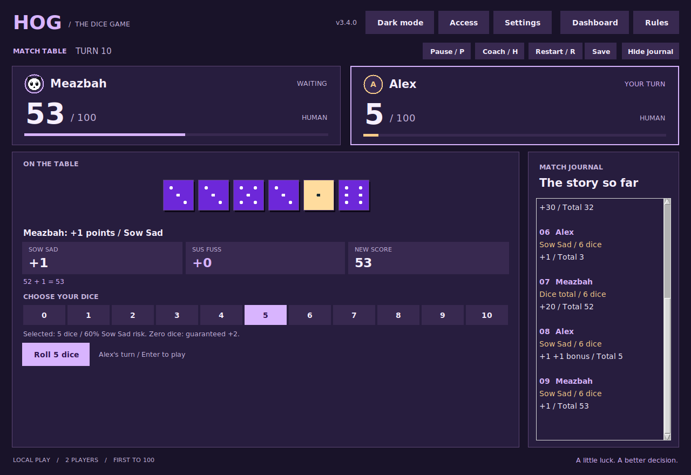

Cosmetics do not change scoring, dice probabilities, strategies, profile win records or saved RNG state. Appearance previews draw vector shapes and perform no scoring roll. Customization needs no downloaded assets or additional runtime package. This is a local progression system, not a competitive anti-cheat service.

## Track Campaign Milestones

The **Milestones** tab displays persistent per-profile progress bars:

| Milestone | Target |
| --- | --- |
| First landing | Clear one stage. |
| Rising contender | Clear three stages. |
| Campaign champion | Clear all six stages. |
| Star collector | Earn nine total best stars. |
| Perfect trail | Earn all eighteen best stars. |

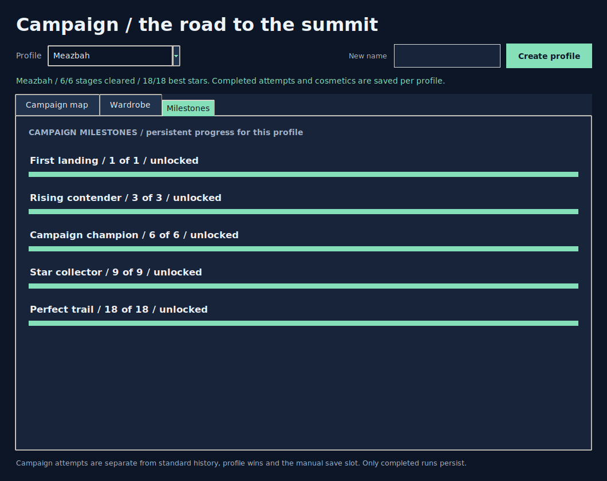

These campaign milestones are separate from the six existing standard-match profile achievements. The v3.3.0 position puzzles retain their session-only learning progress; campaign progression is the new persistent system.

## Data Upgrade and Compatibility

The first normal launch against a schema-1 database creates **`hog.sqlite3.v1-backup`** beside the existing database, unless that backup already exists. It uses SQLite's backup operation and installs the backup before migration. If backup creation fails, the upgrade does not proceed. New campaign tables and schema version 2 are installed in a transaction; failures roll back and are reported through the existing temporary-storage fallback notice.

The existing database, settings paths, profiles, standard history, tournaments and manual save format remain supported. The SQL database version becomes **2**; the standard saved-match JSON format remains **1**. Earlier Hog releases cannot open schema 2. Keep the pre-upgrade backup if you intend to return to an older version, and close the app before copying or restoring database files. An existing backup is not overwritten.

Campaign data lives in `campaign_runs` and `profile_cosmetics`. Campaign attempts do **not** enter standard match history, the local wins leaderboard, standard CSV exports, or standard statistics/replay/decision-review selectors. Those selectors continue to cover standard desktop matches. Completing campaign stages never replaces or clears the standard manual save slot. Campaign progression stays local and is not synchronized with the multiplayer relay.

The main standard-text minimum remains 960 × 720; analysis and campaign windows support 900 × 720 with larger text sometimes needing more space. The dashboard keeps two compact navigation rows. No required runtime dependency is added.


Screenshots show actual Tk windows and real seeded completions in temporary in-memory profiles. No example database, personal results or unlocked equipment are shipped as user data.

## Retained from v3.3.0

The expanded live coach, pre-roll decision reviews, eight model-based puzzles, numeric explanations, tie-aware answers and session-only puzzle progress remain available. Standard-rule coaching still assumes optimal continuation by both players and cannot predict dice luck.

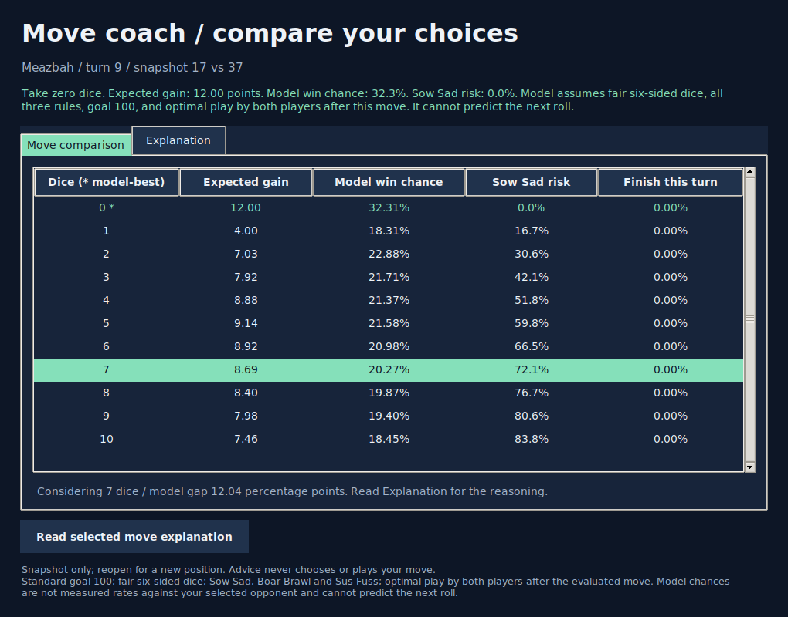

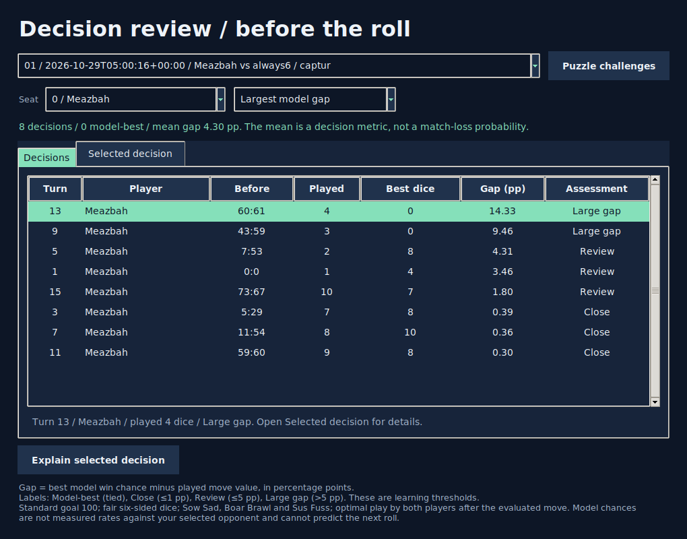

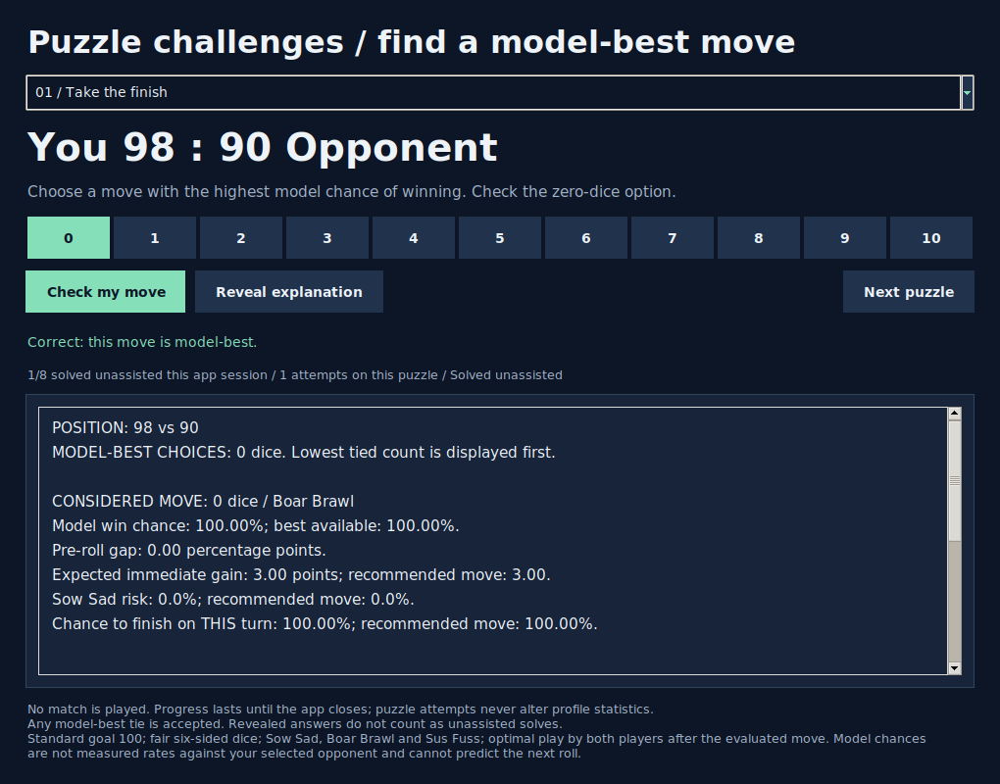

## Retained from v3.2.0

Profile statistics, observed opponent results, personal records, dice-choice charts, interactive score replays, timeline scrubbing, key turns, adjustable playback speeds, and read-only history validation remain included. Historical screenshots below show those features at introduction.

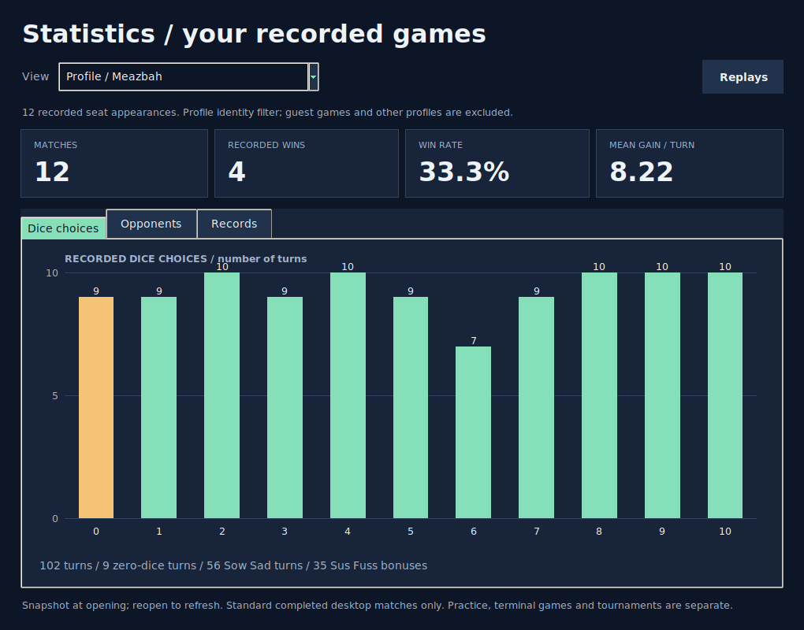

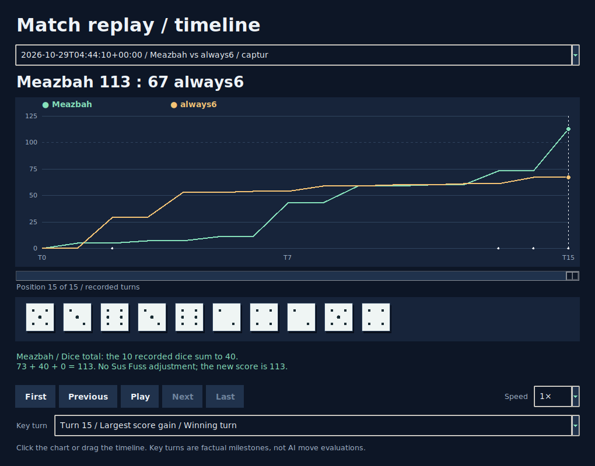

## Retained from v3.1.0

The adaptive dashboard, real activity totals, player cards, name-initial avatars, match scoring breakdown, dice-risk previews, collapsible journal, and motion-aware turn pulse remain available. The new Stats action joins the navigation rail and compact horizontal strip.

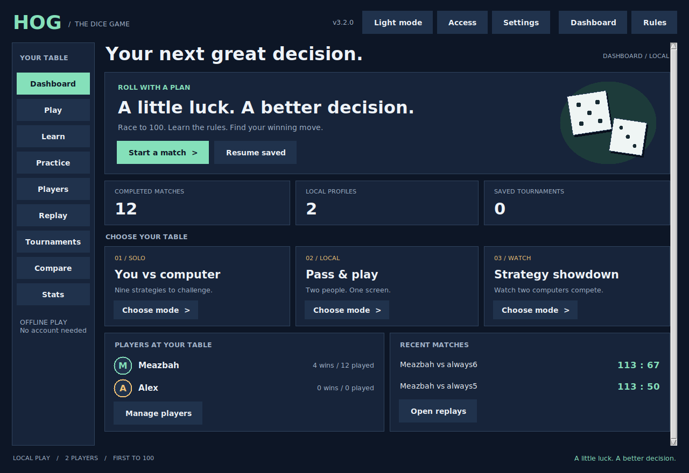

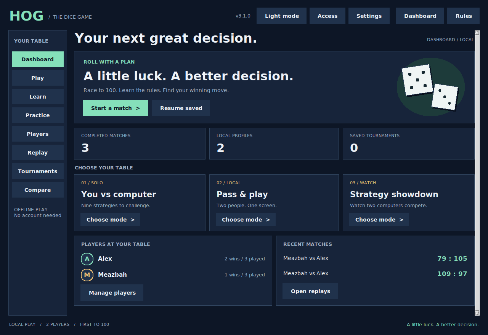

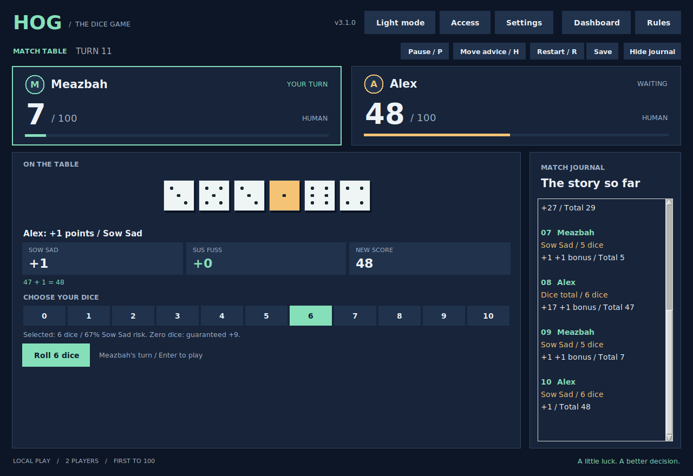

## Retained from v3.0.0

v3.0.0 completed the original six-upgrade plan. Its tutorial, replay viewer, configurable practice, accessibility settings, and native packaging are retained here. Historical screenshots below illustrate when each feature was introduced.

### Interactive Tutorial

From Home, click **Tutorial**. Choose answers to four questions. Incorrect answers receive feedback; the next lesson unlocks after the correct answer. Answers come from the same scoring functions used by the game. Tutorial exercises do not alter profiles or history.

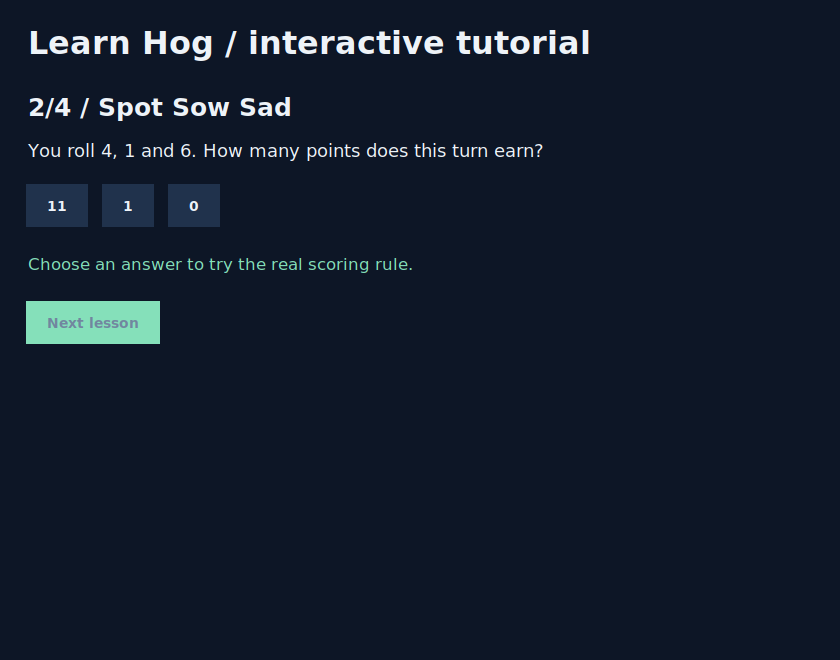

### Read-Only Match Replays

Open **Player hub > Replay viewer**, then select one of the latest 100 completed desktop matches. Use **First**, **Previous**, **Play / pause**, **Next**, and **Last** to inspect the match. Every displayed score pair is reconstructed and validated from recorded outcomes, rather than generated from new rolls. Turn points, bonus points, dice choices, and final totals remain visible.

Replay viewing never adds history entries or changes statistics. Earlier v2.2.0 completed desktop records are supported; this viewer is for standard 100-point matches, not practice sessions.

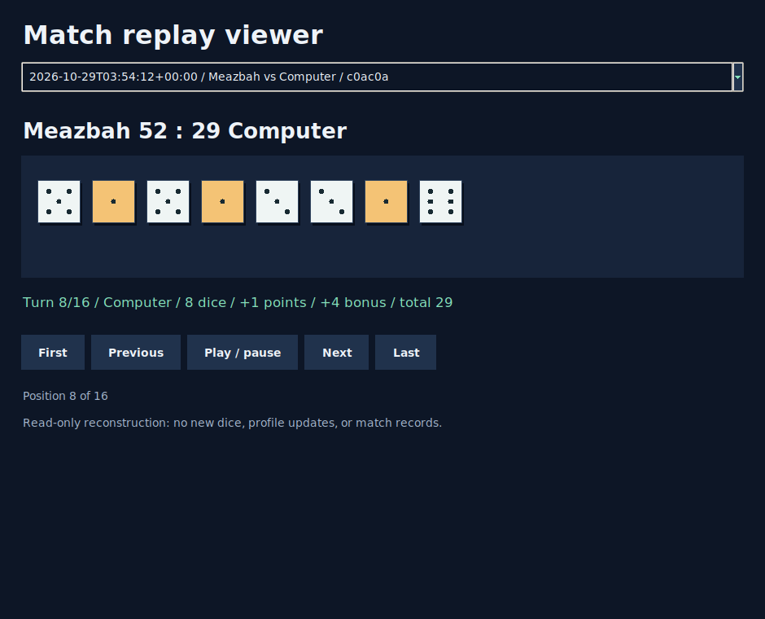

### Configurable Practice Table

From Home, click **Practice**. Choose a goal from 20 to 200, starting scores below that goal, an optional integer seed, and an opponent: `always5`, `always6`, or `catch-up`. Toggle Sus Fuss on/off, then start practice. Sow Sad and Boar Brawl always apply. Human and computer turns use immediate results so you can focus on the rule effects.

Practice is temporary and deliberately isolated: no saved match, profile ranking, achievements, history entry, or optimal-policy advice. The Hard policy assumes standard rules and goal 100, so it is not offered for custom practice.

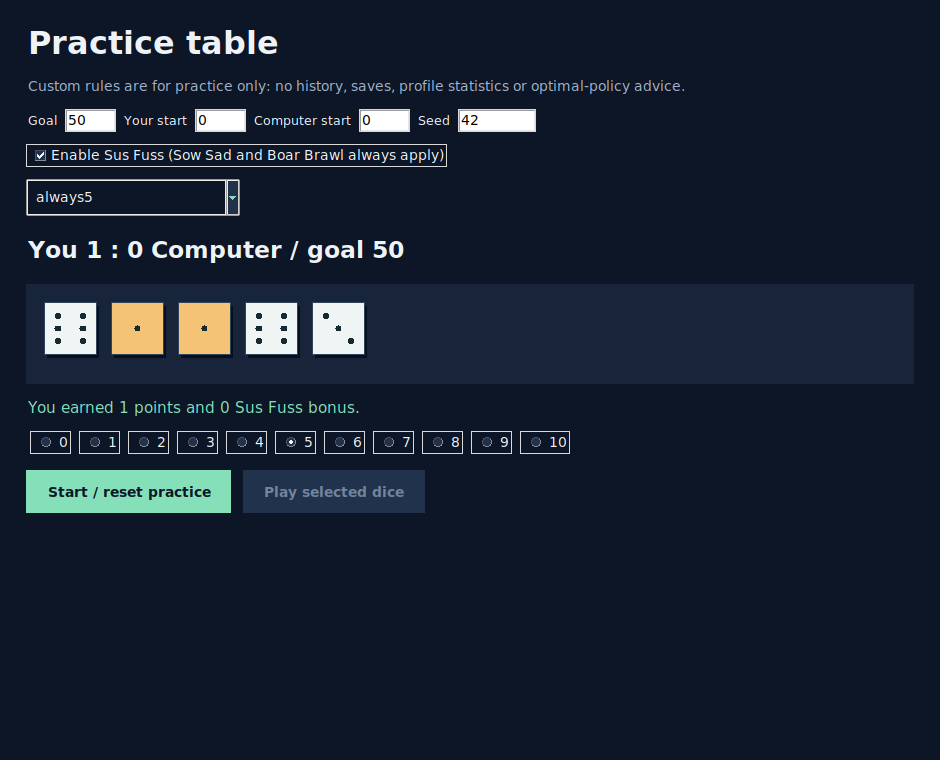

### Accessibility Controls

Click **Access** in the header. Enable larger label/control text, reduced motion, high contrast, or mute. These settings persist with existing preferences and preserve the current match. High contrast is also available in the Settings theme selector. Larger text may need a wider window; canvas diagrams retain their own readable labels.

Buttons retain keyboard focus indicators. Standard gameplay shortcuts remain listed below. This release does not claim complete screen-reader certification.

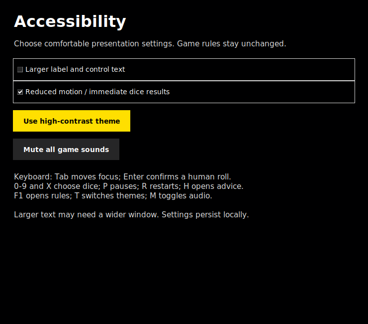

### Run Without a Separate Python Installation on Linux

A tested one-folder Linux x86_64 build is included. Keep the entire `Hog` folder together:

```bash
chmod +x native/linux-x86_64/Hog/Hog
./native/linux-x86_64/Hog/Hog
```

It was built and checked on Linux with glibc 2.39, Python 3.12.3, and Tk 8.6. It requires a graphical desktop and system graphics libraries. Compatibility with older glibc versions is not claimed.

For Windows, use the Python source command below, or run **`build-windows.bat` on Windows** to produce `dist/Hog/Hog.exe`. A Windows executable is not included, and Windows execution has not been tested here. Native executables must be built on their target operating system.

Optional build commands:

```bash
python -m pip install -r requirements-build.txt
python tools/build_desktop.py
```

The included native build used PyInstaller 6.22.3. This dependency is only for packaging, not source play. See [native/README.md](../../native/README.md) and [INSTALL.md](../../INSTALL.md).

Installation smoke check, with temporary in-memory data:

```bash
python hog_desktop.py --smoke-test
./native/linux-x86_64/Hog/Hog --smoke-test
```

## Retained from v2.2.0

- Local profiles with case-insensitive unique names; no online account or password.
- Attach a profile to each human seat in Match setup, or play as a guest.
- Persistent matches played, wins, losses, best score, zero-dice turns, and prime bonuses.
- Six achievement milestones derived from completed profile matches.
- Desktop match history, a local profile leaderboard, and history CSV export.
- One manual save slot, retaining configuration, completed turns, profile identities, and exact future dice state.
- Resuming opens the match paused; press P to continue. Unfinished animations return to the last completed-turn boundary.
- Seeded computer round robins with equal starting seats, standings charts, persistent tournament results, and match-level CSV export.
- SQLite transactions and unique match IDs prevent replaying a result screen from double-counting wins.

### Create and Use Profiles

Open **Player hub** from Home, enter a name, and select **Create profile**. In Match setup, choose that profile for a human seat. Selecting it fills the display name; you may still customize the displayed name without changing the profile identity. A profile cannot occupy both seats, and computers cannot use human profiles.

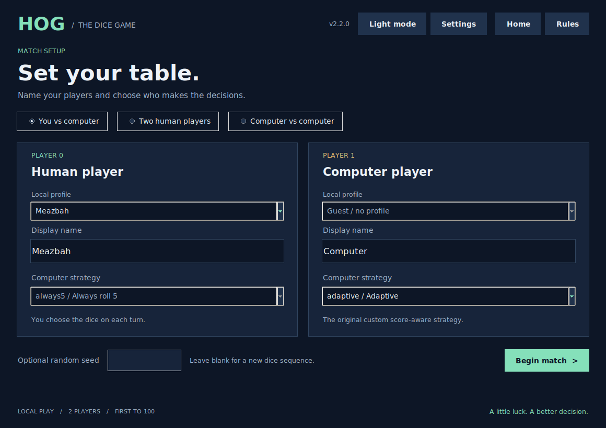

Guest desktop matches enter history but do not create profile statistics. The original terminal game is deliberately separate and does not write to the desktop database. Computer tournaments also keep separate standings rather than changing human statistics.

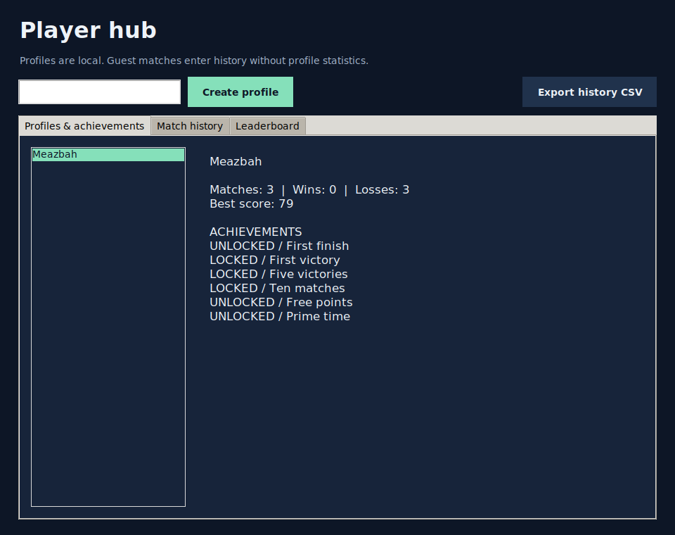

| Achievement | Unlock condition |
| --- | --- |
| First finish | Complete one profile match. |
| First victory | Win one profile match. |
| Five victories | Win five profile matches. |
| Ten matches | Complete ten profile matches. |
| Free points | Complete a match containing at least one zero-dice turn for that profile. |
| Prime time | Complete a match containing at least one Sus Fuss bonus for that profile. |

The leaderboard sorts profiles by wins, then matches played, then name. It is a local activity ranking, not an online rating or an Elo estimate.

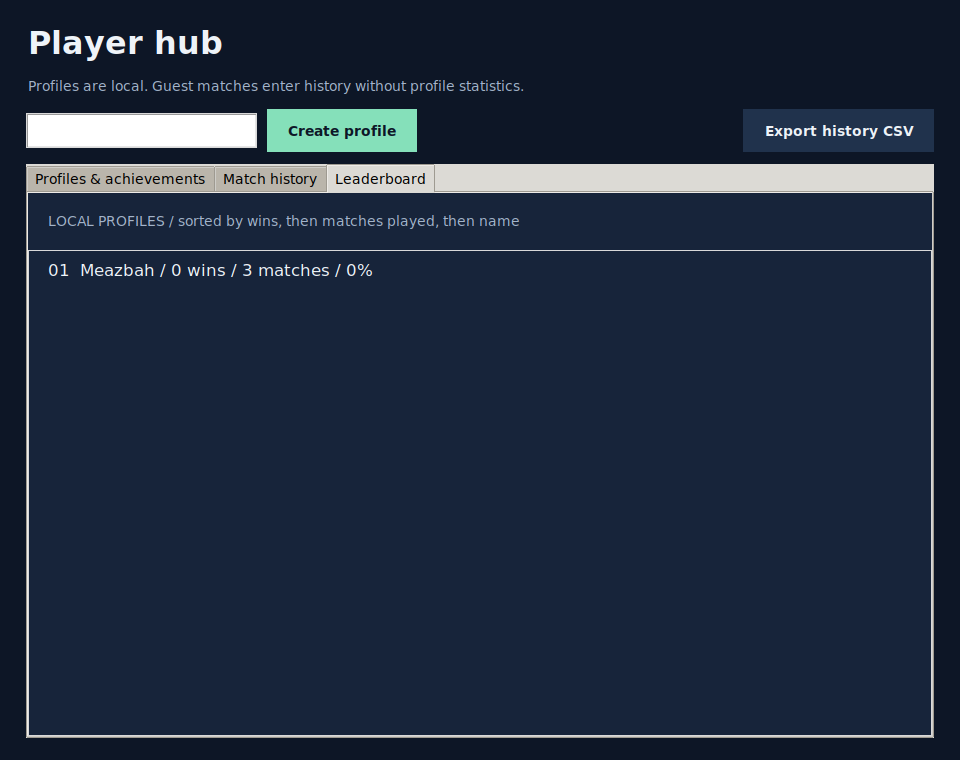

### Match History and CSV

The Player hub's **Match history** tab shows the latest 100 completed desktop matches. The CSV export includes all stored matches, one row per player, with UTC finish time, match ID, seat, name, score, win flag, turns, and scoring-rule counts. Spreadsheet formula prefixes in display names are escaped on export.

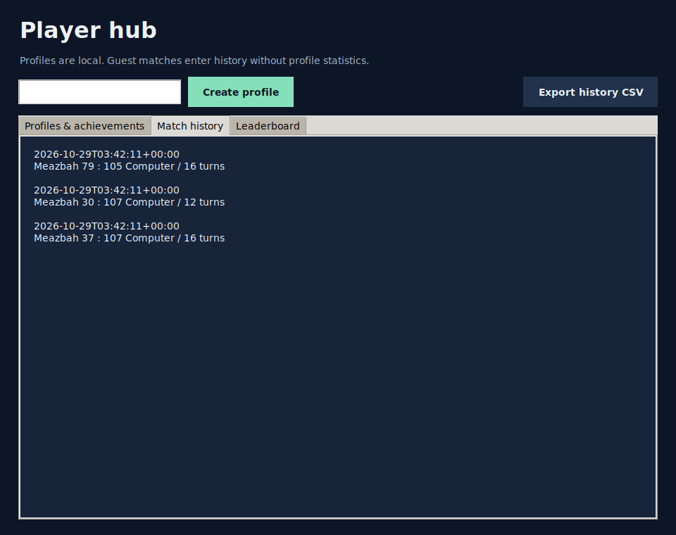

### Save and Resume

Click **Save** during an unfinished desktop match. The match pauses and the latest save slot is replaced. Saving is manual; closing an unsaved game does not automatically save it. From Home, click **Resume saved**. The match reopens paused with the same scores, journal, player to move, identities, and future dice sequence, even when the original game had no seed.

If saved during a roll preview, only completed turns are stored. No scoring dice were consumed by that preview, so resuming at the turn boundary preserves the future result. Finishing that match clears its own save slot; finishing a different match does not clear another saved match.

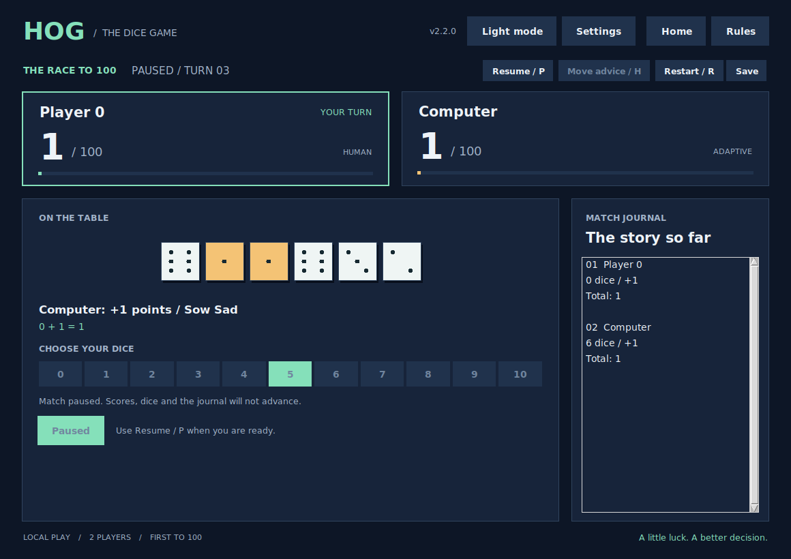

A desktop replay starts a new match ID and, if set, restarts its seed. Resume keeps the old match ID and generator state. Completed matches are deduplicated by ID before statistics are updated.

### Computer Tournaments

Open **Tournaments** from Home. Select 2-9 distinct strategies, 1-200 games per starting seat, and an integer seed. Each pair plays the same number of games in both seat orders. A five-strategy tournament with 10 games per seat runs 200 matches, with 80 appearances per strategy.

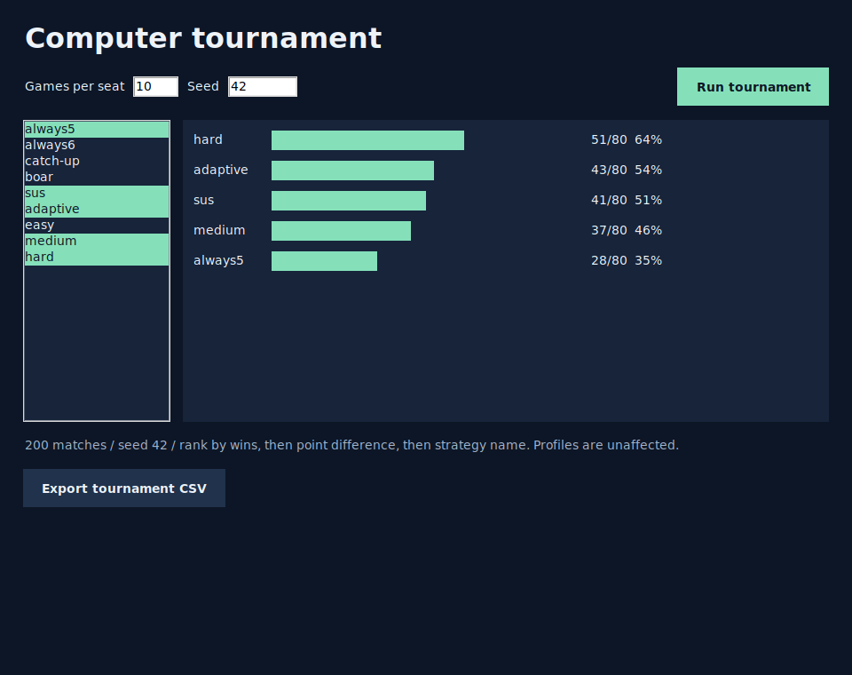

Standings sort by wins, then total point difference, then strategy name. Bars show observed win rates over the selected opponents. These sampled results do not guarantee future performance. The tournament runs in a worker; keep its window open until results appear to save that run. The dropdown reopens previously saved tournament results. **Export tournament CSV** writes one row per game, with player strategies, scores, and winner.

### Local Data and Backups

The normal desktop launcher stores `hog.sqlite3` beside `settings.json` in the platform's Hog configuration directory listed below. The database holds profiles, completed desktop matches, one save slot, tournament results, campaign attempts, and profile cosmetics. There is no cloud synchronization or telemetry. Close the app before copying this database for backup or transfer. A clean release ZIP contains no personal database or demo profiles.

If the database cannot be opened, the app shows a notice in Player hub and uses temporary in-memory storage for that session; existing data is not replaced. Save and history failures are reported without changing game rules. Profiles currently cannot be renamed or deleted through the interface.

## Retained from v2.1.0

- **Easy:** a fixed five-dice opponent for practice.
- **Medium:** maximizes exact expected score gain, including Sus Fuss; takes a guaranteed zero-dice win.
- **Hard:** chooses the move with the best model probability of winning the complete match against an optimal opponent.
- **Move advisor:** click **Move advice / H** during a human turn. See every legal move, expected gain, Sow Sad risk, and model win chance. Advice never plays your move.
- **Strategy comparison:** open from Home, choose a baseline and games per starting seat, then run real matches in a background worker. Bars show measured win rates; gold lines show approximate 95% Wilson intervals.
- Policy preparation and comparisons run outside Tk callbacks. The worker never touches widgets.
- Original six strategies remain; all nine are selectable in desktop and terminal modes.

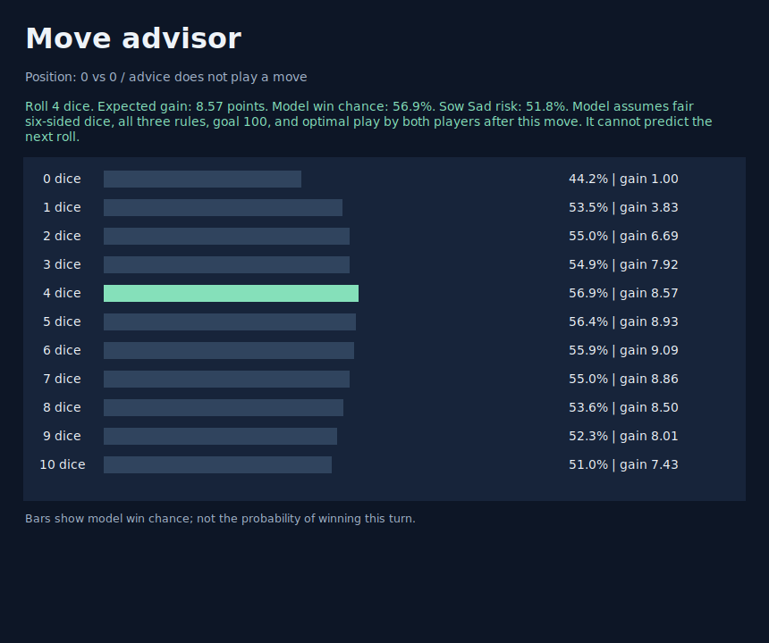

The advisor displays a snapshot of the position shown at the top. It is requested explicitly, rather than shown automatically during ordinary play. If you continue playing with the window open, request fresh advice for the new position.

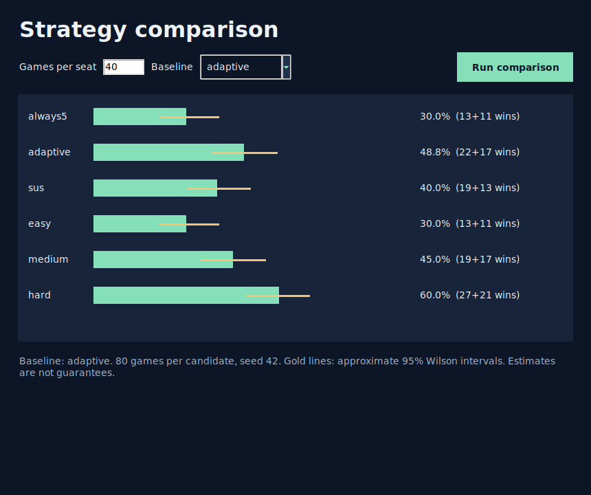

### How the Hard Opponent Works

This edition uses exact finite-state probability calculations rather than noisy Monte Carlo move estimates. For each roll count, the program counts every possible non-one sum and includes the probability of Sow Sad. Zero dice is deterministic. Sus Fuss is applied to every possible resulting score.

The policy solves 10,000 active score pairs in descending total-score order. Every turn increases a score, so the dependency graph is acyclic. It selects the action maximizing `sum(P(outcome) * (1 - opponent_value(next_state)))`, treating a winning turn as value 1. Near ties favor fewer dice.

**Assumptions:** fair six-sided dice, the three original rules, goal 100, and optimal play by both players after the considered move. The displayed model chance is not a prediction of the next roll or a measured win rate against the selected opponent. No trained model, API, GPU, or network connection is involved.

Medium optimizes immediate points; Hard optimizes winning the match. Difficulty labels are not a guarantee of monotonically increasing empirical win rates against every heuristic.

### Measured Benchmark

An included run used 100 games per starting seat, seed 42, and the original adaptive strategy as baseline. Hard won **112/200 (56.0%)**, with an approximate 95% Wilson interval of **49.1%-62.7%**. Medium won 95/200 (47.5%). These are sampled results with overlapping uncertainty, not proof of superiority in every matchup. Full counts and intervals are in [benchmark.json](../benchmark.json).

The comparison screen evaluates six named candidates, including Easy and its identical five-dice baseline, against any of the nine strategies. It resets the same seed for each candidate, so runs are reproducible. `--games` in the terminal experiment lab still evaluates all nine available strategies.

## Start

Extract the ZIP, open the project folder, and run:

```bash
python hog_desktop.py
```

Python 3.10+, Tkinter, and a graphical desktop are required. No third-party Python packages are required to play. On Windows, `py -3 hog_desktop.py` also works. On Linux, Tk support may require `python3-tk`. Check with `python -m tkinter`.

## Retained from v2.0.0

- Dice roll previews rotate and bounce before the actual result is resolved once.
- Animation uses independent randomness and never alters seeded scoring outcomes.
- Switch between dark and light themes without resetting a match or setup fields.
- Pause freezes computer turns and an in-progress animation; resume continues it.
- Restart confirms before resetting scores and cancels pending callbacks.
- Settings automatically pause a running match, then restore its previous state.
- Reduced-motion mode resolves turns immediately.
- Optional original WAV effects for rolling, Sow Sad, bonuses, and wins.
- Relaxed, normal, and fast computer pacing.
- Display preferences are saved atomically outside the source folder.

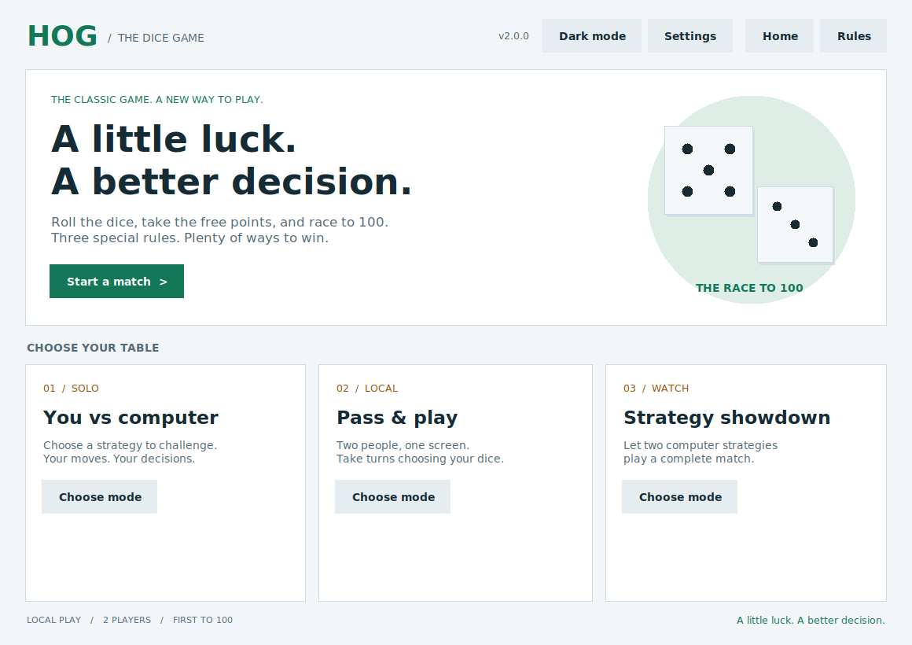

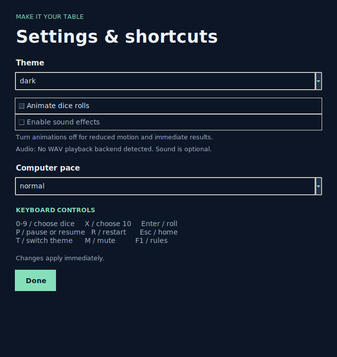

## Controls

| Key | Action |
| --- | --- |
| 0–9 | Choose dice count |
| X | Choose 10 dice |
| Enter | Confirm a human move |
| P | Pause / resume |
| R | Restart match |
| T | Switch theme |
| M | Toggle optional sound |
| F1 | Rules |
| H | Request move advice during a human turn |
| Esc | Home, confirming before leaving a match |

Shortcuts do not interfere with typing in name/seed fields. Mouse controls remain available. Human inputs are locked during rolling and computer turns.

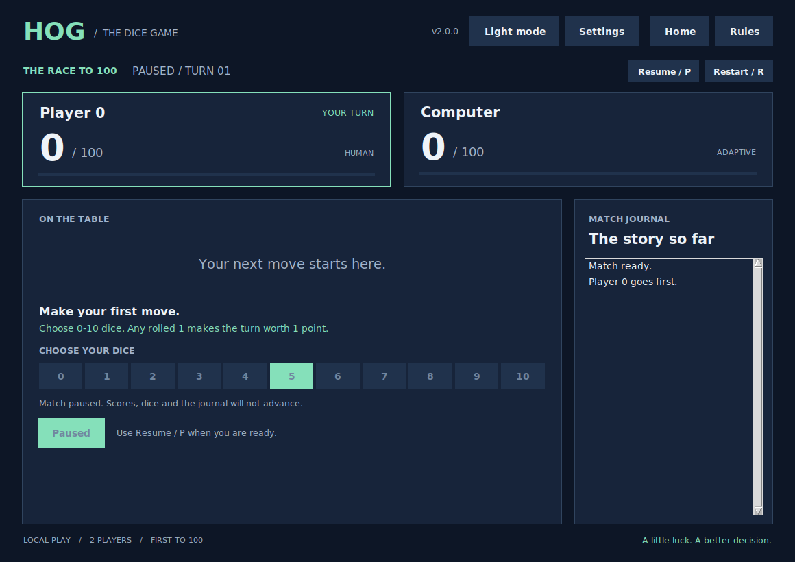

## Sound and Preferences

Sound defaults to off. Windows uses built-in `winsound`; macOS uses `afplay`; Linux uses an available `paplay` or `aplay`. If no backend exists, the sound control is disabled and the game remains playable. An available player still needs a working audio device. Playback failures do not interrupt a match.

Preferences contain only theme, animation, sound, and computer pace. Locations:

- Windows: `%APPDATA%/Hog/settings.json`
- macOS: `~/Library/Application Support/Hog/settings.json`
- Linux: `${XDG_CONFIG_HOME:-~/.config}/Hog/settings.json`

Malformed settings fall back to defaults. If saving fails, changes still apply for the current session. Profiles, history, saves, and tournament results use the separate SQLite database described above.

Launch overrides:

```bash
python hog_desktop.py --theme light --no-animation --mute
```

## Rules and Modes

Choose human vs computer, two humans, or computer vs computer. Player 0 starts; first to finish a turn with at least 100 points wins.

- **Sow Sad:** any rolled 1 makes the turn worth 1 point; otherwise sum the dice.
- **Boar Brawl:** zero dice earns `max(1, 3 * abs(opponent_tens - player_ones))`.
- **Sus Fuss:** totals with exactly 3 or 4 positive factors rise to the next prime, including after zero-dice turns.

The original six strategies remain: `always5`, `always6`, `catch-up`, `boar`, `sus`, and the original `adaptive` heuristic. The winner screen offers replay, new setup, and final-table review. A fixed seed restarts on desktop replay.

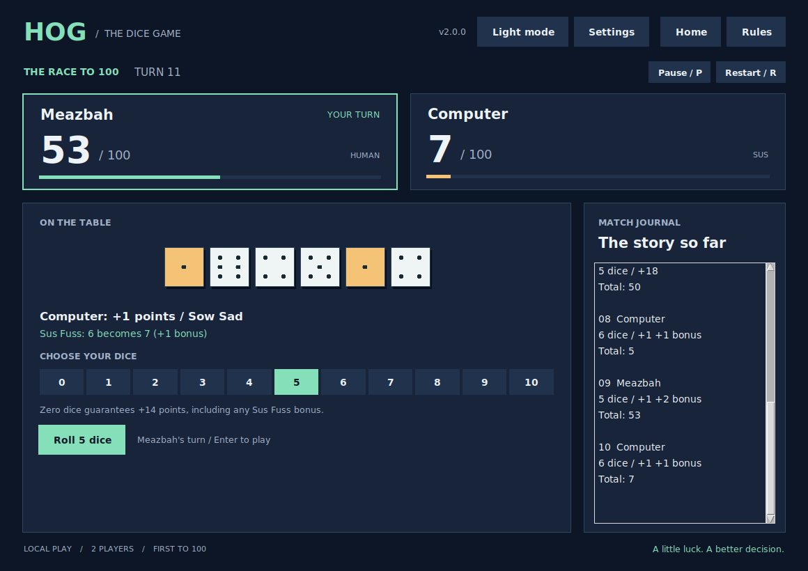

## Terminal and Experiments

```bash
python hog_ui.py
python hog.py -r --games 100 --samples 500 --seed 42
```

The experiment game count is per starting seat per strategy. Results are sampled estimates; both seats and approximate pooled Wilson intervals are reported.

## Previous Releases

| Version | Main changes |
| --- | --- |
| v1.0.0 | Original coursework simulator, rules, text interface, and adaptive strategy. |
| v1.1.0 | Terminal menus, names, opponent selection, replay, working experiments, seeds, and 39 checks. |
| v1.2.0 | First graphical desktop interface, journal, winner screen, incremental engine, and 55 checks. |
| v2.0.0 | Animation, themes, optional sound, pause/restart, shortcuts, settings persistence, and 82 checks. |
| v2.1.0 | Easy/Medium/Hard opponents, exact win-probability policy, optional advice, visual comparisons, and 94 checks. |
| v2.2.0 | Profiles, statistics, six achievements, history, exact save/resume, local leaderboard, tournaments, CSV export, and 110 checks. |
| v3.0.0 | Interactive tutorial, replay navigation, practice settings, accessibility, native Linux build, packaging scripts, and 122 checks. |
| v3.1.0 | Dashboard navigation, activity/player cards, initial avatars, adaptive layout, scoring breakdown, risk previews, collapsible journal, turn pulse, and 135 checks. |
| v3.2.0 | Profile statistics, opponent results, dice-choice charts, records, interactive score timelines, replay speeds, factual turn explanations, and 156 checks. |
| v3.3.0 | Expanded move coach, pre-roll decision review, eight model-based puzzles, session learning progress, navigation fixes, and 177 checks. |
| v3.4.0 | Six-stage persistent campaign, objective stars, opponent personalities, wardrobe, dice/avatar/theme rewards, milestone bars, schema-2 migration/backup, and 207 checks. |
| **v3.5.0** | Private rooms, relay-owned scoring, ready lobby, timers, retries/reconnection, alternating rematches, HTTPS, cleanup regression fix, and 236 checks. |

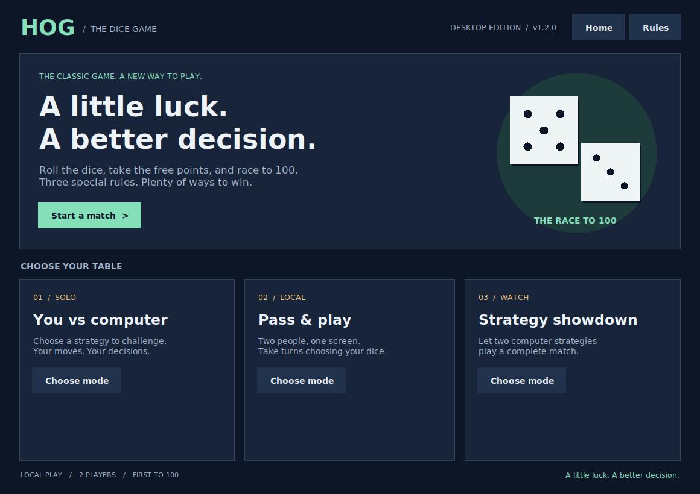

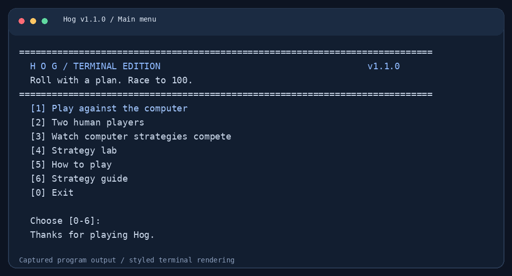

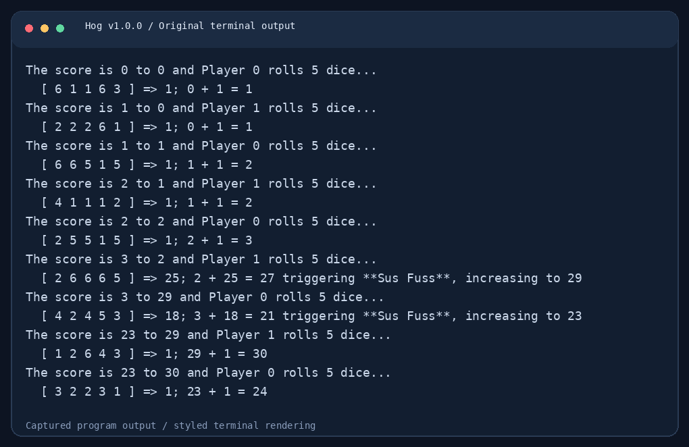

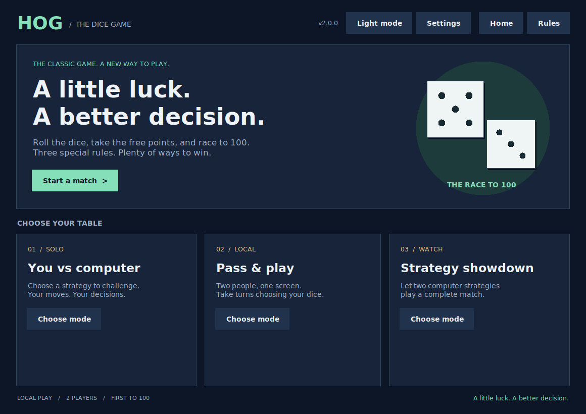

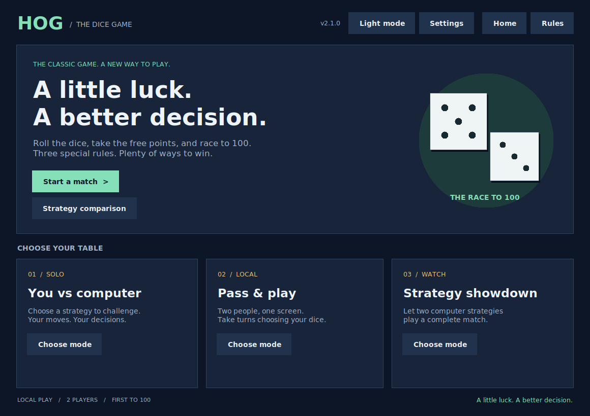

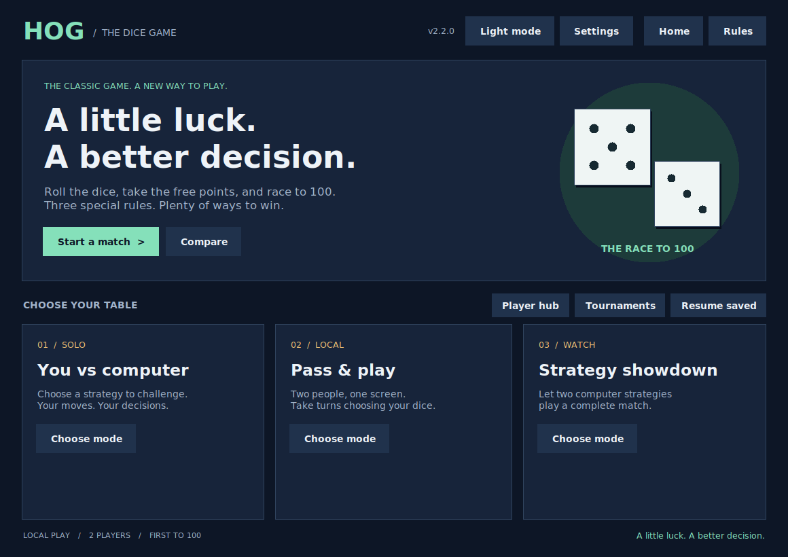

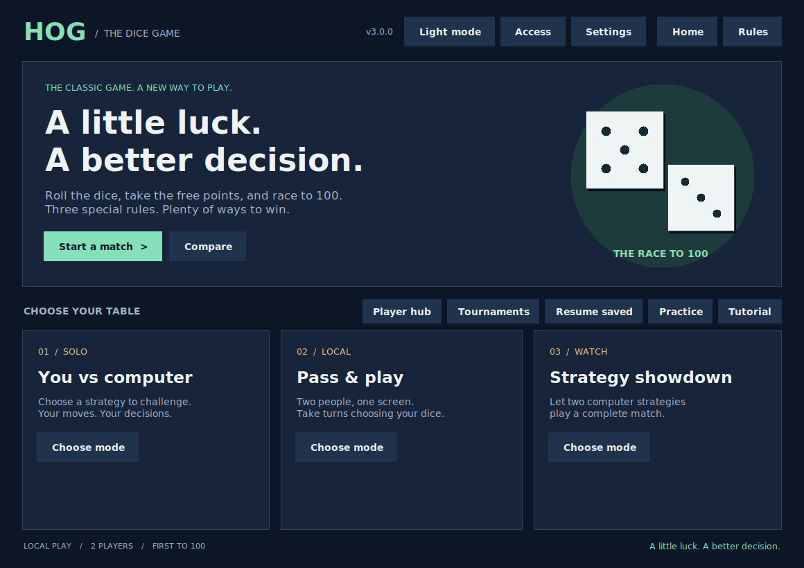

Full earlier documentation: [v3.4.0](v3.4.0.md), [v3.3.0](v3.3.0.md), [v3.2.0](v3.2.0.md), [v3.1.0](v3.1.0.md), [v3.0.0](v3.0.0.md), [v2.2.0](v2.2.0.md), [v2.1.0](v2.1.0.md), [v2.0.0](v2.0.0.md), [v1.2.0](v1.2.0.md), [v1.1.0](v1.1.0.md). See [CHANGELOG.md](../../CHANGELOG.md) for cumulative changes. Archived README files describe their historical releases.

## Architecture and Files

| Module | Responsibility |
| --- | --- |
| `hog.py` | Rules, strategy registry, incremental sessions, full-match simulator |
| `hog_ai.py` | Exact roll distributions, greedy and optimal policies, move advice, measured comparisons |
| `hog_match.py` | Validated match setup and human profile assignments |
| `hog_online.py` | Authoritative room lifecycle, server scoring, turn/seat validation and reconnect timing |
| `hog_server.py` | Bounded HTTP(S) relay, JSON requests, TLS and in-memory rooms |
| `hog_online_client.py` | Validated HTTP(S) calls, certificate checks and in-memory seat credentials |
| `hog_online_ui.py` | Lobby/table UI, network worker, retry scheduling and presence |
| `ONLINE.md` | Local, LAN and HTTPS hosting instructions and lifecycle details |
| `hog_campaign.py` | Stage catalog, objective evaluation, unlock thresholds and milestone targets |
| `hog_campaign_storage.py` | Validated campaign runs, persistent best progress and profile equipment |
| `hog_campaign_ui.py` | Campaign map, stage matches, wardrobe and milestones |
| `hog_coach.py` | Model comparisons, move explanations, pre-roll review and puzzle answer validation |
| `hog_coach_ui.py` | Learning hub, live coach, decision review, puzzles and session progress |
| `hog_statistics.py` | Validated history reading, per-profile aggregates, records, milestones, scoring explanations |
| `hog_insights_ui.py` | Statistics and interactive replay windows, playback and timeline controls |
| `hog_charts.py` | Canvas dice-choice and score-progression charts |
| `hog_drawing.py` | Shared vector dice drawing for live play and replay |
| `hog_dashboard.py` | Initial avatars, recorded result summaries, and scoring breakdown presentation |
| `hog_showcase.py` | Tutorial exercises, practice rules, validated replay reconstruction |
| `native/` | Tested Linux one-folder package and native runtime notices |
| `tools/build_desktop.py` | Reproducible native packaging command |
| `hog_storage.py` | SQLite profiles, statistics, history, save validation, and exports |
| `hog_tournament.py` | Seeded equal-seat round robins and tournament CSV export |
| `hog_desktop.py` | Tk views, controls, animation and cancellable timers |
| `hog_preferences.py` | Palette tokens, validated settings, atomic saving |
| `hog_audio.py` | Optional nonblocking WAV playback |
| `hog_ui.py`, `hog_experiments.py` | Retained terminal tools |
| `assets/sounds/` | Four original generated WAV effects |
| `tests/` | Engine, CLI, GUI, animation, preferences, and audio regressions |
| `docs/` | Screenshots, archived documentation, validation |
| `tools/` | Optional captures and sound generation |

A move passes from the UI through animation to `GameSession.advance` exactly once. Completed turn events update scores and the journal. Pausing cancels the current timer; restart discards the old animation. Cosmetic previews use separate randomness from gameplay.

## Validation and Screenshots

```bash
python -m unittest discover -s tests -v
python -m doctest hog.py dice.py
```

236 checks passed on Python 3.12.3 / Tk 8.6 on a Linux virtual display, alongside 18 documentation examples. The rebuilt Linux package passed its version and real-window smoke checks. GUI classes skip when no display is available. Native Windows/macOS playback was verified with mocked backends, not physical audio devices. Native Windows/macOS execution is not claimed.

Current PNGs capture actual Tk windows. Historical terminal images are styled renderings with raw transcripts preserved. Optional screenshot tools require Pillow; playing and tests do not. The WAV generator uses only the standard library.

This edition includes self-hosted private multiplayer. It does not include public matchmaking, cloud accounts, persistent online rooms, or a prebuilt Windows/macOS executable. v3.5.0 is the fifth release in the new improvement roadmap; the final distribution-polish release remains future work.

## Credits

Original project and adaptive strategy: **Md Meazbah Mehedi Prodhan**. Based on the supplied Python Programming Project 1 Hog assignment and starter files. Original `dice.py` and `ucb.py` are retained; `ucb.py` credits UC Berkeley project utilities. This expanded GitHub edition goes beyond the coursework restriction to edit only `hog.py`.

## Architecture and Development Takeaways

The multiplayer relay is authoritative and independent of local persistence. A dedicated client executor makes HTTP(S) calls; only the Tk thread updates widgets. Request identities and match/turn checks distinguish a retry from a new move. Closing views cancels polling, and closing the app releases cyclic view callbacks on the Tk thread.

Campaign rules, persistence and presentation are split across three focused modules. Stage results are validated before they unlock profile cosmetics; campaign attempts have a separate lifecycle from standard saved matches.

Presentation helpers (`hog_dashboard.py`) derive dashboard summaries and scoring labels without modifying match data. The coaching layer reuses the exact policy and reviews the score pair before each recorded roll. Its puzzle evaluator accepts numerical ties and keeps session progress separate from profile records. The statistics layer validates completed events before aggregating them; replay charts consume those reconstructed states. `hog_insights_ui.py` composes the two analysis windows with the main desktop app, and `hog_charts.py` renders data without external dependencies. Layout, pulse, and scoring callbacks are tracked separately so cosmetic changes cannot advance a match.

The project separates scoring and turn events (`hog.py`), probability analysis (`hog_ai.py`), local persistence (`hog_storage.py`), tournament simulation (`hog_tournament.py`), tutorial/practice/replay validation (`hog_showcase.py`), and Tk presentation (`hog_desktop.py`). Background workers calculate policies and tournaments; only the Tk thread updates widgets or SQLite records.

Game randomness, cosmetic animation randomness, and recorded replay outcomes have distinct lifecycles. Tests verify that animation and advice do not change real dice results, saved games preserve future outcomes, replay is read-only, and practice cannot distort standard profile statistics.

The original coursework grew into six separately packaged upgrades, followed by dashboard, statistics, coaching, campaign and private-multiplayer releases, while preserving the scoring rules. This progression demonstrates control flow, closures, probability, dynamic programming, event-driven interfaces, transactional storage, input validation, reproducible tests, and native packaging.
